**Soru 1** Bir aracın hızı v(t) = 3t² + 2t m/sn fonksiyonu ile ifade edilmiştir. t= 3sn'de aracın aldığı mesafe nedir?

**Çözüm:**\
Alınan mesafe (x), hız fonksiyonunun (v(t)) zamana (t) göre integralidir. t=0'dan t=3'e kadar belirli integral alınır.

1.  **İntegral denkleminin kurulması:**\
    x = ∫v(t) dt = ∫₀³ (3t² + 2t) dt

2.  **İntegralin alınması:**\
    ∫(3t² + 2t) dt = (3 \* t³/3) + (2 \* t²/2) = t³ + t²

3.  **Belirli integralin hesaplanması:**\
    x = \[t³ + t²\]₀³\
    x = (3³ + 3²) - (0³ + 0²)\
    x = (27 + 9) - 0\
    x = 36 m

**Soru 2** Bir aracın hızı v(t) = 3t² + 2t m/sn fonksiyonu ile ifade edilmiştir. t= 3sn'de aracın ivmesi nedir?

**Çözüm:**\
İvme (a), hızın (v) zamana göre türevidir.

1.  **Türev denkleminin kurulması:**\
    a(t) = dv/dt = d/dt (3t² + 2t)

2.  **Türev alınması:**\
    a(t) = 6t + 2

3.  **Değerin hesaplanması:**\
    a(3) = 6(3) + 2\
    a(3) = 18 + 2 = 20 m/sn²

**Soru 3** Bir parçacığın konumu x(t) = 8t - t² (t: saniye) fonksiyonu ile temsil ediliyor. 5. saniyede parçacığın kat ettiği toplam mesafe nedir?

**Çözüm:**\
Parçacığın yön değiştirip değiştirmediğini anlamak için önce hız fonksiyonu bulunur.

1.  **Hız fonksiyonunu bulma:**\
    v(t) = dx/dt = 8 - 2t

2.  **Yön değiştirme noktasını bulma (v(t)=0):**\
    8 - 2t = 0 =\> t = 4 saniye\
    Parçacık 4. saniyede yön değiştirmiştir. Bu nedenle 0-4 sn ve 4-5 sn aralıkları ayrı ayrı incelenmelidir.

3.  **Konumları hesaplama:**

    - x(0) = 8(0) - 0² = 0 m

    - x(4) = 8(4) - 4² = 32 - 16 = 16 m

    - x(5) = 8(5) - 5² = 40 - 25 = 15 m

4.  **Kat edilen mesafeyi hesaplama:**

    - 0-4 sn arası mesafe: \|x(4) - x(0)\| = \|16 - 0\| = 16 m

    - 4-5 sn arası mesafe: \|x(5) - x(4)\| = \|15 - 16\| = 1 m

    - Toplam Mesafe = 16 m + 1 m = **17 m**

**Soru 4** Başlangıç hızı sıfır olan bir parçacığın ivmesi a(v) = 0.5 \* v⁻¹ m/sn² fonksiyonu ile temsil ediliyor. 25 saniye sonunda parçacığın hızı ne olur?

**Çözüm:**\
a = dv/dt ilişkisi kullanılarak diferansiyel denklem çözülür.

1.  **Diferansiyel denklemi kurma ve düzenleme:**\
    a = dv/dt =\> 0.5 / v = dv/dt\
    v dv = 0.5 dt

2.  **İntegral alma (t=0, v=0'dan t=25, v=v_son'a):**\
    ∫₀ᵛ v dv = ∫₀²⁵ 0.5 dt

3.  **İntegralleri çözme:**

    - Sol taraf: \[v²/2\]₀ᵛ = v²/2

    - Sağ taraf: \[0.5t\]₀²⁵ = 0.5 \* 25 = 12.5

4.  **Hızı bulma:**\
    v²/2 = 12.5\
    v² = 25\
    v = 5 m/sn

**Soru 5** Bir parçacığın hızı v(x) = 0.5 \* x⁻¹ m/sn (x: konum) fonksiyonu ile temsil ediliyor. Parçacığın t=0 anında x=0 konumunda olduğu varsayılırsa, 25 saniyede ne kadar yer değiştirir?

**Çözüm:**\
v = dx/dt ilişkisi kullanılarak diferansiyel denklem çözülür.

1.  **Diferansiyel denklemi kurma ve düzenleme:**\
    v = dx/dt =\> 0.5 / x = dx/dt\
    x dx = 0.5 dt

2.  **İntegral alma (t=0, x=0'dan t=25, x=x_son'a):**\
    ∫₀ˣ x dx = ∫₀²⁵ 0.5 dt

3.  **İntegralleri çözme:**

    - Sol taraf: \[x²/2\]₀ˣ = x²/2

    - Sağ taraf: \[0.5t\]₀²⁵ = 12.5

4.  **Konumu bulma:**\
    x²/2 = 12.5\
    x² = 25\
    x = 5 m\
    Parçacık **5 metre** yer değiştirmiştir.

**Soru 6** Başlangıç hızı 4 m/sn olan bir parçacığın ivmesi a(v) = 0.5 \* v⁻¹ m/sn² ile veriliyor. Parçacık hızını 5 m/sn'ye kaç saniyede çıkarır?

**Çözüm:**\
a = dv/dt ilişkisinden v dv = 0.5 dt denklemi kurulur.

1.  **İntegral alma (v=4'ten v=5'e, t=0'dan t'ye):**\
    ∫₄⁵ v dv = ∫₀ᵗ 0.5 dt

2.  **İntegralleri çözme:**

    - Sol taraf: \[v²/2\]₄⁵ = (5²/2) - (4²/2) = 12.5 - 8 = 4.5

    - Sağ taraf: \[0.5t\]₀ᵗ = 0.5t

3.  **Zamanı bulma:**\
    4.5 = 0.5t\
    t = 9 saniye

**Soru 7** Başlangıç konumu 3 m olan bir parçacığın hızı v(x) = 0.5 \* x⁻¹ m/sn ile veriliyor. Parçacık 5 m konumuna ne kadar sürede ulaşır?

**Çözüm:**\
v = dx/dt ilişkisinden x dx = 0.5 dt denklemi kurulur.

1.  **İntegral alma (x=3'ten x=5'e, t=0'dan t'ye):**\
    ∫₃⁵ x dx = ∫₀ᵗ 0.5 dt

2.  **İntegralleri çözme:**

    - Sol taraf: \[x²/2\]₃⁵ = (5²/2) - (3²/2) = 12.5 - 4.5 = 8

    - Sağ taraf: \[0.5t\]₀ᵗ = 0.5t

3.  **Zamanı bulma:**\
    8 = 0.5t\
    t = 16 saniye

**Soru 8** Başlangıç hızı sıfır olan parçacığın ivmesi a(x) = 4x m/sn² fonksiyonu ile temsil ediliyor. 2 m yer değiştirince hızı ne olur?

**Çözüm:**\
İvme, hız ve konum arasındaki zamandan bağımsız a dx = v dv ilişkisi kullanılır.

1.  **Formülde yerine koyma:**\
    (4x) dx = v dv

2.  **İntegral alma (x=0'dan 2'ye, v=0'dan v'ye):**\
    ∫₀² (4x) dx = ∫₀ᵛ v dv

3.  **İntegralleri çözme:**

    - Sol taraf: \[2x²\]₀² = 2(2)² - 0 = 8

    - Sağ taraf: \[v²/2\]₀ᵛ = v²/2

4.  **Hızı bulma:**\
    8 = v²/2 =\> v² = 16 =\> v = 4 m/sn

**Soru 9** Başlangıç hızı sıfır olan parçacığın ivmesi a(x) = 4x m/sn² ile veriliyor. Hızı 36 m/sn olduğunda ne kadar yer değiştirmiştir?

**Çözüm:**\
a dx = v dv ilişkisi kullanılır.

1.  **İntegral alma (x=0'dan x'e, v=0'dan 36'ya):**\
    ∫₀ˣ (4x) dx = ∫₀³⁶ v dv

2.  **İntegralleri çözme:**

    - Sol taraf: \[2x²\]₀ˣ = 2x²

    - Sağ taraf: \[v²/2\]₀³⁶ = 36²/2 = 1296/2 = 648

3.  **Yer değiştirmeyi bulma:**\
    2x² = 648 =\> x² = 324 =\> x = 18 m

**Soru 10** Şekildeki hava balonunun yatay konumu x = 8t (m), yörüngesi ise y = x²/10 ile tanımlanmıştır. t=2 saniye olduğunda bileşke hızın büyüklüğü m/sn cinsinden nedir?

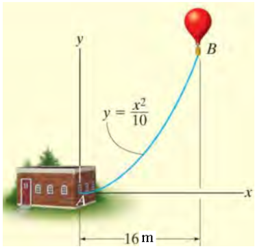

**Çözüm:**

1.  **Hızın x-Bileşenini (vx) Bulma:**\
    vx = dx/dt = d/dt (8t) = 8 m/sn (sabit)

2.  **Hızın y-Bileşenini (vy) Bulma (Zincir Kuralı):**\
    vy = dy/dt = (dy/dx) \* (dx/dt)\
    dy/dx = d/dx (x²/10) = 2x/10 = x/5\
    vy = (x/5) \* vx = (x/5) \* 8 = 8x/5

3.  **Değerleri t=2 saniye için Hesaplama:**

    - x(2) = 8 \* 2 = 16 m

    - vx = 8 m/sn

    - vy = 8 \* (16) / 5 = 128 / 5 = 25.6 m/sn

4.  **Bileşke Hızın Büyüklüğünü Bulma:**\
    v = √(vx² + vy²) = √(8² + 25.6²) = √(64 + 655.36)\
    v = √(719.36) ≈ 26.82 m/sn

**Soru 11** Şekildeki hava balonunun yatay konumu x = 8t (m), yörüngesi ise y = x²/10 ile tanımlanmıştır. t=2 saniye olduğunda bileşke hızın x ekseni ile yaptığı açı derece cinsinden nedir?

**Çözüm:**

1.  **Hız Bileşenlerini Bulma:** vx = dx/dt = 8 m/sn, vy = (x/5) \* vx ve x(2) = 16 m olduğundan:

    - vx = 8 m/sn

    - vy = 25.6 m/sn

2.  **Açıyı Hesaplama:**\
    tan(θ) = vy / vx = 25.6 / 8 = 3.2\
    θ = arctan(3.2) ≈ 72.65°

**Soru 12**\
Şekildeki hava balonunun yatay konumu x = 8t (m), yörüngesi ise y = x²/10 ile tanımlanmıştır. t=2 saniye olduğunda balonun düşey hızı (v_y) ne kadardır?

**Çözüm:**\
1.  **t=2 anındaki x konumu:** x(2) = 8 \* 2 = 16 m

2.  **vy denklemi:** vy = 8x/5

3.  **Değeri yerine koyma:** vy = 8 \* 16 / 5 = 128 / 5 = 25.6 m/sn

**Soru 13** Şekilde gösterilen bir çuval, 12 m/s yatay hızla 6 m yükseklikteki bir rampadan kaymaktadır. Çuvalın yere çarpması için gereken süre nedir? (g = 9.81 m/sn²)

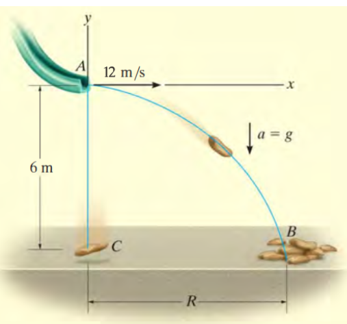

**Çözüm:**\
Düşme süresi sadece dikey hareketle ilgilidir. Yatay hız süreyi etkilemez.\
h = v_y₀\*t + ½gt²

- Başlangıç dikey hız (v_y₀) = 0

- Yükseklik (h) = 6 m\
  6 = 0 \* t + ½ \* (9.81) \* t²\
  6 = 4.905 \* t²\
  t² = 6 / 4.905 ≈ 1.2232\
  t ≈ 1.11 saniye

**Soru 14** Şekilde gösterilen bir çuval, 12 m/s yatay hızla 6 m yükseklikteki bir rampadan kaymaktadır. Çuvalın yatayda kat ettiği mesafe (R) nedir? (g = 9.81 m/sn²)

**Çözüm:**\
Önce düşme süresi dikey hareketten bulunur: 6 = ½ \* 9.81 \* t² =\> t ≈ 1.11 sn.\
Yatay hareket sabit hızlıdır: R = vx \* t

- Yatay hız (vx) = 12 m/sn

- Uçuş süresi (t) ≈ 1.11 sn\
  R = 12 \* 1.11 ≈ 13.32 metre

**Soru 15** 3 m yükseklikteki bir rampadan 30° açıyla fırlatılan bir motosiklet 2 sn sonra yere düşüyor. Rampadan ayrılma hızı (v_A) nedir? (g = 10 m/sn²)

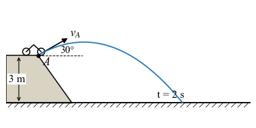

**Çözüm:**\
Dikey hareket denklemi kullanılır.\
y = y₀ + (v_A \* sinα) \* t - ½gt²

- y = 0 (son konum)

- y₀ = 3 m (ilk konum)

- α = 30°

- t = 2 sn\
  0 = 3 + (v_A \* sin30°) \* 2 - ½ \* 10 \* 2²\
  0 = 3 + (v_A \* 0.5) \* 2 - 5 \* 4\
  0 = 3 + v_A - 20\
  0 = v_A - 17\
  v_A = 17 m/sn

**Soru 16** P noktasında hızı 6m/sn olan bir buz patencisi, hızını sabit 1 m/sn² ivmeyle artırıyor. 4 saniye sonra ivmenin teğetsel bileşeni ne olur?

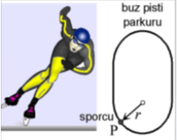

**Çözüm:**\
Teğetsel ivme (at), hızın büyüklüğündeki değişim oranıdır. Soruda bu değerin hareket boyunca sabit ve 1 m/sn² olduğu doğrudan verilmiştir. Dolayısıyla 4 saniye sonra da teğetsel ivme **1 m/sn²**'dir.

**Soru 17** P noktasında hızı 6m/sn olan bir buz patencisi, hızını sabit 1 m/sn² ivmeyle artırıyor. 4 saniye sonra ivmenin normal bileşeni (an) nedir? (r=20m)

**Çözüm:**\
Normal ivme an = v²/r formülü ile bulunur. Önce 4 saniye sonraki hız bulunmalıdır.

1.  **4 Saniye Sonraki Hızı Hesaplama:**\
    v = v₀ + at \* t = 6 + (1 \* 4) = 10 m/sn

2.  **Normal İvmenin Hesaplanması:**\
    an = v²/r = 10² / 20 = 100 / 20 = 5 m/sn²

**Soru 18** Parabolik bir yörüngede kayan bir kayakçının hızı 6 m/sn ve hızının artış oranı (teğetsel ivme) 2 m/sn²'dir. O andaki normal ivmesi 1.27 m/sn² ise, bileşke ivmenin büyüklüğü nedir?

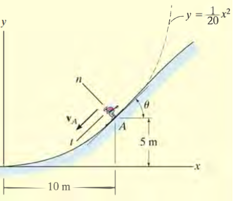

**Çözüm:**\
Bileşke ivme, teğetsel ve normal bileşenlerin vektörel toplamıdır.\
a = √(at² + an²)

- at = 2 m/sn²

- an ≈ 1.27 m/sn²\
  a = √(2² + 1.27²) = √(4 + 1.61) = √5.61 ≈ 2.37 m/sn²

**Soru 19** Parabolik bir yörüngede kayan bir kayakçının hızının artış oranı (teğetsel ivme) 2 m/sn², normal ivmesi 1.27 m/sn²'dir. Bileşke ivme vektörünün x ekseni ile yaptığı açı nedir? (Kayakçının bulunduğu noktadaki eğim açısı 45°'dir.)

**Çözüm:**\
Bu karmaşık bir problemdir. İvme bileşenlerini x-y koordinatlarına dönüştürmek gerekir.

1.  **Eksenleri Tanımlama:** Teğet yönü, pozitif x-ekseniyle 225° açı yapar. Normal yönü ise buna dik ve eğrilik merkezine doğru, yani 135° açı yapar.

2.  **Teğetsel İvmenin Bileşenleri:**

    - a_tx = at \* cos(225°) = 2 \* (-√2/2) ≈ -1.414 m/sn²

    - a_ty = at \* sin(225°) = 2 \* (-√2/2) ≈ -1.414 m/sn²

3.  **Normal İvmenin Bileşenleri:**

    - a_nx = an \* cos(135°) = 1.27 \* (-√2/2) ≈ -0.9 m/sn²

    - a_ny = an \* sin(135°) = 1.27 \* (√2/2) ≈ 0.9 m/sn²

4.  **Bileşke İvmenin x ve y Bileşenleri:**

    - ax = a_tx + a_nx = -1.414 - 0.9 = -2.314 m/sn²

    - ay = a_ty + a_ny = -1.414 + 0.9 = -0.514 m/sn²

5.  **Açının Hesaplanması:**\
    Vektör 3. bölgededir. Referans açı: φ_ref = arctan(\|ay/ax\|) = arctan(0.514/2.314) ≈ 12.5°\
    Pozitif x-ekseninden ölçülen açı: φ = 180° + 12.5° = 192.5°

**Soru 20**\
r=10m (sabit) yarıçaplı bir yörüngede dönen bir sepetin açısal konumu θ = 0.1t rad'dır. t=1sn'de sepetin bileşke hızı nedir?

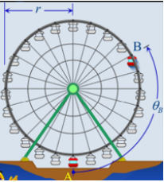

**Çözüm:**

1.  **Radyal Hız (v_r):** Yarıçap sabit olduğundan ṙ = 0. Dolayısıyla v_r = 0.

2.  **Enine Hız (v_θ):**

    - Açısal hız: θ̇ = d/dt(0.1t) = 0.1 rad/sn (sabit)

    - v_θ = r \* θ̇ = 10 \* 0.1 = 1 m/sn

3.  **Bileşke Hız:**\
    v = √(v_r² + v_θ²) = √(0² + 1²) = 1 m/sn

**Soru 21** Bir mekanizmada B bileziğinin radyal konumu r = 100t² (mm) ve açısal konumu θ = t³ (rad) olarak verilmiştir. t=1 saniye anında bileziğin bileşke hızı nedir?

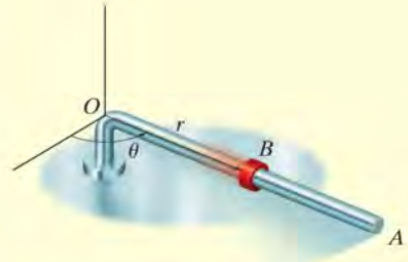

**Çözüm:**

1.  **Gerekli Değerleri t=1 için bulma:**

    - r(1) = 100(1)² = 100 mm

    - ṙ = dr/dt = 200t =\> ṙ(1) = 200 mm/sn

    - θ̇ = dθ/dt = 3t² =\> θ̇(1) = 3 rad/sn

2.  **Hız Bileşenlerini Hesaplama:**

    - Radyal hız: v_r = ṙ = 200 mm/sn

    - Enine hız: v_θ = r \* θ̇ = 100 \* 3 = 300 mm/sn

3.  **Bileşke Hızı Bulma:**\
    v = √(v_r² + v_θ²) = √(200² + 300²) = √(40000 + 90000)\
    v = √130000 ≈ 360.56 mm/sn

**Soru 22** Şekildeki makara sisteminde, motor (M) halatı 10 m/s sabit hızla kendine doğru çekmektedir. Silindir A'nın hızı nedir ve hangi yöndedir?

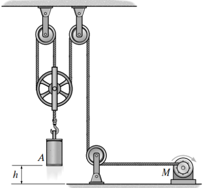

**Çözüm:**

1.  **İp Uzunluğu Denklemi:** Referans (datum) olarak üst sabit makaraların seviyesini alalım. Silindirin konumu s_A, motorun çektiği ipin ucu s_M olsun. Silindire bağlı 3 adet dikey ip segmenti vardır.\
    L = 3s_A + s_M

2.  **Zamana Göre Türev Alma:**\
    dL/dt = 3(ds_A/dt) + (ds_M/dt)\
    0 = 3v_A + v_M

3.  **Hızı Hesaplama:** Motor ipi kendine doğru çektiği için s_M artar, yani v_M = +10 m/s.\
    0 = 3v_A + 10\
    v_A = -10/3 m/sn ≈ -3.33 m/sn\
    Negatif işaret, s_A mesafesinin azaldığını, yani silindirin **yukarı doğru** hareket ettiğini gösterir. Hızı **3.33 m/sn**'dir.

**Soru 23** A ve B motorları kabloları a = 0.2t m/s² ivmesiyle çekiyor. Başlangıçta durgun olan yükün h = 4 m yükselmesi ne kadar zaman alır?

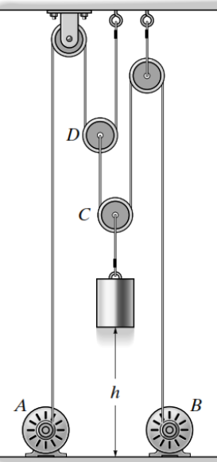

**Çözüm:**

1.  **Kinematik İlişkiyi Kurma:** İp uzunluğundan 4v_yük = 3v_motor bulunur. Bu ivmeler için de geçerlidir: a_yük = (3/4)a_motor.

2.  **Yükün İvmesi:** a_yük = (3/4) \* (0.2t) = 0.15t m/s²

3.  **İvmeden Hıza, Hızdan Konuma Geçiş (İntegral):**

    - v_yük(t) = ∫(0.15t) dt = 0.075t²

    - h(t) = ∫(0.075t²) dt = 0.025t³

4.  **Zamanı Bulma:**\
    4 = 0.025t³\
    t³ = 4 / 0.025 = 160\
    t = (160)^(1/3) ≈ 5.43 saniye

**Soru 24** A motoru kabloyu 2 m/s, B motoru ise 4 m/s hızla çekiyorsa, yükün merkezinin hızı nedir?

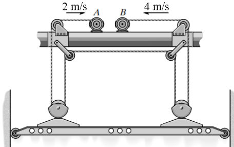

**Çözüm:**\
Yük rijit bir cisim gibi davranır. Sol tarafının hızı A motoruna, sağ tarafının hızı B motoruna bağlıdır.

1.  **Sol Tarafın Hızı:** v_sol = v_A / 2 = 2 / 2 = 1 m/s (yukarı)

2.  **Sağ Tarafın Hızı:** v_sağ = v_B / 2 = 4 / 2 = 2 m/s (yukarı)

3.  **Merkezin Hızı:** Yükün merkezinin hızı, uç noktaların hızlarının aritmetik ortalamasıdır.\
    v_yük = (v_sol + v_sağ) / 2 = (1 + 2) / 2 = 1.5 m/s (yukarı)

**Soru 25** C motoru kabloyu a_C = 3t² ivmesiyle, D motoru ise a_D = 5 m/s² ivmesiyle çekiyor. Başlangıçta aralarında 3 m olan A ve B bloklarının d=0 konumunda buluşması ne kadar sürer?

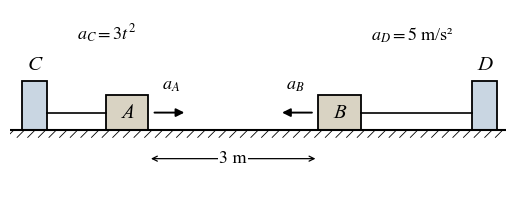

**Çözüm:**

1.  **Blokların İvmeleri:**

    - Blok A: a_A = a_C / 2 = 1.5t² (sağa, pozitif yön)

    - Blok B: a_B = a_D = 5 m/s² (sola, negatif yön, a_B = -5)

2.  **Konum Denklemleri (İki kez integral):**

    - Blok A: x_A(t) = ∫(∫1.5t² dt) dt = ∫(0.5t³) dt = 0.125t⁴

    - Blok B: x_B(t) = 3 + ∫(∫-5 dt) dt = 3 + ∫(-5t) dt = 3 - 2.5t²

3.  **Konumları Eşitleme:**\
    x_A = x_B =\> 0.125t⁴ = 3 - 2.5t²\
    0.125t⁴ + 2.5t² - 3 = 0\
    u = t² değişken değiştirmesi ile 0.125u² + 2.5u - 3 = 0. Karesel denklem çözüldüğünde pozitif kök u ≈ 1.136 bulunur.\
    t = √u ≈ √1.136 ≈ 1.07 saniye

**Soru 26** Batıya 4 m/sn hızla giden bir araba, doğuya 3 m/sn hızla giden başka bir arabayı nasıl görür?

**Çözüm:**\
Bu bir bağıl hız problemidir. Gözlemci (batıya giden) ve gözlenen (doğuya giden) belirlenir. Doğu yönü (+) olsun.\
v_bağıl = v_gözlenen - v_gözlemci\
v_bağıl = (+3) - (-4) = +7 m/sn\
Sonuç pozitif olduğu için, batıya giden araba diğer arabayı **doğuya doğru 7 m/sn hızla** gidiyormuş gibi görür.

**Soru 27** A uçağı batıya 400 km/h, B uçağı ise kuzeye 300 km/h hızla uçmaktadır. A'nın B'ye göre hızının büyüklüğü nedir?

**Çözüm:**\
Bu iki boyutlu bir bağıl hız problemidir. Doğu (+i), Kuzey (+j) olsun.

- v_A = -400i

- v_B = +300j\
  "A'nın B'ye göre hızı" v_A/B demektir.\
  v_A/B = v_A - v_B = -400i - 300j\
  Büyüklüğü: \|v_A/B\| = √((-400)² + (-300)²) = √(160000 + 90000) = √250000 = 500 km/h

**Soru 28** Bir trenin hızı şekildeki v-t grafiği ile verilmiştir. 60 saniye boyunca kat ettiği toplam mesafeyi bulunuz. (Grafikte t=0'da v=0, t=20'de v=16, t=40'da v=21, t=60'da v=24, noktalar arası geçişler doğru olacak)

**Çözüm:**\
Toplam mesafe, v-t grafiğinin altındaki alana eşittir. Alanı trapezlere bölerek hesaplayabiliriz.

- Alan 1 (0-20s): ½ \* (0 + 16) \* 20 = 160 m

- Alan 2 (20-40s): ½ \* (16 + 21) \* (40-20) = ½ \* 37 \* 20 = 370 m

- Alan 3 (40-60s): ½ \* (21 + 24) \* (60-40) = ½ \* 45 \* 20 = 450 m\
  Toplam Mesafe = 160 + 370 + 450 = **980 m**

**Soru 29** y² = 4x parabolik yolu üzerinde hareket eden bir parçacığın hızı sabit 4 m/s'dir. Parçacık x=4 m konumundayken ivmesinin büyüklüğü nedir?

**Çözüm:**\
Sabit hız, teğetsel ivmenin sıfır olduğu (at = 0) anlamına gelir. İvme, sadece normal bileşenden oluşur: a = an = v²/ρ.

1.  **Eğrilik Yarıçapını (ρ) Bulma:**

    - dy/dx: 2y(dy/dx) = 4 =\> dy/dx = 2/y

    - d²y/dx²: -2/y² \* (dy/dx) = -4/y³

    - x=4 iken y=√(4\*4) = 4.

    - dy/dx = 2/4 = 0.5

    - d²y/dx² = -4/4³ = -4/64 = -0.0625

    - ρ = \[1 + (dy/dx)²\]³/² / \|d²y/dx²\| = \[1 + 0.5²\]³/² / \|-0.0625\| = \[1.25\]³/² / 0.0625 ≈ 22.36 m

2.  **İvmeyi Bulma:**\
    a = an = v²/ρ = 4² / 22.36 = 16 / 22.36 ≈ 0.716 m/s²

**Soru 30** Bir parçacığın ivmesi a = (12t - 3t¹/²) m/s²'dir. t=0'da parçacık durgun ve konumu s=15 m ise, t=4 saniyedeki konumunu bulunuz.

**Çözüm:**

1.  **Hız Fonksiyonunu Bulma (İntegral):**\
    v(t) = ∫a dt = ∫(12t - 3t¹/²) dt = 6t² - 2t³/² + C₁\
    v(0)=0 olduğundan C₁=0. Yani v(t) = 6t² - 2t³/².

2.  **Konum Fonksiyonunu Bulma (İntegral):**\
    s(t) = ∫v dt = ∫(6t² - 2t³/²) dt = 2t³ - (4/5)t⁵/² + C₂\
    s(0)=15 olduğundan C₂=15. Yani s(t) = 2t³ - (4/5)t⁵/² + 15.

3.  **t=4 için Konumu Hesaplama:**\
    s(4) = 2(4)³ - (4/5)(4)⁵/² + 15\
    s(4) = 2(64) - (0.8)(32) + 15\
    s(4) = 128 - 25.6 + 15 = 117.4 m

