# 

**Soru 1** 

Başlangıçta durmakta olan 3000 kg'lık bir döküm parçası, sabit bir ivme ile 0.3 saniyede 0.2 m/s'lik bir hıza ulaştırılıyor. Parçanın ivmesi nedir?

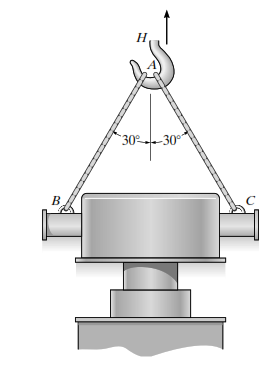

**Çözüm:**\
Bu bir kinematik problemidir. Sabit ivmeli hareket denklemlerinden biri kullanılır.\
Verilenler:

- Başlangıç hızı (v₀) = 0 m/s (durgun halden)

- Son hız (v) = 0.2 m/s

- Süre (t) = 0.3 s

Kullanılacak denklem: v = v₀ + a\*t\
0.2 = 0 + a \* (0.3)\
a = 0.2 / 0.3\
a = 0.667 m/s²

# Soru 2 

160 Mg (160,000 kg) kütleli bir tren, eğimli bir yolda yukarı doğru hareket etmektedir. Motorun uyguladığı çekiş kuvveti 196,200 N ve eğimden dolayı trene etki eden yer çekimi kuvvetinin bileşeni 155,440 N'dur. Trenin ivmesi nedir? (Sürtünme ihmal edilmiştir).

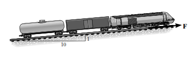

**Çözüm:**\
Newton'un İkinci Yasası (ΣF = m\*a) kullanılır.\
Verilenler:

- Kütle (m) = 160,000 kg

- Çekiş Kuvveti (F_çekiş) = 196,200 N

- Yer çekimi bileşeni (F_g) = 155,440 N (harekete ters yönde)

Yokuş yukarı yönde net kuvvet:\
ΣF = F_çekiş - F_g\
ΣF = 196,200 - 155,440 = 40,760 N

Şimdi ivmeyi bulalım:\
a = ΣF / m\
a = 40,760 / 160,000\
a ≈ 0.25 m/s²

# Soru 3 

30°'lik eğik düzlem üzerinde duran 10 kg'lık A bloğuna etki eden normal kuvvet ne kadardır? (g = 9.81 m/s²)

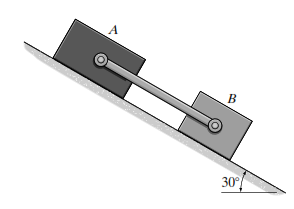

**Çözüm:**\
Normal kuvvet, yüzeye dik olan kuvvetlerin dengesinden bulunur. Serbest cisim diyagramında, ağırlığın (mg) yüzeye dik bileşeni normal kuvvete eşittir.\
Verilenler:

- Kütle (m) = 10 kg

- Eğim açısı (θ) = 30°

- Yer çekimi ivmesi (g) = 9.81 m/s²

N = mg \* cos(θ)\
N = 10 \* 9.81 \* cos(30°)\
N = 98.1 \* 0.866\
N = 84.96 N

# Soru 4 30°'lik eğik düzlemde sabit hızla aşağı kayan 100 N ağırlığındaki bir bloğa etki eden kinetik sürtünme kuvveti ne kadardır?

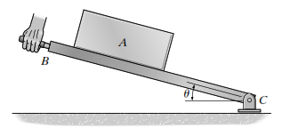

**Çözüm:**\
Blok "sabit hızla" hareket ettiği için ivme sıfırdır (a=0). Bu, net kuvvetin de sıfır olduğu anlamına gelir (ΣF=0). Eğim boyunca aşağı yönde hareket olduğundan, sürtünme kuvveti yukarı yöndedir.\
Ağırlığın eğime paralel bileşeni:\
W_paralel = W \* sin(θ) = 100 \* sin(30°) = 100 \* 0.5 = 50 N\
Net kuvvetin sıfır olması için sürtünme kuvveti bu kuvvete eşit olmalıdır:\
F_sürtünme = W_paralel = 50 N

# Soru 5 

Bir römorkör, her biri 2 kN'luk su direncine maruz kalan üç özdeş barcı sabit hızla çekmektedir. Sadece son barç düşünüldüğünde, ikinci ve üçüncü barç arasındaki kablodaki gerilme kuvveti nedir?

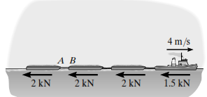

**Çözüm:**\
Sistem "sabit hızla" hareket ettiğinden, her bir parçası için net kuvvet sıfırdır. Sadece üçüncü (en sondaki) barç için serbest cisim diyagramı çizilirse:

- İleri yönde kablo gerilmesi (T)

- Geri yönde su direnci (F_direnç = 2 kN)\
  Net kuvvetin sıfır olması için:\
  ΣF = T - F_direnç = 0\
  T = F_direnç = 2 kN

# Soru 6 

Bir vinç, 3500 kg'lık bir motoru 4 m/s²'lik sabit bir ivme ile yukarı doğru kaldırmaktadır. Motoru tutan dikey kablodaki gerilme kuvveti nedir? (g = 9.81 m/s²)

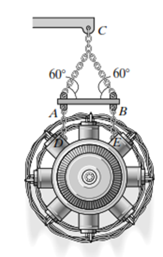

**Çözüm:**\
Newton'un İkinci Yasası (ΣF = m\*a) dikey yönde uygulanır.\
Verilenler:

- Kütle (m) = 3500 kg

- İvme (a) = 4 m/s² (yukarı yönlü)\
  Yukarı yönde net kuvvet:\
  ΣF_y = T - mg\
  T - mg = m\*a\
  T = m\*a + mg = m \* (a + g)\
  T = 3500 \* (4 + 9.81)\
  T = 3500 \* 13.81\
  T = 48,335 N

# Soru 7 

Dikey düzlemde hareket eden 50 kg'lık bir merminin yörüngesinin eğrilik yarıçapı 200 m'dir. Şekildeki konumda (eğim 30°) mermiye etki eden normal ivme 4.25 m/s² olduğuna göre, merminin hızı nedir?

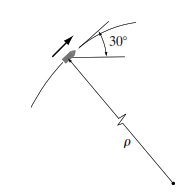

**Çözüm:**\
Normal ivme formülü a_n = v²/ρ kullanılır.\
Verilenler:

- Normal ivme (a_n) = 4.25 m/s²

- Eğrilik yarıçapı (ρ) = 200 m\
  Formülden hızı (v) çekelim:\
  v² = a_n \* ρ\
  v = √(a_n \* ρ)\
  v = √(4.25 \* 200)\
  v = √850\
  v ≈ 29.15 m/s\
  *Not: Sorudaki orijinal değerler yerine basitleştirilmiş bir normal ivme değeri kullanılmıştır.*

**Soru 8**

Dikey düzlemde hareket eden bir mermiye sadece yer çekimi kuvveti etki etmektedir. Yörüngesinin teğetinin yatayla 30° açı yaptığı bir anda, merminin teğetsel ivmesi nedir? (g = 9.81 m/s²)

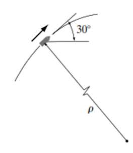

**Çözüm:**\
Teğetsel ivme, net kuvvetin hareket yönündeki (teğet) bileşeninden kaynaklanır. Tek kuvvet olan yer çekimi (mg) düşey aşağı yönlüdür. Bu kuvvetin teğet bileşeni bulunur.\
ΣF_t = m \* a_t\
-mg \* sin(30°) = m \* a_t\
a_t = -g \* sin(30°)\
a_t = -9.81 \* 0.5\
a_t = -4.905 m/s² (Negatif işaret hızın azaldığını gösterir)

# 

**Soru 9** 

100 m yarıçaplı dairesel bir pistte hareket eden bir aracın hızı 20 m/s'dir. Aracın merkezcil (normal) ivmesi nedir?

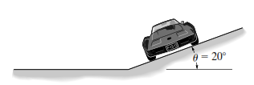

**Çözüm:**\
Merkezcil ivme (normal ivme) formülü a_n = v²/ρ kullanılır.\
Verilenler:

- Hız (v) = 20 m/s

- Yarıçap (ρ) = 100 m\
  a_n = (20)² / 100\
  a_n = 400 / 100\
  a_n = 4 m/s²

# Soru 10 

4 metre uzunluğundaki bir ipe bağlı 30 kg'lık bir top, en alt noktasından 4 m/s hızla geçiyor. Bu anda ipteki gerilme kuvveti ne kadardır? (g = 9.81 m/s²)

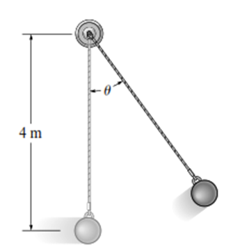

**Çözüm:**\
En alt noktada, normal ivme yukarı doğrudur. Net kuvvet denklemi dikey yönde yazılır.\
ΣF_n = m \* a_n\
T - mg = m \* (v²/r)\
T = mg + m \* (v²/r)\
Verilenler:

- Kütle (m) = 30 kg

- Hız (v) = 4 m/s

- Yarıçap (r) = 4 m\
  T = (30 \* 9.81) + 30 \* (4² / 4)\
  T = 294.3 + 30 \* (4)\
  T = 294.3 + 120\
  T = 414.3 N

# 

**Soru 11**

Bir araba, m kütlesi ile dikey bir tepenin zirvesinden (yarıçap r) geçmektedir. Arabanın yolla temasını kaybetmemesi için sahip olabileceği maksimum hız nedir? 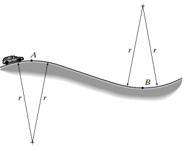

**Çözüm:**\
Yolla temasın tam kesilme anında, yüzeyin normal kuvveti (N) sıfır olur. Bu durumda, merkezcil kuvveti sağlayan tek kuvvet ağırlıktır (mg).\
ΣF_n = m \* a_n\
mg = m \* (v_max² / r)\
g = v_max² / r\
v_max² = gr\
v_max = √(gr)

**Soru 12**

Yatay düzlemde dönen bir çubuğa takılı 0.5 kg'lık bir bilezik, merkezden 0.6 m uzaktadır. Çubuğun açısal hızı 2 rad/s ise, bileziğe etki eden merkezcil ivme (radyal ivme) nedir?

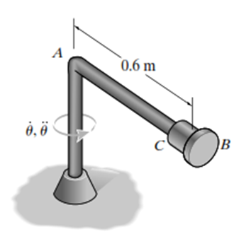

**Çözüm:**\
Kutupsal koordinatlarda radyal ivme formülü a_r = r̈ - rθ̇² dir. Bilezik sabit bir konumda (r=0.6m) olduğu için ṙ ve r̈ sıfırdır.

Verilenler:

- r = 0.6 m

- Açısal hız (θ̇) = 2 rad/s\
  a_r = 0 - (0.6) \* (2)²\
  a_r = -0.6 \* 4\
  a_r = -2.4 m/s²\
  Büyüklüğü 2.4 m/s²'dir ve merkeze doğrudur.

**Soru 13**

2 Mg'luk (2000 kg) bir kamyon 15 m/s hızla giderken fren yaparak 10 metrede duruyor. Kamyonun yavaşlama ivmesinin büyüklüğü nedir?

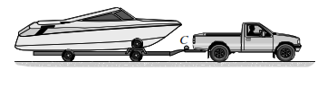

**Çözüm:**\
Zamandan bağımsız kinematik denklemi kullanılır: v² = v₀² + 2a(s - s₀)\
Verilenler:

- Başlangıç hızı (v₀) = 15 m/s

- Son hız (v) = 0 m/s (duruyor)

- Mesafe (s - s₀) = 10 m\
  0² = 15² + 2 \* a \* 10\
  0 = 225 + 20a\
  -225 = 20a\
  a = -225 / 20 = -11.25 m/s²\
  İvmenin büyüklüğü 11.25 m/s²'dir.

**Soru 14**A bloğu 300 N ağırlığındadır. Şekildeki makara sisteminde kordona 150 N'luk bir kuvvet uygulanıyor. A bloğuna etki eden net kuvvet nedir? (Makara ağırlıkları ihmal edilmiştir).

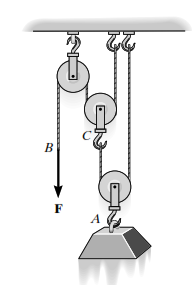

**Çözüm:**\
Uygulanan 150 N'luk kuvvet, kordon boyunca her yerde aynı gerilmeyi oluşturur (T = 150 N). Şekilde 150 N'luk kuvvet iki makara aşamasında ikiye katlanarak A bloğunu çeken kablolar üzerinde toplam 4F = 4 \* 150 = 600 N'luk yukarı yönlü kuvvet oluşturur. A bloğunun ağırlığı 300 N'dur.\
ΣF = F_yukarı - W_aşağı = 600 - 300 = 300 N (yukarı)

**Soru 15**

Şekildeki A arabasının üzerinde duran B bloğu sürtünmesiz yüzeyden aşağı kaymaktadır. B bloğunun kütlesi 'm' ise, B bloğuna arabanın yüzeyi tarafından uygulanan normal kuvvet (N_B) nedir? (Açı θ)

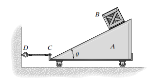

**Çözüm:**\
B bloğunun serbest cisim diyagramı çizilir. Yüzeye dik doğrultuda ivme olmadığı varsayılır (kayma hareketi yüzeye paraleldir). Bu doğrultudaki kuvvetler dengededir.\
ΣF_dik = 0\
N_B - mg \* cos(θ) = 0\
N_B = mg \* cos(θ)

**Soru 16**

500 kg'lık bir balona 6000 N'luk bir kaldırma kuvveti etki ediyor. Balonun başlangıçtaki (hava direnci yokken) yukarı yönlü ivmesi nedir? (g = 9.81 m/s²)

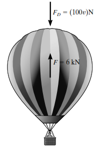

**Çözüm:**\
Newton'un İkinci Yasası (ΣF = m\*a) dikey yönde uygulanır.\
Verilenler:

- Kütle (m) = 500 kg

- Kaldırma kuvveti (F_kaldırma) = 6000 N\
  ΣF_y = F_kaldırma - mg\
  ΣF_y = 6000 - (500 \* 9.81)\
  ΣF_y = 6000 - 4905 = 1095 N\
  a = ΣF_y / m = 1095 / 500\
  a = 2.19 m/s²

**Soru 17**

0.2 kg'lık bir blok, pürüzsüz bir koni yüzeyinde 0.120 m'lik bir yarıçapta 0.5 m/s'lik sabit bir hızla dönmektedir. Bloğa etki eden net merkezcil kuvvet ne kadardır? 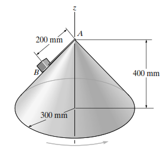

**Çözüm:**\
Net merkezcil kuvvet F_n = m \* a_n = m \* (v²/r) formülüyle bulunur.\
Verilenler:

- Kütle (m) = 0.2 kg

- Hız (v) = 0.5 m/s

- Yarıçap (r) = 0.120 m\
  F_n = 0.2 \* (0.5² / 0.120)\
  F_n = 0.2 \* (0.25 / 0.120)\
  F_n = 0.2 \* 2.0833\
  F_n ≈ 0.417 N

**Soru 18**

5000 kg'lık bir uçak, 3000 m yarıçaplı yatay bir dairesel yörüngede 97 m/s'lik sabit bir hızla uçmaktadır. Uçağın maruz kaldığı merkezcil ivme nedir?

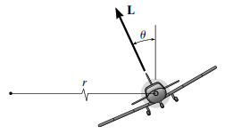**Çözüm:**\
Merkezcil ivme a_n = v²/r formülüyle bulunur.\
Verilenler:

- Hız (v) = 97 m/s

- Yarıçap (r) = 3000 m\
  a_n = 97² / 3000\
  a_n = 9409 / 3000\
  a_n ≈ 3.14 m/s²

**Soru 19**

80 kg'lık bir sandık, yatayla 20°'lik açı yapan bir zincirle çekilmektedir. Kinetik sürtünme katsayısı 0.3'tür. Sandık hareket halindeyken yüzeyin normal kuvveti 664 N ise, sürtünme kuvveti ne kadardır?

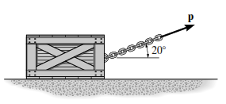

**Çözüm:**\
Kinetik sürtünme kuvveti F_s = μ_k \* N formülüyle bulunur.\
Verilenler:

- Kinetik sürtünme katsayısı (μ_k) = 0.3

- Normal kuvvet (N) = 664 N\
  F_s = 0.3 \* 664\
  F_s = 199.2 N

**Soru 20**

Şekildeki sistemde A bloğu (25 kg) pürüzsüz eğik düzlemde, C bloğu (10 kg) ise sürtünmeli yatay düzlemde hareket etmektedir. C bloğuna etki eden normal kuvvet ne kadardır? (g = 9.81 m/s²)

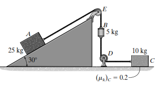

**Çözüm:**\
Sadece C bloğunun dikey kuvvet dengesine bakılır. C bloğu yatay hareket ettiği için dikey ivmesi sıfırdır.\
ΣF_y = 0\
N_C - m_C\*g = 0\
N_C = m_C \* g\
N_C = 10 \* 9.81\
N_C = 98.1 N
