**Soru 1** 100 kg kütleli bir sandık, yatayla 15° açı yapan bir kablo ile 500 N'luk sabit bir kuvvet uygulanarak çekilmektedir. Kablo kuvvetinin sandığı 10 m hareket ettirdiğinde yaptığı iş ne kadardır?

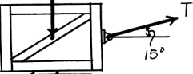

**Çözüm:**\
Sabit bir kuvvetin yaptığı iş U = F \* s \* cos(θ) formülü ile hesaplanır.

- Kuvvet (F) = 500 N

- Mesafe (s) = 10 m

- Açı (θ) = 15°

U = 500 \* 10 \* cos(15°)\
U = 5000 \* 0.966\
U = 4830 J ≈ 4.83 kJ

**Soru 2** 1.5 kg kütleli bir blok, Fs = 900s² (N) direncine sahip doğrusal olmayan bir yaya çarpmaktadır. Yayın 0.2 m sıkışması sırasında yay kuvvetinin yaptığı iş ne kadardır?

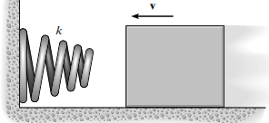

**Çözüm:**\
Değişken bir kuvvetin yaptığı iş, kuvvetin mesafeye göre integralini alarak bulunur. Yay kuvveti harekete zıt yönde olduğu için iş negatiftir.\
U_yay = -∫ Fs ds\
U_yay = -∫₀⁰·² 900s² ds\
U_yay = -\[300s³\]₀⁰·²\
U_yay = -\[300 \* (0.2)³ - 300 \* (0)³\]\
U_yay = -\[300 \* 0.008\]\
U_yay = -2.4 J

**Soru 3** 2000 kg kütleli bir araba, yatay bir yolda 100 km/h (27.78 m/s) hızla giderken fren yaparak duruyor. Lastikler ile yol arasındaki kinetik sürtünme katsayısı 0.25'tir. Arabayı durdurmak için sürtünme kuvvetinin yaptığı işi, durma mesafesi (s') cinsinden ifade ediniz. (g = 9.81 m/s²)

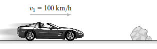

**Çözüm:**\
Önce sürtünme kuvvetinin büyüklüğü bulunur. Yatay düzlemde N = mg'dir.

- Normal Kuvvet (N) = 2000 kg \* 9.81 m/s² = 19620 N

- Sürtünme Kuvveti (Ff) = μk \* N = 0.25 \* 19620 = 4905 N

Sürtünme kuvveti harekete zıt olduğu için yaptığı iş negatiftir.\
U_sürtünme = -Ff \* s'\
U_sürtünme = -4905s' J

**Soru 4** Yay sabiti 2000 N/m olan bir tabanca yayının ilk sıkışma miktarı 0.05 m'dir. Yay serbest bırakıldığında son sıkışma miktarı 0.0375 m oluyor. Bu esnada yayın potansiyel enerjisindeki değişim ne kadardır?

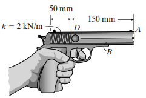

**Çözüm:**\
Yayın potansiyel enerjisi Ve = ½ks² dir. Potansiyel enerjideki değişim, yayın yaptığı işin negatifidir.

- İlk Potansiyel Enerji (Ve₁) = ½ \* 2000 \* (0.05)² = 1000 \* 0.0025 = 2.5 J

- Son Potansiyel Enerji (Ve₂) = ½ \* 2000 \* (0.0375)² = 1000 \* 0.001406 = 1.406 J

- Potansiyel Enerji Değişimi (ΔVe) = Ve₂ - Ve₁ = 1.406 - 2.5 = -1.094 J

**Soru 5** 2000 kg'lık bir arabanın kinetik enerjisi, hızı 100 km/h (27.78 m/s) iken ne kadardır?

**Çözüm:**\
Kinetik enerji T = ½mv² formülü ile hesaplanır.

- Kütle (m) = 2000 kg

- Hız (v) = 27.78 m/s

T = ½ \* 2000 \* (27.78)²\
T = 1000 \* 771.73\
T = 771730 J ≈ 772 kJ

------------------------------------------------------------------------

**Soru 6** 70 kg kütleli bir kayakçı, durgun halden kaymaya başlayarak B noktasına ulaşıyor. A ve B noktaları arasındaki dikey yükseklik farkı 46 m olduğuna göre, kayakçının B noktasındaki hızı nedir? (Sürtünme ihmal edilmiştir, g = 9.81 m/s²)

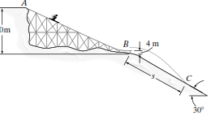

**Çözüm:**\
Enerjinin korunumu ilkesi kullanılır: T₁ + V₁ = T₂ + V₂. Başlangıç noktası (A) potansiyel enerji için referans (datum) alınırsa V₁ = 0. Durgun halden başladığı için T₁ = 0.\
0 + mgh = ½mv₂² + 0\
g \* h = ½ \* v₂²\
v₂ = √(2gh)\
v₂ = √(2 \* 9.81 \* 46)\
v₂ = √(902.52) = 30.04 m/s

**Soru 7** Bir motor, 2000 N ağırlığındaki bir yükü 2 m/s sabit hızla yukarı kaldırıyor. Motorun çıkış gücü kaç kW'tır?

**Çözüm:**\
Güç P = F \* v formülü ile hesaplanır. Sabit hızla kaldırmak için gereken kuvvet, yükün ağırlığına eşittir (F = 2000 N).\
P_out = 2000 N \* 2 m/s = 4000 W = 4 kW

**Soru 8** 10 kN ağırlığındaki bir otomobil, 7°'lik bir yokuşu 20 m/s sabit hızla tırmanıyor. Motorun bu hızı korumak için ürettiği güç ne kadardır? (Sürtünme ihmal edilmiştir).

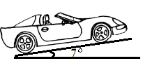

**Çözüm:**\
Sabit hızla yokuş yukarı çıkmak için motorun, ağırlığın yokuşa paralel bileşenini yenmesi gerekir.\
F = W \* sin(θ) = 10000 \* sin(7°) = 10000 \* 0.1219 = 1219 N\
Güç:\
P = F \* v = 1219 \* 20 = 24380 W ≈ 24.4 kW

**Soru 9** Verimi %80 (ε = 0.8) olan bir motorun 19.5 kW'lık giriş gücü vardır. Motorun ürettiği çıkış gücü ne kadardır?

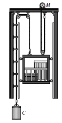

**Çözüm:**\
Verim ε = P_çıkış / P_giriş formülü ile bulunur.\
P_çıkış = ε \* P_giriş\
P_çıkış = 0.8 \* 19.5 kW\
P_çıkış = 15.6 kW

**Soru 10** Yatay düzlemdeki 20 kg'lık bir yaka, sıkıştırılmış iki yaya bağlıdır. Yayların toplam potansiyel enerjisi 18.75 J iken sistem serbest bırakılıyor. Yaylar tamamen gevşediğinde (potansiyel enerji sıfırlandığında) yakanın hızı ne olur?

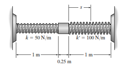

**Çözüm:**\
Enerjinin korunumu ilkesi kullanılır: T₁ + V₁ = T₂ + V₂. Başlangıçta sistem durduğu için T₁ = 0.

- V₁ (elastik potansiyel enerji) = 18.75 J

- V₂ (son potansiyel enerji) = 0

- T₂ (son kinetik enerji) = ½mv₂²

0 + 18.75 = ½ \* (20) \* v₂² + 0\
18.75 = 10 \* v₂²\
v₂² = 1.875\
v₂ = 1.37 m/s

**Soru 11** Bir motor, 60 kg'lık bir sandığı 5 metrelik bir yüksekliğe 2 saniyede sabit hızla çıkarıyor. Motorun ortalama çıkış gücü ne kadardır? (g = 9.81 m/s²)

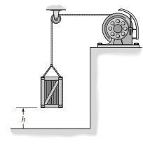

**Çözüm:**\
Yapılan iş, potansiyel enerjideki değişime eşittir:\
İş (U) = mgh = 60 \* 9.81 \* 5 = 2943 J\
Ortalama güç, yapılan işin zamana bölünmesiyle bulunur:\
P_ort = U / t = 2943 J / 2 s = 1471.5 W ≈ 1.47 kW

**Soru 12** 1000 kg'lık bir dragster'a 20 kN'luk sabit bir itki kuvveti uygulanıyor. Dragster 50 m/s hıza ulaştığı anda, motorun anlık gücü ne kadardır?

**Çözüm:**\
Anlık güç P = F \* v formülüyle hesaplanır.

- Kuvvet (F) = 20 kN = 20000 N

- Hız (v) = 50 m/s

P = 20000 N \* 50 m/s = 1,000,000 W = 1 MW

**Soru 13** 5 gramlık (0.005 kg) bir bilye, 3 m yükseklikten serbest bırakılıyor. Tam yere çarpmadan önceki hızı nedir? (Sürtünme ihmal edilmiştir, g = 9.81 m/s²)

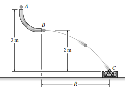

**Çözüm:**\
Enerjinin korunumu kullanılır. Başlangıçtaki potansiyel enerji, sondaki kinetik enerjiye dönüşür.\
mgh = ½mv²\
gh = ½v²\
v = √(2gh)\
v = √(2 \* 9.81 \* 3)\
v = √(58.86) ≈ 7.67 m/s

**Soru 14** 100 kg'lık bir sandık, 45°'lik eğik düzlemde 10 m yukarıda durmaktadır. Sandık serbest bırakıldığında, aşağı kayarken 10 metrelik yolu kat ettiğinde yer çekimi kuvvetinin yaptığı iş ne kadardır? (g = 9.81 m/s²)

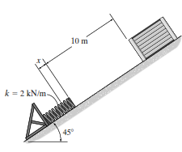

**Çözüm:**\
Yer çekimi kuvvetinin yaptığı iş, dikey yer değiştirmeye bağlıdır.

- Dikey yer değiştirme (h) = 10 \* sin(45°) = 7.07 m

- Yapılan iş (U_g) = W \* h = (mg) \* h

U_g = (100 \* 9.81) \* 7.07 = 981 \* 7.07 ≈ 6936 J\
(Sandık aşağı hareket ettiği için iş pozitiftir.)

**Soru 15** Gerilmemiş uzunluğu 200 mm ve yay sabiti 50 N/m olan bir lastik bant, 245 mm'ye kadar geriliyor. Bantta depolanan elastik potansiyel enerji ne kadardır?

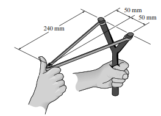

**Çözüm:**\
Önce yayın ne kadar uzadığı (s) bulunur.\
s = Son uzunluk - İlk uzunluk = 245 mm - 200 mm = 45 mm = 0.045 m\
Elastik potansiyel enerji: Ve = ½ks²\
Ve = ½ \* 50 \* (0.045)²\
Ve = 25 \* 0.002025 = 0.0506 J

**Soru 16** 400 Mg'lık (400,000 kg) bir trenin hızı, 100 saniyede düzgün bir şekilde 0'dan 10 m/s'ye çıkıyor. Bu 100 saniye boyunca trene aktarılan toplam iş (kinetik enerji değişimi) ne kadardır?

**Çözüm:**\
İş-Enerji Prensibi'ne göre yapılan net iş, kinetik enerjideki değişime eşittir.\
ΣU = T₂ - T₁

- T₁ (ilk kinetik enerji) = 0 (durgun halden)

- T₂ (son kinetik enerji) = ½mv₂²

ΣU = ½ \* 400,000 \* (10)² - 0\
ΣU = 200,000 \* 100 = 20,000,000 J = 20 MJ

**Soru 17** Bir arabanın motoru 15 kW'lık sabit bir güç üretiyor. Araba 10 m/s hıza ulaştığında, motorun tekerleklere uyguladığı itki kuvveti ne kadardır? (Verim ve sürtünme ihmal edilmiştir).

**Çözüm:**\
P = F \* v formülünden kuvvet çekilir.

- Güç (P) = 15 kW = 15000 W

- Hız (v) = 10 m/s

F = P / v = 15000 / 10 = 1500 N

**Soru 18** Bir top, yaylı bir mekanizmadan fırlatılacaktır. Yayı sıkıştırmak için 1000 N'luk bir kuvvet gerekmektedir ve yay 0.5 m sıkıştırılmıştır. Bu durumda yayın yay sabiti (k) nedir? (F = ks)

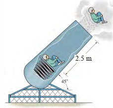

**Çözüm:**\
Hooke Yasası'ndan k = F / s bulunur.

- Kuvvet (F) = 1000 N

- Sıkışma (s) = 0.5 m

k = 1000 / 0.5 = 2000 N/m

**Soru 19** 300 N ağırlığındaki A bloğu, iki yayın üzerine düşürülüyor. Blok yaylara çarptıktan sonra en fazla 3 m'lik bir yüksekliğe geri fırlıyor. Bloğun bu yüksekliğe ulaşması için yer çekimine karşı yapılan iş ne kadardır?

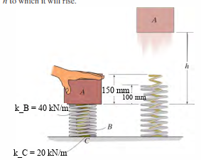

**Çözüm:**\
Yapılan iş, potansiyel enerji değişimine eşittir.

- Yükseklik (h) = 3 m

- Ağırlık (W) = 300 N

U_g = W \* h = 300 \* 3 = 900 J\
(Blok yukarı hareket ettiği için yer çekiminin yaptığı iş negatiftir, ancak bloğun yer çekimine *karşı* yaptığı iş pozitiftir.)

**Soru 20** Bir uydu, Dünya'nın kütle çekim potansiyel enerjisi alanında hareket etmektedir. A noktasında potansiyel enerjisi -1.19x10⁹ J ve kinetik enerjisi 0.37x10⁹ J'dür. Uydunun A noktasındaki toplam mekanik enerjisi nedir?

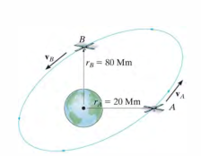

**Çözüm:**\
Toplam mekanik enerji, kinetik ve potansiyel enerjilerin toplamıdır.\
E = T + V\
E = (0.37 \* 10⁹ J) + (-1.19 \* 10⁹ J)\
E = -0.82 \* 10⁹ J
