# BÖLÜM 1: KOLAY SEVİYE (8 Soru)

**Soru 1:** Şekildeki yatay düzlemde duran bir taşa 200 N'luk sabit bir kuvvet şekildeki gibi uygulanmaktadır. Kuvvetin 10 saniye boyunca taşa uyguladığı itme (impuls) nedir?

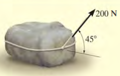\
**Çözüm:**\
İmpuls (I) = Kuvvet ($F_{x}$) $\times \$Zaman (t) $I = 200\cos 45\text{ N} \times 10\text{ s} = 1414.214\text{ N} \cdot \text{s}$

**Soru 2:** Kütlesi 100 kg olan ve sürtünmesiz yatay düzlemde duran bir taşa, yatay bileşeni hareket yönünde olan 200 N'luk net bir kuvvet etki etmektedir. 10 saniye sonra taşın hızı ne olur?

\
**Çözüm:**\
İmpuls = Momentum Değişimi ($\int_{}^{}{F \cdot dt} = F \cdot \mathrm{\Delta}t = m \cdot \Delta v$)\
$200\cos 45 = 100 \cdot (v_{son} - 0)$

$$
1414.214 = 100 \cdot v_{son} \Rightarrow v_{son} = 14.142\text{ m/s}
$$

**Soru 3:** 2 kg kütleli bir blok, sürtünmesiz $45^{\circ}$eğimli bir yüzeyden yukarı doğru 3 m/s ilk hızla fırlatılıyor. Bloğun durana kadar geçen süreyi hesaplayınız. ($g = 9.81\text{ m/s}^{2}$)\
**Çözüm:**

Hareket yönü yukarı pozitif olsun. Aşağı doğru ağırlık bileşeni kuvvet uygular.\
Momentum İlkesi:

$m(v_{1}) + \Sigma\int Fdt = m(v_{2})$

$$
2(3) - (2 \cdot 9.81 \cdot \sin(45^{\circ})) \cdot t = 0
$$

$$
6 - 13.87t = 0 \Rightarrow t \approx 0.432\text{ s}
$$

**Soru 4:** Bir cisme etki eden kuvvetin zamana bağlı grafiği verilmiştir. Kuvvet 0-2 saniye arasında 0'dan 10 N'a doğrusal artmakta, 2-4 saniye arasında 10 N sabit kalmaktadır. Cisme etki eden toplam itmeyi (impuls) bulunuz.

**Çözüm:**\
İtme = Kuvvet-Zaman grafiğinin altındaki alan.\
Alan 1 (Üçgen): $(2 \times 10)/2 = 10\text{ N} \cdot \text{s}$\
Alan 2 (Dikdörtgen): $(4 - 2) \times 10 = 20\text{ N} \cdot \text{s}$\
Toplam İtme $= 10 + 20 = 30\text{ N} \cdot \text{s}$

**Soru 5:** 15.000 kg kütleli bir vagon 1.5 m/s hızla giderken, ters yönden gelen 12.000 kg kütleli ve 0.75 m/s hıza sahip başka bir vagonla çarpışıp kenetleniyor. Kenetlendikten sonraki ortak hızları ne olur?

**Çözüm:**\
Momentum Korunumu: $\Sigma mv_{1} = \Sigma mv_{2}$

$$
{(15000 \cdot 1.5) + (12000 \cdot - 0.75) = (15000 + 12000) \cdot v_{ortak}
}{22500 - 9000 = 27000 \cdot v_{ortak}}
$$

$$
13500 = 27000 \cdot v_{ortak} \Rightarrow v_{ortak} = 0.5\text{ m/s}
$$

**Soru 6:** A aracı 2000 kg kütleli ve sağa doğru 2 m/s hızla, B aracı 1500 kg kütleli ve sola doğru 4 m/s hızla hareket etmektedir. Kafa kafaya çarpışıp kenetlenirlerse çarpışma sonrası hız ne olur?

**Çözüm:**

$$
\Sigma mv_{1} = \Sigma mv_{2}
$$

$$
(2000 \cdot 2) + (1500 \cdot - 4) = (2000 + 1500) \cdot v_{ortak}
$$

$$
4000 - 6000 = 3500 \cdot v_{ortak}
$$

$- 2000 = 3500 \cdot v_{ortak} \Rightarrow v_{ortak} = - 0.57\text{ m/s}$(Sola doğru)

**Soru 7:** 500 m/s namlu çıkış hızına sahip 0.002 kg'lık bir mermi 0.001 saniye içinde namludan çıkmaktadır. Mermiye etki eden ortalama kuvveti bulunuz.

**Çözüm:**

$$
F_{ort} \cdot \Delta t = m \cdot \Delta v
$$

$$
F_{ort} \cdot 0.001 = 0.002 \cdot (500 - 0)
$$

$$
F_{ort} = 1000\text{ N}
$$

# BÖLÜM 2: ORTA SEVİYE (16 Soru)

**Soru 8:** Sürtünmesiz ray üzerinde duran 50 kg kütleli A aracı üzerindeki 75 kg kütleli çocuk, araca göre 3 m/s bağıl hızla yatay olarak atlıyor. Çocuğun yere göre hızı nedir?

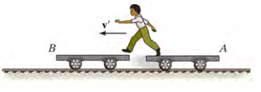

**Çözüm:**\
Momentum korunumu:

$$
0 = m_{c} \cdot v_{c} + m_{a} \cdot v_{a}
$$

Bağıl hız denklemi:

$$
v_{c} = v_{a} + v_{c/a} \Rightarrow v_{c} = v_{a} + 3
$$

$$
0 = 75(v_{a} + 3) + 50v_{a} \Rightarrow 125v_{a} = - 225 \Rightarrow v_{a} = - 1.8\text{ m/s}
$$

$$
v_{c} = - 1.8 + 3 = 1.2\text{ m/s}
$$

**Soru 9:** Sürtünmesiz ray üzerinde duran 50 kg kütleli A aracı üzerindeki 75 kg kütleli çocuk, araca göre 3 m/s bağıl hızla yatay olarak atlıyor. Çocuk atladıktan hemen sonra A aracının hızı (büyüklük olarak) nedir?

**Çözüm:**

\
Momentum korunumu:

$$
0 = m_{c} \cdot v_{c} + m_{a} \cdot v_{a}
$$

Bağıl hız denklemi:

$$
v_{c} = v_{a} + v_{c/a} \Rightarrow v_{c} = v_{a} + 3
$$

$0 = 75(v_{a} + 3) + 50v_{a} \Rightarrow 125v_{a} = - 225 \Rightarrow v_{a} = - 1.8\text{ m/s}$

**Soru 10:** 50 tonluk bir lokomotif ve her biri 30 tonluk 3 vagon duruştan harekete geçiyor. Trenin 80 saniyede 40 km/h (11.11 m/s) hıza ulaşması için lokomotifin tekerleklerine etki eden **ortalama** çekiş kuvveti (F) ne olmalıdır? (Sürtünmeleri ihmal ediniz).

**Çözüm:**

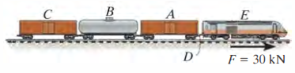\
Toplam Kütle $= 50 + 3(30) = 140\text{ ton} = 140.000\text{ kg}$

$$
F \cdot \Delta t = m \cdot \Delta v
$$

$$
F \cdot 80 = 140.000 \cdot 11.11
$$

$$
F = 19.442\text{ N} \approx 19.4\text{ kN}
$$

**Soru 11:** 2500 kg'lık bir cip (A), 1250 kg'lık bir arabayı (B) vinç halatı kendine göre 2 m/s hızla çekmektedir. Çarpıştıkları andaki hızlarını momentum korunumu ile ilişkilendiriniz (Başlangıçta duruyorlar, sürtünmeyi ihmal ediniz).\
**Çözüm:**

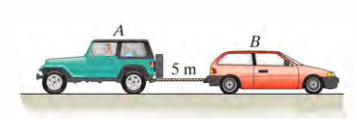\
Momentum korunumu: $m_{A}v_{A} + m_{B}v_{B} = 0$

$$
2500v_{A} + 1250v_{B} = 0 \Rightarrow v_{B} = - 2v_{A}
$$

Bağıl Hız: $v_{A/B} = v_{A} - v_{B} = 2$(halat sarma hızı)

$$
v_{A} - \left( - 2v_{A} \right) = 2 \Rightarrow 3v_{A} = 2 \Rightarrow v_{A} = 0.67\text{ m/s, }v_{B} = - 1.33\text{ m/s}
$$

**Soru 12:** 300 kg'lık bir araba üzerindeki 75 kg'lık bir adam, 0.1 kg'lık bir mermiyi arabaya göre 900 m/s hızla yatay olarak ateşliyor. Ateşleme sonrası arabanın hızı ne olur? (Başlangıçta duruyorlar, sürtünmeyi ihmal ediniz).

**Çözüm:**

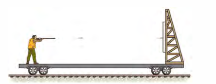\
Sistem momentumu korunur (Başlangıçta 0).

$0 = m_{mermi}v_{mermi} + (m_{adam} + m_{araba})v_{araba}$

$$
v_{mermi} = v_{araba} + 900
$$

$$
0 = 0.1(v_{araba} + 900) + (375)v_{araba}
$$

$$
0 = 0.1v_{araba} + 90 + 375v_{araba} \Rightarrow 375.1v_{araba} = - 90
$$

$$
v_{araba} \approx - 0.24\text{ m/s}
$$

**Soru 13:** Buz pateni yapan 70 kg kütleli bir sporcu, elindeki 8 kg'lık bir bloğu kendisine göre 2 m/s hızla yatay olarak fırlatıyor. Başlangıçta duran sporcunun fırlatma sonrası hızı ne olur?

**Çözüm:**

$$
0 = m_{blok}v_{blok} + m_{sporcu}v_{sporcu}
$$

$$
v_{blok} = v_{sporcu} + 2
$$

(Bağıl hız)

$$
0 = 8(v_{sporcu} + 2) + 70v_{sporcu}
$$

$$
78v_{sporcu} = - 16 \Rightarrow v_{sporcu} = - 0.205\text{ m/s}
$$

**Soru 14:** 0.5 kg kütleli A topu 6 m/s hızla sağa giderken, durmakta olan 5 kg kütleli B bloğuna çarpıyor. Geri dönme (Restitüsyon) katsayısı $e = 0.6$ise çarpışmadan hemen sonra B'nin hızı ne olur? $e = (v_{B2} - v_{A2})/(v_{A1} - v_{B1})$\
**Çözüm:**

Momentum Korunumu:

$$
0.5(6) + 0 = 0.5v_{A2} + 5v_{B2} \Rightarrow 3 = 0.5v_{A2} + 5v_{B2}\ldots(1)
$$

Restitüsyon:

$$
e = (v_{B2} - v_{A2})/(v_{A1} - v_{B1}) \Rightarrow 0.6 = (v_{B2} - v_{A2})/6
$$

$$
3.6 = v_{B2} - v_{A2} \Rightarrow v_{A2} = v_{B2} - 3.6\ldots(2)
$$

(2)🡪(1):

$$
3 = 0.5(v_{B2} - 3.6) + 5v_{B2}
$$

$$
3 = 0.5v_{B2} - 1.8 + 5v_{B2} \Rightarrow 4.8 = 5.5v_{B2} \Rightarrow v_{B2} \approx 0.87\text{ m/s}
$$

**Soru 15:** 5000 kg'lık kamyon 30 km/h hızla giderken, aynı yönde 10 km/h hızla giden 2000 kg'lık araca arkadan çarpıyor. Çarpışma sonrası araçlar kenetlenirse (plastik çarpışma), ortak hız ne olur?

**Çözüm:**

$30\text{ km/h} = 8.33\text{ m/s}$, $10\text{ km/h} = 2.78\text{ m/s}$

$$
\Sigma mv_{1} = \Sigma mv_{2}
$$

$$
5000(8.33) + 2000(2.78) = (7000)v_{ortak}
$$

$$
41650 + 5560 = 7000v_{ortak} \Rightarrow 47210 = 7000v_{ortak}
$$

$$
v_{ortak} \approx 6.74\text{ m/s}(24.3\text{ km/h})
$$

**Soru 16:** 10 kg'lık A silindiri aşağı doğru 2 m/s hızla hareket ederken, ipe bağlı 8 kg'lık B silindiri yukarı doğru hareket etmektedir. 3 saniye sonraki hızları bulmak için kullanılacak temel impuls-momentum denklemini (A cismi için) yazınız. (İp gerilmesi T).

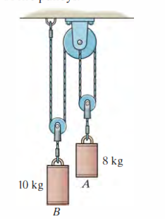\
**Çözüm:**\
A cismi için (Aşağı yön pozitif):

$$
m_{A}v_{A1} + \Sigma\int Fdt = m_{A}v_{A2}
$$

$$
10(2) + (10 \cdot 9.81 \cdot 3) - (T \cdot 3) = 10v_{A2}
$$

**Soru 17:** Makaralı sistemde A bloğu 10 kg, B bloğu 50 kg'dır. Sistem serbest bırakıldıktan 2 saniye sonra B bloğunun hızı ne olur? (İp gerilmesini ve ivmeyi sabit varsayınız, basit dinamik de kullanılabilir ancak impuls ile çözünüz).

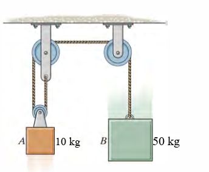\
**Çözüm:**\
Sistem ivmesi

$$
a = (m_{B} - m_{A})g/(m_{B} + m_{A}) = (40 \cdot 9.81)/60 = 6.54\text{ m/s}^{2}
$$

$$
v = v_{0} + at = 0 + 6.54 \cdot 2 = 13.08\text{ m/s}
$$

**Soru 18:** Şekildeki sistemde elastik ip ucundaki 3 kg'lık disk yatay düzlemde dönmektedir. $r_{1} = 1.5$m'de teğetsel hız 5 m/s ise, ip kısaltılıp $r_{2} = 1.2$ m olduğunda diskin hızı ne olur?

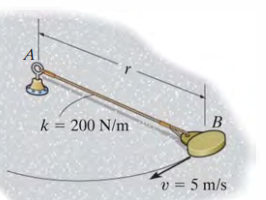\
**Çözüm:**\
Açısal Momentum Korunumu:

$$
H_{1} = H_{2} \Rightarrow m \cdot v_{1} \cdot r_{1} = m \cdot v_{2} \cdot r_{2}
$$

$$
3 \cdot 5 \cdot 1.5 = 3 \cdot v_{2} \cdot 1.2
$$

$$
7.5 = 1.2v_{2} \Rightarrow v_{2} = 6.25\text{ m/s}
$$

**Soru 19:** 2 kg'lık bir top, ipe asılı 20 kg'lık duran bir bloğa 4 m/s hızla çarpıyor. Restitüsyon katsayısı $e = 0.8$. Çarpışmadan hemen sonra bloğun hızı nedir?

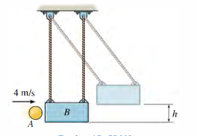\
**Çözüm:**

Momentum:

$$
2(4) + 0 = 2v_{A2} + 20v_{B2} \Rightarrow 4 = v_{A2} + 10v_{B2}
$$

Restitüsyon:

$$
0.8 = (v_{B2} - v_{A2})/4 \Rightarrow 3.2 = v_{B2} - v_{A2}
$$

Taraf tarafa topla:

$$
7.2 = 11v_{B2} \Rightarrow v_{B2} \approx 0.65\text{ m/s}
$$

**Soru 20:** 1500 kg'lık bir roket kızağına etki eden itki kuvvetinin zamana göre değişimi şekilde (kN cinsinden) verilmiştir. Kızağın t = 2.5 s'deki hızı nedir? (Başlangıç hızı 0, sürtünme ihmal edilecektir.)

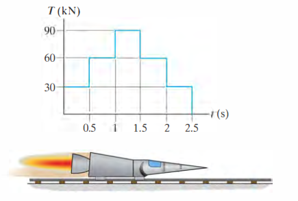\
**Çözüm:**\
İtme, kuvvet-zaman grafiğinin altında kalan alandır. Grafik 0.5 s genişliğinde 5 basamaktan oluşur: 30, 60, 90, 60 ve 30 kN.

$$
I = 0.5 \cdot (30 + 60 + 90 + 60 + 30) = 135\text{ kN} \cdot \text{s} = 135000\text{ N} \cdot \text{s}
$$

$$
I = m\Delta v \Rightarrow 135000 = 1500 \cdot v_{son}
$$

$$
v_{son} = 90\text{ m/s}
$$

**Soru 21:** 2 kg'lık top, 0.5 m yarıçaplı dairesel yolda 5 m/s hızla dönmektedir. Topa teğetsel bir kuvvet etki etmemektedir. İp çekilerek yarıçap 0.25 m'ye düşürülürse yeni hız ne olur?\
**Çözüm:**\
Açısal Momentum Korunumu

$$
mv_{1}r_{1} = mv_{2}r_{2}
$$

$$
5 \cdot 0.5 = v_{2} \cdot 0.25
$$

$$
2.5 = 0.25v_{2} \Rightarrow v_{2} = 10\text{ m/s}
$$

# BÖLÜM 3: ZOR SEVİYE (8 Soru)

**Soru 22:** 4 kg'lık bir mermi yatayda 20 m/s hızla giderken havada patlayarak iki parçaya ayrılıyor: A parçası (1.5 kg) ve B parçası (2.5 kg). A parçası yatayla 45 derece yukarı sola doğru B parçası yatayla 30 derece aşağı sağa doğru fırlıyor. A parçasının hızını bulunuz.

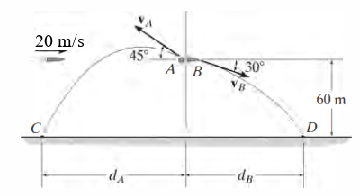\
**Çözüm:** (Patlamadan önce dikey momentum 0)\
Dikey Momentum Korunumu: $0 = m_{A}(v_{A}\sin 45) - m_{B}(v_{B}\sin 30)$

$$
1.5\frac{v_{A}}{\sqrt{2}} - 2.5\frac{v_{B}}{2} = 0 \rightarrow v_{B} = 0.8485v_{A}\ldots(1)
$$

Yatay Momentum korunumu:

$$
4(20) = 1.5(v_{A}\cos 45) + 2.5(v_{B}\cos 30)
$$

$$
80 = - 1.5\frac{v_{A}}{\sqrt{2}} + 2.5v_{B}\frac{\sqrt{3}}{2} \rightarrow - 1.061v_{A} + 2.165v_{B} = 80..(2)
$$

(1)🡪2\
$$
- 1.061v_{A} + 2.165 \bullet 0.8485v_{A} = 80
$$

$$
0.7765v_{A} = 80 \rightarrow v_{A} \approx 103.0\ m/sn
$$

**Soru 23:** 800 kg'lık bir kazık (pile), 300 kg'lık bir çekiç ile 0.5 m yükseklikten vurularak kuma çakılıyor. Çarpışma plastik değil, $e = 0.1$ . Çekiç kazığa çarptığında kazığın ilk hızı ne olur?

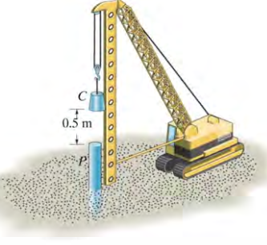\
**Çözüm:**\
Çekiç hızı

$v_{c1} = \sqrt{2 \cdot 9.81 \cdot 0.5} \approx 3.13\text{ m/s}$

Momentum:

$$
300(3.13) + 0 = 300v_{c2} + 800v_{p2}\ldots(1)
$$

$$
e = 0.1 = \frac{v_{p2} - v_{c2}}{3.13} \Rightarrow v_{p2} - v_{c2} = 0.313 \rightarrow v_{c2} = - 0.313 + v_{p2}\ldots(2)
$$

(2)🡪(1)

$$
300(3.13) = 300 \bullet \left( - 0.313 + v_{p2} \right) + 800 \bullet v_{p2}
$$

$$
v_{p2} \approx 0.94\text{ m/s}
$$

**Soru 24:** 0.4 kg'lık A bilardo topu 5 m/s hızla duran B topuna çarpıyor. Çarpışma merkezi değil, eğik çarpışmadır. Çarpışma düzleminin normali ile A'nın geliş doğrultusu arasında 30 derece açı vardır. $e = 0.8$ . B topunun çarpışma sonrası hızı nedir? (B topu normal doğrultusunda hareket eder).

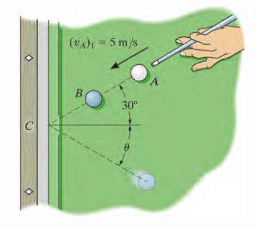\
**Çözüm:**\
Teğetsel momentum korunur: $v_{At2} = v_{At1} = 5\sin 30 = 2.5\text{ m/s}$\
Normal momentum: $m(5\cos 30) = mv_{An2} + mv_{Bn2}$

Restitüsyon (Normal eksen): $0.8 = (v_{Bn2} - v_{An2})/(5\cos 30)$

Çözümden $v_{Bn2}$ bulunur.

**Soru 25:** 3 kg kütleli bir top eğri bir yoldan aşağı kayarak B noktasına geliyor. B noktasındaki eğrilik yarıçapı 10 m'dir. Topun hızı 20 m/s ise ve B noktası eğrilik merkezine (O) göre yatay konumdaysa, topun O noktasına göre açısal momentumu nedir?

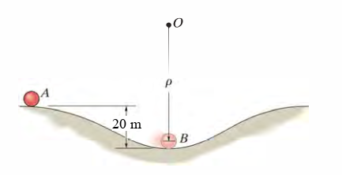\
**Çözüm:**

$H_{O} = m \cdot v \cdot r$

(Hız vektörü yarıçap vektörüne diktir)

$H_{O} = 3\text{ kg} \cdot 20\text{ m/s} \cdot 10\text{ m} = 600\text{ kg} \cdot \text{m}^{2}/\text{s}$

**Soru 26:** Bir lunapark aracı $r = 3\$m yarıçaplı yörüngede 10 m/s hızla dönerken, kol içeri doğru çekilerek yarıçap saniyede 1 m/s hızla kısaltılıyor. Yarıçap 2 m olduğunda aracın teğetsel hızı ne olur?

**Çözüm:**\
Merkezi kuvvet moment oluşturmaz, Açısal Momentum Korunur.

$$
mv_{1}r_{1} = mv_{2}r_{2}
$$

$$
10 \cdot 3 = v_{2} \cdot 2 \Rightarrow v_{2} = 15\text{ m/s}
$$
