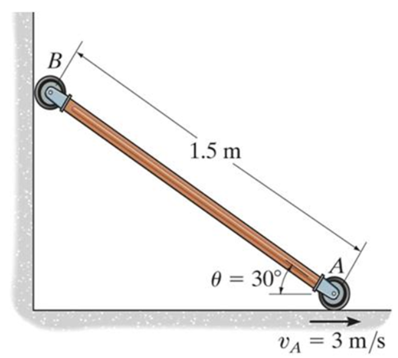
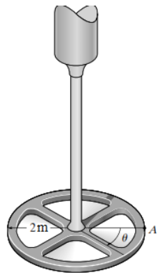
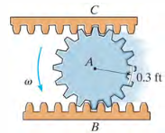
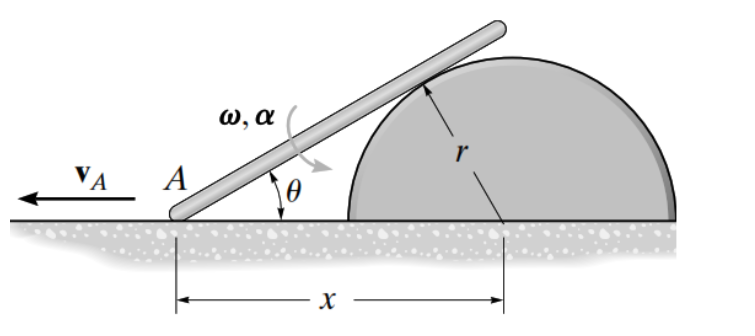
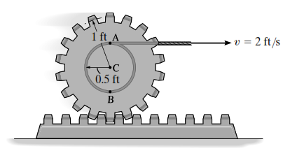
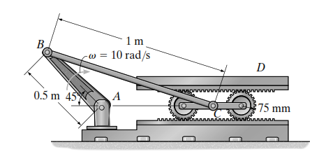
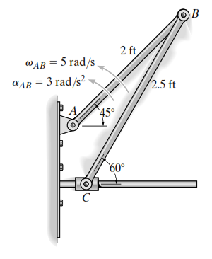
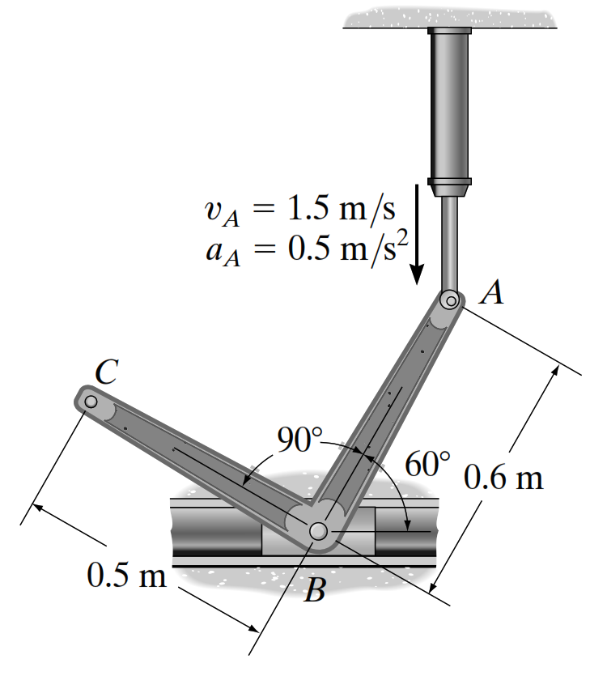
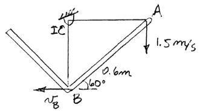
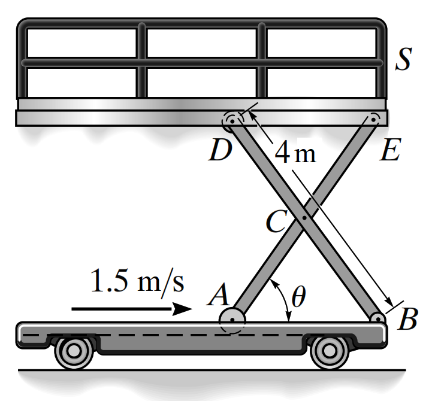

**Cismin Kinematiği – Ünite 6 Sayısal Test Soruları ve Çözümleri**

# BÖLÜM 1: KOLAY SEVİYE (8 Soru)

**Soru 1:** Şekildeki çubuk duvara ve yere dayalı olarak kaymaktadır. A ucu sağa doğru $v_{A} = 3$ m/s hızla hareket etmektedir. $\theta = 30^{\circ}$ olduğu anda çubuğun açısal hızı ($\omega$) kaç rad/s'dir? (Çubuk boyu $L = 1.5$m)

\
**Çözüm:**\
Kinematik ilişki: $v_{A} = - L \cdot \omega \cdot \sin(\theta)$ (Yatay hız bileşeni türevi)\
Veya Ani Dönme Merkezi (IC) yöntemiyle: A noktasındaki hız vektörüne dik ve B noktasındaki hız vektörüne dik doğruların kesişimi IC noktasıdır.\
$r_{A/IC} = L \cdot \sin(30^{\circ}) = 1.5 \cdot 0.5 = 0.75$ m

$\omega = v_{A}/r_{A/IC} = 3/0.75 = 4$ rad/s.

**Soru 2:** Şekildeki sistemde çubuğun açısal hızı 4 rad/s ise, $\theta = 30^{\circ}$olduğu anda B noktasının (duvar üzerindeki uç) hızı kaç m/s olur? (Çubuk boyu $L = 1.5$ m)\
**Çözüm:**\
IC Yöntemi ile:

$r_{A/IC} = L \cdot \sin(30^{\circ}) = 1.5 \cdot 0.5 = 0.75$ m

$\omega = v_{A}/r_{A/IC} = 3/0.75 = 4$ rad/s.

$r_{B/IC} = L \cdot \cos(30^{\circ}) = 1.5 \cdot \frac{\sqrt{3}}{2} \approx 1.3$ m

$v_{B} = \omega \cdot r_{B/IC} = 4 \cdot 1.3 = 5.2$ m/s.

**Soru 3:** Yarıçapı $r = 0.15$ m olan bir disk, $\omega_{0} = 2$ rad/s ilk açısal hızıyla dönmekte ve $\alpha = 1$ rad/s² sabit açısal ivmeyle hızlanmaktadır. $t = 2$ saniye sonra diskin kenarındaki bir noktanın teğetsel hızı ($v$) ne olur?

**Çözüm:**

$\omega = \omega_{0} + \alpha t = 2 + 1(2) = 4$ rad/s\
$v = \omega \cdot r = 4 \cdot 0.15 = 0.6$ m/s.

**Soru 4:** Bir diske sarılı ip aşağıya doğru $a(t) = 2.4t$m/s² ivmesiyle inmektedir. Diskin yarıçapı $r = 0.$<!-- -->2 ve başlangıç hızı sıfırdır. Diskin açısal konumunu ($\theta$) veren fonksiyon nedir?\
**Çözüm:**\
Teğetsel ivme:

$a_{t} = \alpha \cdot r \Rightarrow 2.4t = \alpha \cdot 0.2 \Rightarrow \alpha = 12t$rad/s²

$\omega = \int\alpha dt = \int 12tdt = 6t^{2}$

$\theta = \int\omega dt = \int 6t^{2}dt = 2t^{3}$ rad.

**Soru 5:** Bir diske sarılı ip aşağıya doğru $a(t) = 2.4t$m/s² ivmesiyle inmektedir. Diskin yarıçapı $r = 0.$<!-- -->2 ve başlangıç hızı sıfırdır. Diskin açısal hızının ($\omega$) zamana bağlı değişim fonksiyonu nedir?\
**Çözüm:**\
$$
a_{t} = \alpha \cdot r \Rightarrow 2.4t = \alpha \cdot 0.2 \Rightarrow \alpha = 12t
$$

$\omega = \int\alpha dt = 6t^{2}$ rad/s.

**Soru 6:** Bir diske sarılı ip aşağıya doğru $a(t) = 2.4t$m/s² ivmesiyle inmektedir. Diskin yarıçapı $r = 0.$<!-- -->2 ve başlangıç hızı sıfırdır. $t = 2$ saniye anındaki açısal hız kaç rad/s olur?\
**Çözüm:**

$$
a_{t} = \alpha \cdot r \Rightarrow 2.4t = \alpha \cdot 0.2 \Rightarrow \alpha = 12t
$$

$\omega = \int\alpha dt = 6t^{2}$ rad/s.

$\omega(2) = 6 \cdot (2^{2}) = 6 \cdot 4 = 24$ rad/s.

**Soru 7:** Bir elektrik motoru A dişlisini $\omega_{A} = 40$ rad/s sabit hızla döndürmektedir. A dişlisinin yarıçapı 20 mm, buna temas eden B dişlisinin yarıçapı 50 mm'dir. B dişlisinin açısal hızı nedir?\
**Çözüm:**\
Temas noktasındaki hızlar eşittir

$$
v = \omega_{A}r_{A} = \omega_{B}r_{B}
$$

$$
40 \cdot 20 = \omega_{B} \cdot 50
$$

$\omega_{B} = 800/50 = 16$ rad/s.

**Soru 8:** Bir makaranın iç göbeğine sarılı ip $v = 2$ m/s sabit hızıyla çekilmektedir. Makara kaymadan yuvarlanmaktadır. İç yarıçap $r = 0.1$ m, dış yarıçap $R = 0.2$ m ise makaranın açısal hızı nedir?\
**Çözüm:**\
Kaymadan yuvarlanma durumunda yerle temas noktası anlık dönme merkezidir (IC).\
İpin çıktığı noktanın yere uzaklığı: $R - r = 0.2 - 0.1 = 0.1$ m.\
$v = \omega \cdot (R - r) \Rightarrow 2 = \omega \cdot 0.1 \Rightarrow \omega = 20$ rad/s.

# BÖLÜM 2: ORTA SEVİYE (16 Soru)

**Soru 9:** Şekildeki sistemde açının zamanla değişimi $\theta(t) = 1.5\sin(3t)$ radyan olarak verilmiştir. Yarıçapı $r = 2$ m olan diskin A noktasındaki (çember üzerinde) teğetsel hızın ulaşabileceği maksimum değer nedir?

\
**Çözüm:**\
Açısal hız: $\omega = d\theta/dt = 1.5 \cdot 3 \cdot \cos(3t) = 4.5\cos(3t)$\
Maksimum açısal hız : $\omega_{\max} = 4.5$ rad/s (kosinüs 1 olduğunda).\
Maksimum hız: $v_{\max} = \omega_{\max} \cdot r = 4.5 \cdot 2 = 9$m/s.

**Soru 10:** Kaynak 2 (Google Form, Sayfa 11, Soru 11)\
**Soru:** Bir disk $\omega_{0} = 8$ rad/s ilk hızıyla dönmeye başlıyor ve $\alpha = 6$rad/s² sabit ivmeyle hızlanıyor. $t = 0.5$ saniye sonraki açısal hızı nedir?\
**Çözüm:**\
$$
\omega = \omega_{0} + \alpha t
$$

$\omega = 8 + 6(0.5) = 8 + 3 = 11$ rad/s.

**Soru 11:** $\omega_{0} = 8$ rad/s ve $\alpha = 6$ rad/s² olan bir disk, 2 tam tur attıktan sonraki açısal hızı kaç rad/s olur?

**Çözüm:**

$\theta = 2\text{ tur} = 2 \cdot 2\pi = 4\pi \approx 12.57$ rad.\
$$
\omega^{2} = \omega_{0}^{2} + 2\alpha\theta
$$

$\omega^{2} = 8^{2} + 2 \cdot 6 \cdot 12.57 = 64 + 150.84 = 214.84$

$\omega = \sqrt{214.84} \approx 14.66$ rad/s.

**Soru 12:** $\omega_{0} = 8$ rad/s, $\alpha = 6$ rad/s² olan bir diskin yarıçapı $r = 2$ m'dir. $t = 0.5$ saniyede, diskin kenarındaki bir noktanın ivmesinin *normal* (merkezcil) bileşeni kaç m/s² olur?

**Çözüm:**\
Önce $t = 0.5\$s'deki $\omega$ bulunur:

$\omega = 8 + 6(0.5) = 11$ rad/s.

$a_{n} = \omega^{2} \cdot r = 11^{2} \cdot 2 = 121 \cdot 2 = 242$ m/s².

**Soru 13:** $\omega_{0} = 8$ rad/s, $\alpha = 6$ rad/s² olan bir diskin yarıçapı $r = 2$ m'dir. Diskin $t = 0.5$ saniyede ivmenin *teğetsel* bileşeni kaç m/s² olur?\
**Çözüm:**

$a_{t} = \alpha \cdot r \rightarrow a_{t} = 6 \cdot 2 = 12$m/s².

**Soru 14:** Pinyon dişlisi A, sabit B dişli rafı üzerinde yuvarlanmaktadır. A'nın açısal hızı $\omega = 4$ rad/s ise, A'nın merkezine bağlı olan ve A ile birlikte hareket eden üstteki C dişli rafının hızı nedir? (A'nın yarıçapı $r = 0.15$ m).

<figure>

</figure>

**Çözüm:**\
Ani Dönme Merkezi (IC), A'nın B ile temas noktasıdır.\
A'nın merkez hızı: $v_{A} = \omega \cdot r = 4 \cdot 0.15 = 0.6$ m/s.\
C rafı, A dişlisinin en üst noktasına temas eder (IC'ye uzaklık $2r$).\
$v_{C} = \omega \cdot (2r) = 4 \cdot 0.3 = 1.2$ m/s.

**Soru 15:** Bir tekerlek yatay düzlemde kaymadan yuvarlanıyor. Tekerleğin merkezinin hızı sağa doğru 2 m/s ise, tekerleğin yere temas eden noktasının (A) ve en üst noktasının (B) hızları nedir?\
**Çözüm:**\
Kaymadan yuvarlanma $\rightarrow v_{A} = 0$

(IC noktası).\
Merkez hızı: $v_{O} = 2$ m/s.\
En üst nokta (B), merkezin IC'ye olan uzaklığının iki katı uzaklıktadır.\
$v_{B} = 2 \cdot v_{O} = 2 \cdot 2 = 4$ m/s (Sağa doğru).

**Soru 16:** Yarıçapı 0.5 m olan bir disk sola doğru yuvarlanıyor. Merkezinin hızı $v_{O} = 3$ m/s ve açısal ivmesi $\alpha = 8$ rad/s²'dir. Kaymadan yuvarlanıyorsa, diskin en üst noktasının teğetsel ivmesi ($a_{t}$) nedir ($\omega = 0$)?

**Çözüm:**\
En üst noktanın (B) ivmesi:

${\vec{a}}_{B} = {\vec{a}}_{O} + {\vec{a}}_{B/O}$

\
Merkez ivmesi

$a_{O} = \alpha \bullet r = 8 \cdot 0.5 = 4$ m/s² (sola).\
B'nin O'ya göre teğetsel ivmesi

$a_{t,B/O} = \alpha \bullet r = 4$ m/s² (sola).\
Toplam teğetsel ivme (yatay bileşen): $4 + 4 = 8$ m/s².

2\. yol

$$
{\vec{a}}_{B} = {\vec{a}}_{O} + \vec{\alpha} \times {\vec{r}}_{B/O} - \omega^{2}{\vec{r}}_{B/O}
$$

$$
{\vec{a}}_{B} = - 4\vec{i} - 8\vec{k} \times 0.5\vec{j} - \omega\left( \omega{\vec{r}}_{B/O} \right)
$$

$$
{\vec{a}}_{B} = {\vec{a}}_{O} + \vec{\alpha} \times {\vec{r}}_{B/O} - \omega^{2}{\vec{r}}_{B/O}
$$

$$
{\vec{a}}_{B} = - 4\vec{i} - 8\vec{k} \times 0.5\vec{j} = - 8\vec{i} + - \omega^{2}{\vec{r}}_{B/O}
$$

**Soru 17:** Bir bowling topu $v_{O} = 8$ m/s hızla ilerlerken, aynı anda $\omega = 10$ rad/s hızla (ters yönde, kayarak) dönmektedir. Yarıçap $r = 0.12$ m ise, topun yerle temas eden A noktasının hız büyüklüğü nedir?

**Çözüm:**

$$
v_{A} = v_{O} - \omega \cdot r
$$

(Dönme hızı ilerlemeye ters yönde hız yaratır).

$v_{A} = 8 - (10 \cdot 0.12) = 8 - 1.2 = 6.8$ m/s.

**Soru 18:** AB kolu 6 rad/s sabit açısal hızla dönmektedir. BC kolunun A ve B noktaları arasındaki yatay mesafe 0.3 m, düşey mesafe 0.4 m'dir. B noktasının hızını hesaplayınız.

**Çözüm:**

$$
r_{AB} = \sqrt{0.3^{2} + 0.4^{2}} = 0.5
$$

$v_{B} = \omega_{AB} \cdot r_{AB} = 6 \cdot 0.5 = 3$ m/s.\
Hız vektörü AB koluna diktir.

**Soru 19:** Şekildeki çubuk yarım daire üzerinde sola doğru kaymaktadır. $\theta = 30^{\circ}$ iken açısal hız $\omega = - 2$ rad/s (saat yönü). Çubuğun A ucunun $v_{A}$ nedir? (Yarıçap $r = 2$ m, $x = r/sin\theta$)

\
**Çözüm:**

Geometri:

$x = r/sin\theta$

Türev:

$v_{A} = dx/dt = - r \cdot (\cos\theta/{\sin}^{2}\theta) \cdot (d\theta/dt)$

$v_{A} = - 2 \cdot (\cos 30/{\sin}^{2}30) \cdot ( - 2)$

$v_{A} = - 2 \cdot \left( \frac{0.866}{0.25} \right) \cdot ( - 2) = 13.86$ m/s.

**Soru 20:** Dişli B sabit bir yatay raf içindedir. A iç göbeğine sarılı ip $v = 0.6$ m/s ile çekilmektedir. Dişli merkezinin hızı nedir? (İç yarıçap 0.15 m, Dış yarıçap 0.3 m).

$$
\mathbf{r}_{\mathbf{iç}}
$$

$$
\mathbf{r}_{\mathbf{d\imath s}}
$$

<figure>

<figcaption>
<math display="block" xmlns="http://www.w3.org/1998/Math/MathML"><semantics><mi mathvariant="bold-italic">𝒗</mi><annotation encoding="application/x-tex">\mathbf{v}</annotation></semantics></math>
</figcaption>
</figure>

**Çözüm:**\
Dış temas noktası (üst nokta) sabit (IC).\
İç göbek (A noktası) IC'ye $(0.3 - 0.15) = 0.15m\ uzakl\imath kta.$

$$
\omega = v_{A}/r_{A/IC} = 0.6/0.15 = 4rad/s.
$$

Merkez hızı $v_{C} = \omega \cdot 0.3 = 4 \cdot 0.3 = 1.2$m/s.

**Soru 21:** Makaslı platformda (Scissor lift), A ucu sağa $v_{A} = 1.5$m/s ile giderken, $\theta = 30^{\circ}$anında kolların açısal hızı nedir? (Kol uzunluğu 4m, yarısı 2m).

**Çözüm:**\
Yatay mesafe $x = 2 \cdot (2\cos\theta) = 4\cos\theta$

$$
v_{A} = dx/dt = - 4\sin\theta \cdot \omega
$$

$$
1.5 = - 4 \cdot \sin(30) \cdot \omega \Rightarrow 1.5 = - 2\omega \Rightarrow \omega = - 0.75rad/s.
$$
Büyüklük 0.75 rad/s.

**Soru 22:** AB kolu 10 rad/s ile dönerken B pistonunun hızı nedir?

$$
\mathbf{\omega}
$$

<figure>

<figcaption>
<math display="block" xmlns="http://www.w3.org/1998/Math/MathML"><semantics><msub><mi>r</mi><mrow><mi>A</mi><mi>B</mi></mrow></msub><annotation encoding="application/x-tex">r_{AB}</annotation></semantics></math>
</figcaption>
</figure>

**Çözüm:**

A:(0,0)

B:(-0.5cos45, 0.5sin45)=(-0.3536, 0.3536)

$$
{\vec{r}}_{B/A} = B - A = - 0.3536\vec{i} + 0.3536\vec{j}
$$

$v_{B} = \omega \times r_{\frac{A}{B}} = - 10\vec{k} \times \left( - 0.3536\vec{i} + 0.3536\vec{j} \right) = 3.536\vec{i} + 3.536\vec{j}$

**Soru 24:** Bir disk 8 rad/s ilk hız ve 6 rad/s² açısal ivme ile dönüyor. 0.5 saniye sonra, disk üzerindeki bir A noktasının toplam hız büyüklüğü 11 m/s ise, diskin yarıçapı kaç metredir?\
**Çözüm:**

$t = 0.5$ sn sonra

$\omega = 8 + 6(0.5) = 11$ rad/s.

$v = \omega \cdot r \Rightarrow 11 = 11 \cdot r \Rightarrow r = 1$ metre.

# BÖLÜM 3: ZOR SEVİYE (8 Soru)

**Soru 26:** AB çubuğu 5 rad/s açısal hız ve 3 rad/s² açısal ivme ile dönerken, C kayar bloğu bir kanalda hareket etmektedir. Mekanizmanın konumu gereği C'nin ivmesi hesaplanırken B noktasının teğetsel ivmesi ($a_{t}$) nedir? ($r_{AB} = 0.6$ m).

**Çözüm:**

$a_{t} = \alpha \cdot r_{AB}$

$a_{t} = 3 \cdot 0.6 = 1.8$ m/s².

**Soru 28:** Dönen bir disk üzerinde (açısal hız $\omega = 8$ rad/s, $\alpha = 5$ rad/s²), bir top merkezden dışarı doğru radyal $v_{rel} = 3$ m/s hız ve $a_{rel} = 1.5$ m/s² ivme ile hareket ediyor. Top merkezden $r = 0.3$ m uzaktayken toplam ivmesinin radyal bileşeni nedir?

**Çözüm:**\
Radyal ivme

$a_{r} = a_{rel} - \omega^{2} \cdot r$

(Dönen eksenlerde).

$a_{r} = 1.5 - (8^{2} \cdot 0.3) = 1.5 - (64 \cdot 0.3) = 1.5 - 19.2 = - 17.7$ m/s².

**Soru 29:** Hidrolik silindir 1.5 m/s hızla uzarken 0.5 m/s² ile hızlanmaktadır. Buna bağlı ABC çubuğunun açısal ivmesini bulmak için hangi yöntem en uygundur?

**Çözüm:**

B(0,0) olsun\
A=$0.6\left( \cos 60\vec{i} + \sin 60\vec{j} \right) = 0.3\vec{i} + 0.52\vec{j}$

C=$0.5\left( - \cos 30\vec{i} + \sin 30\vec{j} \right) = - 0.433\vec{i} + 0.25\vec{j}$

$$
{\vec{r}}_{B/A} = B - A = - 0.3\vec{i} - 0.52\vec{j}
$$

Dönme merkezi (IC)

$$
r_{A/IC} = 0.6cos60 = 30\ m
$$

Açısal hız ($\omega_{ABC})$

$$
v_{A} = \omega_{ABC} \bullet r_{\frac{A}{IC}} \rightarrow \omega_{ABC} = \frac{v_{A}}{r_{\frac{A}{IC}}} = \frac{1.5}{0.3} = 5\ \frac{rad}{sn}
$$

Not: $\omega_{ABC}$ ${\vec{v}}_{B} = {\vec{v}}_{A} + \vec{\omega} \times {\vec{r}}_{B/A}$ formülünden bulunabilir ama daha uzun.

Formülü uygula

$$
{\vec{a}}_{B} = {\vec{a}}_{A} + \vec{\alpha} \times {\vec{r}}_{B/A} - \omega^{2}{\vec{r}}_{B/A}
$$

$$
a_{B}\vec{i} = - 0.5\vec{j} + \alpha_{ABC}\vec{k} \times \left( - 0.433\vec{i} + 0.25\vec{j} \right) - 5^{2}\left( - 0.433\vec{i} + 0.25\vec{j} \right)
$$

$$
a_{B}\vec{i} = \left( 7.5 + 0.5196\alpha_{ABC} \right)\vec{i} + \left( - 0.3{\vec{\alpha}}_{ABC} + 12.49 \right)\vec{j}
$$

$$
\alpha_{ABC} = 41.63\ \frac{rad}{{sn}^{2}}
$$

**Soru 30:** Şekildeki makaslı platformda, DC barının hızı $v = 1.5$ m/s, AE çubuğunun dönme hızı $\omega = - 3$ rad/s iken, A ve D noktaları arasındaki düşey mesafe ($h$) nedir?

\
**Çözüm:**\
Yatay hız:

$$
v = - L \cdot \sin\theta \cdot \omega
$$

$$
1.5 = - 4 \cdot \sin\theta \cdot ( - 3)
$$

$$
1.5 = 12\sin\theta \Rightarrow \sin\theta = 1.5/12 = 0.125
$$

ise

$h = L\sin\theta = 4 \cdot 0.125 = 0.5$m.
