**Cismin Kinetiği – Ünite 7 Sayısal Test Soruları ve Çözümleri**

**BÖLÜM 1: KOLAY SEVİYE (8 Soru)**

**Soru 1**\
Şekildeki sistemin ağırlık merkezine (G) göre kütle atalet momentini ($I_{G}$) bulunuz. Çubuğun kütlesi $m_{ç} = 3$ kg, plakanın kütlesi $m_{p} = 5$ kg'dır.

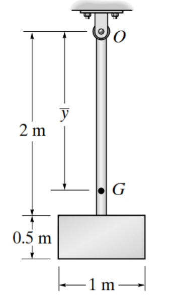

$$
\overline{y} = \frac{m_{ç} \bullet y_{ç} + m_{p} \bullet y_{p}}{m_{ç} + m_{p}} = \frac{3 \bullet 1 + 5 \bullet 2.25}{3 + 5} = 1.78125
$$

$$
I_{ç,G} = {I'}_{ç} + \left( y_{ç} - \overline{y} \right)^{2} \bullet m_{ç} = \frac{1}{12}m_{ç}L^{2} + \left( y_{ç} - \overline{y} \right)^{2} \bullet m_{ç}
$$

$$
I_{ç} = \frac{1}{12}3 \bullet 2^{2} + (1 - 1.78125)^{2} \bullet 3 \cong 2.831
$$

$$
I_{p,G} = {I'}_{p} + \left( y_{p} - \overline{y} \right)^{2} \bullet m_{p} = \frac{1}{12}m_{p}(a^{2} + b^{2}) + \left( y_{p} - \overline{y} \right)^{2} \bullet m_{p}
$$

$$
I_{p,G} = \frac{1}{12}5\left( 1^{2} + {0.5}^{2} \right) + (2.25 - 1.78125)^{2} \bullet 5 = 1.619
$$

$$
\sum_{}^{}I = 2.831 + 1.619 = 4.45\ kg.m^{2}
$$

**Soru 2:** Her bir kenarı $a = 1$ m ve her bir çubuğun kütlesi $m = 1$ kg olan eşkenar üçgenin ağırlık merkezine (O) göre kütle atalet momenti nedir?

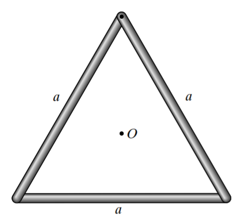\
**Çözüm:**\
Bir çubuğun O'ya uzaklığı $d = \frac{a}{2}\tan(30^{\circ}) = \frac{1}{2\sqrt{3}}$ m.\
Bir çubuğun kendi merkezine göre $I = \frac{1}{12}ma^{2} = \frac{1}{12}(1)(1)^{2} = 0.0833$Paralel eksen: $I_{çubuk/O} = I + md^{2} = 0.0833 + 1 \cdot (\frac{1}{2\sqrt{3}})^{2} = 0.0833 + 0.0833 = 0.166$

Toplam (3 çubuk): $3 \times 0.166 = 0.5$kg$\cdot$m.

**Soru 3**

Şekildeki sistemin O noktasına göre atalet momentini bulunuz. $m_{plaka}$=12,

$m_{çubuk}$=4

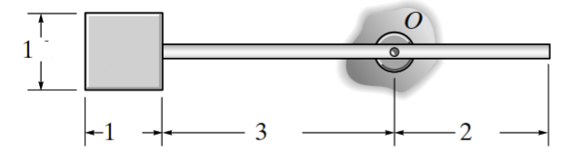

$$
I_{ç,O} = {I'}_{ç} + \left( y_{ç} - y_{O} \right)^{2} \bullet m_{ç} = \frac{1}{12}m_{ç}L^{2} + \left( y_{ç} - y_{O} \right)^{2} \bullet m_{ç}
$$

$$
I_{ç,O} = \frac{1}{12}4 \bullet 5^{2} + (2.5 - 2)^{2} \bullet 4 \cong 9.33kg.m^{2}
$$

$$
I_{p,O} = {I'}_{p} + \left( y_{p} - y_{O} \right)^{2} \bullet m_{p} = \frac{1}{12}m_{p}(a^{2} + b^{2}) + \left( y_{p} - y_{O} \right)^{2} \bullet m_{p}
$$

$$
I_{p,O} = \frac{1}{12}12\left( 1^{2} + 1^{2} \right) + (5.5 - 2)^{2} \bullet 12 = 149kg.m^{2}
$$

$$
\sum_{}^{}I = I_{ç,O} + I_{p,O} = \ 158.33\ kg.m^{2}
$$

**Soru 4**

Şekildeki sistemin O noktasına göre atalet momentini bulunuz. $m_{plaka} = 15,$

$$
m_{çubuk} = 10\ Birim\ kg*m^{2}
$$

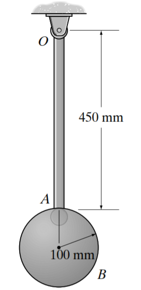

$$
I_{ç,O} = {I'}_{ç} + \left( y_{ç} - y_{O} \right)^{2} \bullet m_{ç} = \frac{1}{12}m_{ç}L^{2} + \left( y_{ç} - y_{O} \right)^{2} \bullet m_{ç}
$$

$$
I_{ç,O} = \frac{1}{12}10 \bullet {0.45}^{2} + (0.225 - 0)^{2} \bullet 10 \cong 0.675kg.m^{2}
$$

$$
I_{p,O} = {I'}_{p} + \left( y_{p} - y_{O} \right)^{2} \bullet m_{p} = \frac{1}{12}m_{p}r^{2} + \left( y_{p} - y_{O} \right)^{2} \bullet m_{p}
$$

$$
I_{p,O} = \frac{1}{12}15 \bullet {0.1}^{2} + (0.55 - 0)^{2} \bullet 15 \cong 4.6125kg.m^{2}
$$

$$
\sum_{}^{}I = I_{ç,O} + I_{p,O} = \ 5.2875\ kg.m^{2}
$$

**Soru 5:**

Şekildeki maden arabası $200$ kg kütleli yük taşıyor. Arabaya $P = 50$ N'luk yatay kuvvet uygulanıyor. Sürtünme yok. Arabanın ve yükün kütle merkezi G olduğuna göre, sistemin yatay ivmesi nedir?

<figure>
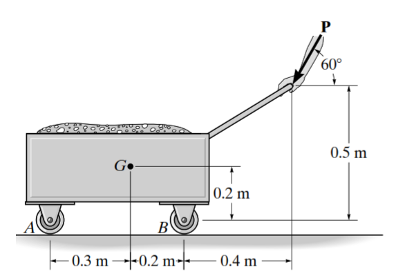
<figcaption>
P
</figcaption>
</figure>

**Çözüm:**

$F = m \cdot a \Rightarrow 50 = 200 \cdot a_{x}$

$a_{x} = 50/200 = 0.25\ \frac{m}{{sn}^{2}}$

**Soru 6**\
Bir önceki soruda (Soru 5), araba yatay düzlemde hareket ettiğine göre G noktasının düşey ivmesi ($a_{y}$) nedir?\
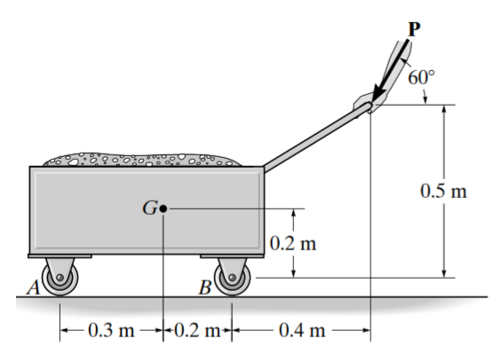

**Çözüm:**\
Yatay düzlemde hareket eden cismin düşey ivmesi sıfırdır. $a_{y} = 0$

.

**Soru 7**\
150 tonluk (150.000 kg) bir uçağın motorları toplam $T = 375$ kN itiş sağlıyor. Tekerleklerdeki sürtünme ihmal edilirse uçağın kalkış ivmesi nedir?

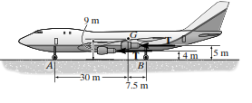

**Çözüm:**

$\Sigma F_{x} = m \cdot a_{x}$

$375.000 = 150.000 \cdot a$

$a = 375/150 = 2.5\frac{m}{{sn}^{2}}$

**Soru 8**\
**Referans:** Kaynak 1 (Hibbeler 17-29)\
**Soru:** 70 kg kütleli bir forklift, 120 kg'lık bir yükü yukarı doğru $a = 3\frac{m}{{sn}^{2}}$ ivme ile kaldırıyor. Yüke etki eden toplam kaldırma kuvveti nedir?\
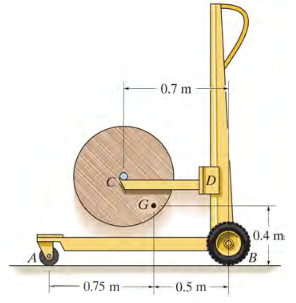

**Çözüm:**\
Sadece yük için serbest cisim diyagramı (SCD):

$\Sigma F_{y} = m \cdot a_{y} \Rightarrow R - mg = m \cdot a$

$R - 120(9.81) = 120(3)$

$R = 1177.2 + 360 = 1537.2N \approx 1.54kN$

**BÖLÜM 2: ORTA SEVİYE (16 Soru)**

**Soru 9**\
1500 kg kütleli bir drag arabası yarışa başlıyor. Ön tekerleklerin (A) yerden kesilmesi için (tepki kuvveti $N_{A} = 0$ ) gereken ivme nedir? (Ağırlık merkezi G'nin arka tekerleğe yatay uzaklığı 1 m, ön tekerleğe 2.5 m, yerden yüksekliği 0.35 m).

2.5m

<figure>
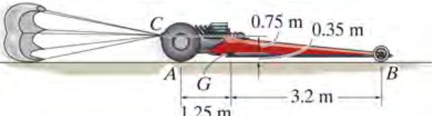
<figcaption>
1m
</figcaption>
</figure>

**Çözüm:**\
Moment denklemi (Arka tekerlek B'ye göre):

$\Sigma M_{B} = \Sigma(M_{k})_{B}$

(Kinetik moment)

$m \cdot g \cdot (1) = m \cdot a \cdot (0.35)$

(A tekerleği havalandığı için $N_{A} = 0$)

$g \cdot 1 = a \cdot 0.35$

$9.81 = 0.35a \Rightarrow a = 28\frac{m}{{sn}^{2}}$

**Soru 10**\
282 $kg \bullet m^{2}$kütle atalet momentine ($I_{O}$) sahip bir volan (flywheel) dururken, üzerine $M = 20N \bullet m$'lik sabit bir tork uygulanıyor. 10 saniye sonra açısal hızı ne olur?\
**Çözüm:**

$\Sigma M_{O} = I_{O} \cdot \alpha \Rightarrow 20 = 282 \cdot \alpha \Rightarrow \alpha \approx 0.071$rad/s2

$\omega = \omega_{0} + \alpha t = 0 + 0.071(10) = 0.71$rad/s.

**Soru 11**\
30 kg kütleli, $r = 0.025$m yarıçaplı (atalet yarıçapı $k_{O} = 0.15$ m) bir tekerleğe 2 N.m tork uygulanıyor. Yataklardaki sürtünme kuvveti teğetsel olarak 50 N ise açısal ivme nedir?

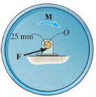

**Çözüm:**\
$$
I_{O} = mk_{O}^{2} = 30(0.15)^{2} = 0.675\ kg \bullet m^{2}
$$

Sürtünme momenti:

$M_{f} = 50\text{ N} \times 0.025\text{ m} = 1.25$ N.m

Net Moment:

$\Sigma M = 2 - 1.25 = 0.75$ N.m

$0.75 = 0.675 \cdot \alpha \Rightarrow \alpha = 1.11$ rad/sn2

**Soru 12:**

60 lb (27 kg) kütleli E diski, dönmekte olan D diskine temas ettiriliyor. D diski ile E diski arasındaki kinetik sürtünme katsayısı $\mu_{k} = 0.3$. E diskinin açısal ivmesi nedir? (Disk yarıçapı 1 ft $\approx$ 0.3 m).

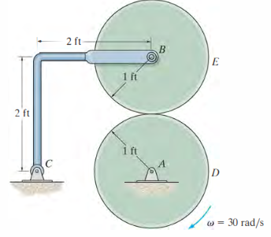\
**Çözüm:**

$I_{E} = \frac{1}{2}mr^{2} = 0.5(27)(0.3)^{2} = 1.215$kg.m2

Sürtünme kuvveti:

$F = \mu_{k}N = 0.3(27 \cdot 9.81) \approx 79.5$N.

Moment:

$M = F \cdot r = 79.5 \cdot 0.3 = 23.85$ N.m

$\alpha = M/I = 23.85/1.215 \approx 19.6$ rad/sn2

**Soru 13**\
4 kg kütleli çubuk yatay dengedeyken ip kesiliyor. İpin kesildiği andaki çubuğun açısal ivmesi nedir? (Çubuk uzunluğu 2m, destek uçta).

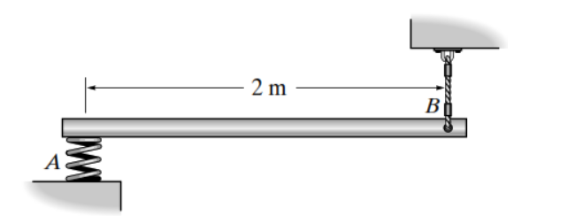\
**Çözüm:**\
Uç noktaya (A) göre moment:

$$
\Sigma M_{A} = I_{A} \cdot \alpha
$$

$$
m \cdot g \cdot (L/2) = (\frac{1}{3}mL^{2}) \cdot \alpha
$$

$$
{g \cdot (L/2) = \frac{1}{3}L^{2} \cdot \alpha \Rightarrow \alpha = \frac{3g}{2L}
}{\alpha = \frac{3 \cdot 9.81}{2 \cdot 2} = \frac{29.43}{4} = 7.36\frac{rad}{{sn}^{2}}}
$$

**Soru 14:**

4 kg kütleli çubuk yatay dengedeyken ip kesiliyor. İpin kesildiği anda çubuğun kütle merkezinin düşey ivmesi ($a_{G,y}$) nedir? (Çubuk uzunluğu 2m, destek uçta).

\
**Çözüm:**\
Teğetsel ivme:

$a_{t} = \alpha \cdot r$

Kütle merkezi

$r = L/2 = 1$ m uzaklıkta.

$a_{G,y} = 7.36 \cdot 1 = 7.36\ \frac{m}{{sn}^{2}}$

**Soru 15**\
30 lb (13.6 kg) küre ve 10 lb (4.5 kg) çubuktan oluşan sarkaç serbest bırakılıyor. O noktasına (çubuğun üstü) göre kütle atalet momenti $I_{O} = 5.27\frac{kg}{m^{2}}$ ise, serbest bırakıldığı andaki (yatay konum) açısal ivme nedir? (Ağırlık merkezi O'dan 0.45 m uzakta, Toplam kütle 18.1 kg).

0.15m

<figure>
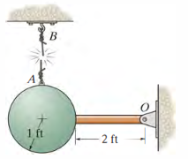
<figcaption>
0.3m
</figcaption>
</figure>

**Çözüm:**

$\Sigma M_{O} = I_{O} \cdot \alpha$

$W_{toplam} \cdot d_{G} = I_{O} \cdot \alpha$

$(18.1 \cdot 9.81) \cdot 0.45 = 5.27 \cdot$

$80 \approx 5.27\alpha \Rightarrow \alpha \approx 15.2\frac{rad}{{sn}^{2}}$

**Soru 16**

Bir kamyon üzerinde 500 lb (227 kg) ağırlığında, yarıçapı 2 ft (0.6 m) olan bir makara taşınıyor. Kamyon 3 ft/s² (0.9 m/s²) ile hızlanıyor. Makara kaymadan yuvarlanıyorsa açısal ivmesi nedir? ($I_{G} = mk_{G}^{2},\ k_{G} = 2\ ft = 0.6$)

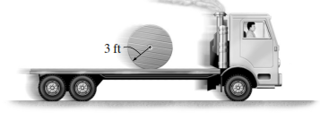\
**Çözüm:**\
Kamyon ivmesi $a_{k}$. Makara bağıl ivme ile geriye yuvarlanır.

$Yatay\ hareket$\
$$
a_{Mutlak} = a_{Kamyon} - a_{Ba\breve{g}\imath l}
$$

$$
a_{G} = a_{k} - (r \cdot \alpha)
$$

$$
F_{s} = ma_{G}
$$

$F_{s} = m(0.9 - 0.6\alpha)$…(1)

Moment denklemi (Temas noktası P'ye göre):

$$
\Sigma M_{G} = I_{G}\alpha
$$

$$
F_{s} \cdot r = I_{G}\alpha
$$

$$
F_{s} \cdot 0.6 = {m0.6}^{2}\alpha
$$

$$
F_{s} = 0.6m\alpha\ldots(2)
$$

Denklemler çözüldüğünde:

$$
\alpha = 0.75\frac{rad}{{sn}^{2}}
$$

**Soru 17**\
**Referans:** Kaynak 1 (Hibbeler 17-111)\
**Soru:** 15 lb (7 kg) silindir, 5 lb (2.3 kg) plaka üzerinde duruyor. Silindire 40 lb-ft (54 N$\cdot$ m) tork uygulanıyor. Kayma yoksa silindirin açısal ivmesi nedir? (Silindir $r = 1.25$ ft = 0.38 m).

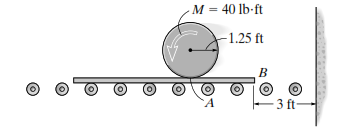\
**Çözüm:**\
$I_{G} = \frac{1}{2}mr^{2} = 0.5(7)(0.38)^{2} = 0.5$ kg.m2\
$$
\Sigma M_{G} = I_{G}\alpha \Rightarrow 54 - F_{s}(0.38) = 0.5\alpha\ldots(1)
$$

Silindir

$$
\sum F_{x} = m_{s}a_{G}
$$

$$
F_{s} = 7 \cdot a_{G}\ldots(2)
$$

Plaka

$$
\sum F_{x} = m_{P}a_{P}
$$

$$
F_{s} = 2.3 \cdot a_{P}\ldots(3)
$$

Silindir sola gidiyorsa

$$
a_{G} = \alpha r - a_{p}\ldots(4)
$$

2, 3 ve 4 nolu denklemlerde Fs=$0.657\alpha$

(1)’e uygulanırsa $\alpha \approx 70$ rad/sn2 bulunur.

**Soru 19:** 200 kg'lık bir arabanın G noktasındaki kütle merkezi yerden 0.3 m yukarıdadır. Araba $a = 5$ m/sn^2 ile hızlanırken arka tekerlekteki (A) normal kuvvet nedir? (Tekerlekler arası mesafe 0.4m, G tam ortada varsayalım).

**Çözüm:**

$\Sigma M_{B} = 0$

(Ön tekerlek B'ye göre moment).

$N_{A}(0.4) - mg(0.2) - ma(0.3) = 0$

$0.4N_{A} = 200(9.81)(0.2) + 200(5)(0.3)$

$0.4N_{A} = 392.4 + 300 \Rightarrow N_{A} = 1731$N

**Soru 20**\
**Referans:** Kaynak 1 (Hibbeler 17-56)\
**Soru:** Dört kanatlı bir fanın toplam kütlesi 2 kg ve $I_{O} = 0.18$ kg.m2. Fana $M = 3(1 - e^{- 0.2t})$N.m tork uygulanıyor. $t = 4$ saniyede açısal hızı nedir? (Başlangıç hızı 0).

**Çözüm:**

$M = I\alpha \Rightarrow \alpha = M/I$

$\omega = \int\alpha dt = \frac{1}{I}\int Mdt$

$\omega = \frac{1}{0.18}\int_{0}^{4}{3(1 -}e^{- 0.2t})dt$

İntegral alınıp değerler konulduğunda

$\omega \approx 20.8$rad/s.

**Soru 21**\
200 kg'lık bir arabanın G noktasındaki kütle merkezi yerden 0.3 m yukarıdadır. Araba $a = 5$ m/sn^2 ile hızlanırken ön tekerlekteki (B) normal kuvvet nedir? (Tekerlekler arası mesafe 0.4m, G tam ortada varsayalım).\
**Çözüm:**

$\Sigma F_{y} = 0 \Rightarrow N_{A} + N_{B} - mg = 0$

$1731 + N_{B} = 200(9.81) = 1962$

$N_{B} = 1962 - 1731 = 231$ N.

**Soru 22**\
**Referans:** Kaynak 1 (Hibbeler 17-105)\
**Soru:** 100 kg'lık bir makara, kablosundan 500 N kuvvetle çekiliyor. Makara yerde kaymadan yuvarlanıyor. Makaranın kütle merkezi G'nin ivmesi nedir? (İç yarıçap $r = 0.15$ m Dış R=0.3 m, $k_{G} = 0.2$ m).

**Çözüm:**

$I_{G} = 100(0.2)^{2} = 4$ kg.m2

Denklemler:

> $500 - F_{s} = 100a_{G}$
>
> $500(0.15) + F_{s}(0.3) = 4\alpha$
>
> $a_{G} = 0.3\alpha$
>
> (Kaymama şartı).\
> Çözüm:
>
> $a_{G} \approx 6.2$ m.sn2

**Soru 23**\
50 kg'lık bir kutu, eğimli yüzeye sahip bir araç üzerinde taşınıyor. Eğim açısı $15^{\circ}$. Araç a ivmesiyle hızlanıyor. Kutunun kaymaması için a en fazla ne olabilir? ($\mu_{s} = 0.5$).

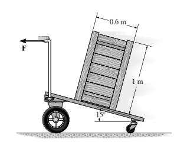

**Çözüm:**\
Kutuya etkiyen kuvvetler: mg, N, Fs

Yüzeye paralel denklem:

$mg\sin 15 - F_{s} = - ma\cos 15$

Yüzeye dik denklem:

$N - mg\cos 15 = ma\sin 15$

Sınır şart:

$F_{s} = \mu_{s}N$

.\
Bu denklemlerden

$a \approx 2$ m/sn2

**Soru 24**\
\
**Soru:** Uzunluğu L, kütlesi m olan bir çubuk, ucundan (O) menteşelidir. $\theta = 30^{\circ}$ açısıyla dururken serbest bırakılıyor. O noktasındaki yatay tepki kuvveti ($O_{x}$) nedir?

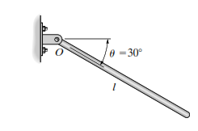

**Çözüm:**\
Teğetsel ivme ve merkezcil ivme bileşenlerini kullanarak:\
Başlangıçta

$\omega = 0$, merkezcil ivme 0.

$\alpha = \frac{3g}{2L}\cos 30$

$O_{x} = m(a_{G})_{x}$

. Geometri ve bileşenlerine ayırma ile

$O_{x} \approx 0.325mg$

**BÖLÜM 3: ZOR SEVİYE (8 Soru)**

**Soru 25**\
22 kg'lık (50 lb) bir plaka, AB ve CD kolları (paralelogram mekanizması) ile asılıdır. AB koluna $M = 13.5$ N.m (10 lb-ft) tork uygulanıyor. Çubuklar $\theta = 30^{\circ}$konumundayken plakanın açısal ivmesi sıfırdır (öteleme yapar). Plakanın çizgisel ivmesi nedir? (Kol boyu 𝐿=1.5 ft = 0.45 m).

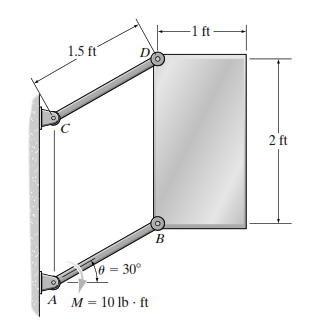\
**Çözüm:**\
Plaka dönme yapmaz, sadece ötelenir (Curvilinear translation).\
Sanal iş veya hareket denklemleriyle:

$\Sigma F_{t} = m(a_{G})_{t}$

Tork momenti kuvvet yaratır:

$F = M/L$

Denge ve hareket denklemleri çözülerek

$a \approx 9.8$ m/sn2

**Soru 26**\
10 lb (4.5 kg) ağırlığındaki ince çubuk A noktasında bir tekerleğe asılıdır. Tekerleğe F=15 lb (67 N) yatay kuvvet uygulanıyor. Çubuğun başlangıçtaki açısal ivmesi nedir? (Çubuk düşey, tekerlek kütlesi ihmal).

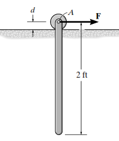\
**Çözüm:**\
Tekerlek kütlesiz olduğu için F direkt pime iletilir.

Pimdeki kuvvet $A_{x} = F = 67$ N

Çubuk için moment (G'ye göre):

$A_{x}(L/2) = I_{G}\alpha$

$A_{x}(L/2) = (\frac{1}{12}mL^{2})\alpha$

Ayrıca

$A_{x} = ma_{G,x} = \alpha d$

Bu sistem çözülürse

$\alpha \approx 145$ rad/sn2

**Soru 27**\
180 lb (81 kg) kütleli makara ($k_{A} = 1.25$ ft) ile 5 lb (2.3 kg) blok birbirine bağlıdır. Sistem serbest bırakıldığında, bloğun ivmesi nedir? (İp makaranın iç yarıçapına sarılı, $r_{i} = 1.5$ ft).

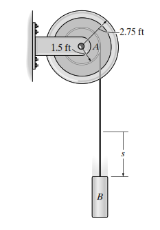\
**Çözüm:**\
Blok için: $mg - T = ma$

Makara için: $T \cdot r_{i} = I_{O}\alpha$

Kinematik: $a = \alpha r_{i}$

Birleştirilirse: $a = \frac{g}{1 + I_{O}/(m_{blok}r_{i}^{2})}$

$a \approx 0.75$ m/sn2

**Soru 28**\
**Referans:** Kaynak 1 (Hibbeler 17-80)\
**Soru:** Bir hortum makarası, üzerindeki hortumun çekilmesiyle ($P = 200$ N) yerde yuvarlanıyor. Hortumun kütlesi değişkendir ancak bir anlık analizde toplam kütle 500 kg, $k_{O} = 0.48$ m, dış yarıçap $R = 0.6$ m olsun. Kaymadan yuvarlanma durumunda açısal ivme nedir? (Çekme kuvveti üstten yatay).

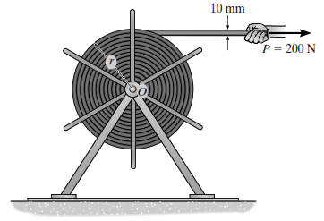\
**Çözüm:**\
IC noktası yerdedir.\
Moment (IC'ye göre):

$P(2R) = I_{IC}\alpha$

$I_{IC} = I_{G} + mR^{2} = m(k_{O}^{2} + R^{2})$

$200(1.2) = 500({0.48}^{2} + {0.6}^{2})\alpha$

$240 = 500(0.23 + 0.36)\alpha = 295\alpha$

$\alpha \approx 0.81$ rad/sn2

**Soru 29**\
500 kg'lık beton boru ($r = 0.5$ m) kamyon kasasında taşınıyor. Kamyon $a = 3$ m/sn2 ile hızlanıyor. Boru kaymadan yuvarlanıyorsa (kamyon kasasına göre) borunun açısal ivmesi nedir?

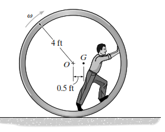

**Çözüm:**\
Bağıl ivme prensibi. Eylemsizlik kuvveti

$F_{eyl} = ma_{kam}$

kütle merkezine etki eder (geriye doğru).\
Sürtünme kuvveti $f$ ileri doğrudur (dönmeyi sağlar).

Moment (G'ye göre): $f \cdot r = I_{G}\alpha$

Yatay kuvvet: $ma_{kam} - f = ma_{G/kam}$

Kinematik: $a_{G/kam} = r\alpha$

Çözüm:

$\alpha = a_{kam}/(1.5r) = 3/(1.5 \cdot 0.5) = 4$ rad/sn2

**Soru 30**\
**Referans:** Kaynak 1 (Hibbeler 17-66)\
**Soru:** "Vurma Merkezi" (Center of Percussion) kavramına göre; O noktasından asılı bir çubuğa, mesnet tepkisinin sıfır olması için kuvvet nereye uygulanmalıdır? (Çubuk boyu L, kütle m).

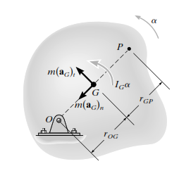

**Çözüm:**

$P$ noktası (Vurma merkezi) ile askı noktası $O$ arasındaki mesafe $q = k_{O}^{2}/\overset{ˉ}{r}$

İnce çubuk için $O$ ucunda $I_{O} = \frac{1}{3}mL^{2}$ ,

kütle merkezi mesafesi $\overset{ˉ}{r} = L/2$

$k_{O}^{2} = I_{O}/m = L^{2}/3$

$q = (L^{2}/3)/(L/2) = 2L/3$

Kuvvet, askı noktasından $2L/3$ mesafesine uygulanmalıdır.

**Soru 31:**

8 kg disk ve buna bağlı 10 kg çubuktan oluşan sistem serbest bırakılıyor. Disk eğik düzlemde ($30^{\circ}$) kaymadan yuvarlanıyor. Sistemin başlangıçtaki açısal ivmesi nedir?

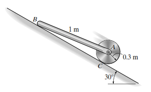\
**Çözüm:**\
Enerji yöntemi veya D'Alembert ilkesi (Sanal iş) ile çözülür.\
Toplam potansiyel enerji değişimi tork yaratır. Toplam eylemsizlik momenti dönmeye karşı koyar.

$$
\Sigma M_{IC} = \Sigma(I_{IC}\alpha + ma\ldots)
$$

Hesaplama sonucunda $\alpha \approx 13.4$ rad/sn2

**Soru 32**\
**Referans:** Kaynak 1 (Hibbeler 17-98)\
**Soru:** 30 lb (13.6 kg) ağırlığındaki tekerlek ($k_{G} = 0.6$ ft) eğik düzlemden aşağı yuvarlanıyor. Statik sürtünme katsayısı $\mu_{s} = 0.2$ . Tekerleğin kaymadan yuvarlanabileceği maksimum eğim açısı $\theta$ nedir?

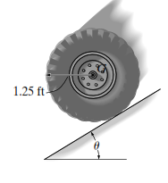\
**Çözüm:**\
Kayma sınırında $F_{s} = \mu_{s}N$

Hareket denklemleri:

$mg\sin\theta - F_{s} = ma$

$N - mg\cos\theta = 0$

$F_{s}r = I_{G}\alpha = mk_{G}^{2}(a/r)$\
Buradan $\tan\theta$ çekilir.

$\tan\theta = \frac{\mu_{s}(1 + mr^{2}/I_{G})}{1}$

. Yada direkt formül ile;

$\tan\theta = \mu_{s}(1 + (r/k_{G})^{2})$

$\theta \approx 47^{\circ}$
