**Titreşim – Ünite 8 Sayısal Test Soruları ve Çözümleri**

**Soru 19**

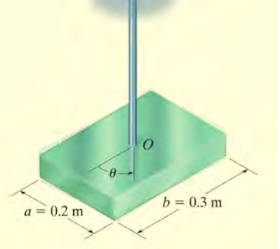

**Soru:** Şekildeki sistemde 10 kg kütleli plaka çubuk dönmesiyle titreşim hareketi yapmaktadır. Çubuğun dönme rijitliği (k) 1,5 N\*m/rad olduğuna göre sistemin titreşim denklemi nedir? Çubuğun kütlesini ihmal ediniz. (a = 0.2 m, b = 0.3 m)

**Çözüm:**\
Bu bir burulma titreşimi sorusudur. Hareket denklemi I \* (d²θ/dt²) + k \* θ = 0 formundadır.

1.  **Eylemsizlik Momenti (I) Hesabı:**\
    Dikdörtgen levhanın kütle merkezine göre eylemsizlik momenti formülü: I = m \* (a² + b²) / 12\
    m = 10 kg, a = 0.2 m, b = 0.3 m\
    I = 10 \* (0.2² + 0.3²) / 12\
    I = 10 \* (0.04 + 0.09) / 12\
    I = 10 \* 0.13 / 12\
    I ≈ 0.1083 kg·m²

2.  **Denklemin Yazılması:**\
    k (dönme rijitliği) = 1,5 olarak verilmiş.\
    Yerine koyarsak:\
    **0,1083 d²θ/dt² + 1,5θ = 0**

**Soru 20**

**Soru:** Şekildeki sistemde 10 kg kütleli plaka çubuk dönmesiyle titreşim hareketi yapmaktadır. Çubuğun dönme rijitliği (k) 1,5 N\*m/rad olduğuna göre sistemin doğal periyodu nedir?

**Çözüm:**\
Doğal periyot T = 2π / ω_n formülüyle bulunur. Doğal frekans ise ω_n = √(k / I) dır.

1.  **Doğal Frekans (ω_n):**\
    I ≈ 0.1083 (Soru 19'dan bulundu), k = 1.5\
    ω_n = √(1.5 / 0.1083) ≈ √13.85 ≈ 3.72 rad/s

2.  **Periyot (T):**\
    T = 2 \* 3.14 / 3.72\
    T ≈ **1,69 s**

**Soru 21**

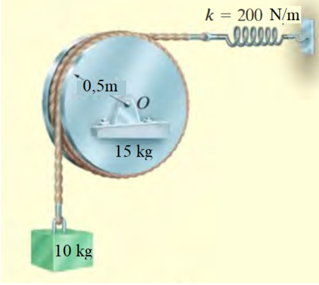

**Soru:** Şekildeki 10 kg kütleli blok, 15 kg’lık disk ve k=200N/m’lik yay yardımıyla dönerek titreşim hareketi yapmaktadır. Titreşim hareketinin denklemini bulunuz. (Disk yarıçapı r = 0,5m)

**Çözüm:**\
Sistem bir sabit eksen etrafında dönen disk ve ona bağlı kütleden oluşur.

1.  **Toplam Eşdeğer Eylemsizlik Momenti (I_eş):**\
    Diskin kendi eylemsizliği: I_disk = (1/2) \* M_disk \* r²\
    I_disk = 0.5 \* 15 \* 0.5² = 1.875 kg·m²\
    Asılı kütlenin (m_blok) dönme merkezine etkisi: I_blok = m_blok \* r²\
    I_blok = 10 \* 0.5² = 2.5 kg·m²\
    Toplam I_eş = 1.875 + 2.5 = 4.375 kg·m²

2.  **Yayın Döndürme Etkisi (Tork Sabiti):**\
    Yay r mesafesinde bağlı olduğu için, küçük açılı titreşimde yaydaki uzama x = r \* θ olur.\
    Yay kuvveti F = k \* (r \* θ).\
    Tork M = F \* r = k \* r² \* θ.\
    Buradan eşdeğer dönme yay sabiti k_t = k \* r² olur.\
    k_t = 200 \* 0.5² = 50 N·m/rad.

3.  **Hareket Denklemi:**\
    I_eş \* (d²θ/dt²) + k_t \* θ = 0\
    4.375 \* (d²θ/dt²) + 50 \* θ = 0\
    Her tarafı 4.375'e bölelim:\
    d²θ/dt² + (50 / 4.375) \* θ = 0\
    **d²θ/dt² + 11,43θ = 0**

**Soru 22**

**Soru:** Şekildeki 10 kg kütleli blok, 15 kg’lık disk ve k=200N/m’lik yay yardımıyla dönerek titreşim hareketi yapmaktadır. Titreşim hareketinin doğal periyodunu bulunuz.

**Çözüm:**\
Bir önceki soruda hareket denklemi d²θ/dt² + 11,43θ = 0 bulunmuştu.\
Burada θ'nın katsayısı doğal frekansın karesidir (ω_n²).

1.  ω_n² = 11.43 =\> ω_n = √11.43 ≈ 3.38 rad/s

2.  Periyot T = 2π / ω_n\
    T = 2 \* 3.14 / 3.38\
    T ≈ **1,86 s**

**Soru 23**

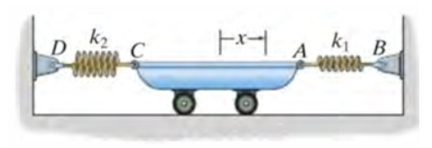

**Soru:** Şekildeki titreşim hareketinin doğal periyodu nedir? k1=100 N/m, k2=200 N/m, m=100 kg. (Şekilde araba iki yaya bağlı)

**Çözüm:**\
Yaylar kütleye paralel bağlıdır (kütle hareket ettiğinde her iki yay da aynı miktar deforme olur ve kuvvetler toplanır).

1.  **Eşdeğer Yay Sabiti:**\
    k_eş = k1 + k2 = 100 + 200 = 300 N/m

2.  **Doğal Frekans:**\
    ω_n = √(k_eş / m) = √(300 / 100) = √3 ≈ 1.732 rad/s

3.  **Periyot:**\
    T = 2π / ω_n = 6.28 / 1.732\
    T ≈ **3,63 s**

**Soru 24**

**Soru:** Şekildeki titreşim hareketinin denklemi nedir? k1=100 N/m, k2=200 N/m, m=100 kg

**Çözüm:**\
Hareket denklemi m \* (d²x/dt²) + k_eş \* x = 0 şeklindedir.

1.  m = 100, k_eş = 300 (bir önceki sorudan).

2.  100 \* (d²x/dt²) + 300 \* x = 0

3.  Her tarafı 100'e bölelim:\
    **d²x/dt² + 3x = 0**

**Soru 25**

**Soru:** Şekildeki titreşim hareketinin denklemi nedir? k1=10 N/m, m=10 kg. (Şekilde yaylı makara sistemi var)

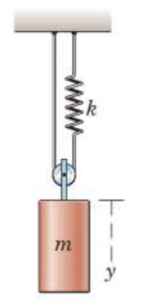

**Çözüm:**\
Şekildeki hareketli makara sisteminde, kütle (m) aşağıya y kadar hareket ederse, ipin her iki kolu da uzamalıdır, bu nedenle makaranın merkezine bağlı ip toplamda hareketi kompanse etmek için yayda 2y kadar uzama yaratır (sabit uç ve yay ucu geometrisine göre).\
Enerji yöntemi veya kuvvet analizi ile:\
Kütle y kadar yer değiştirirse, yay 2y kadar uzar.\
Yaydaki kuvvet F_yay = k \* (2y).\
İpteki gerilme T = F_yay = 2ky.\
Makara üzerindeki yukarı yönlü toplam kuvvet 2T (çünkü ip makarayı iki koldan tutar).\
Geri çağırıcı kuvvet = 2 \* T = 2 \* (2ky) = 4ky.\
Sistemin eşdeğer yay sabiti k_eş = 4k olur.

1.  k_eş = 4 \* 10 = 40 N/m

2.  Denklem: m \* y'' + k_eş \* y = 0\
    10 \* y'' + 40 \* y = 0\
    Sadeleştirirsek (10'a böl):\
    **d²y/dt² + 4y = 0**

**Soru 26**

**Soru:** Şekildeki titreşim hareketinin doğal periyodu nedir? k=10 N/m, m=10 kg

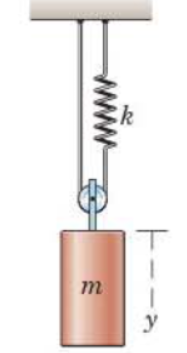

**Çözüm:**\
Bir önceki soruda denklem d²y/dt² + 4y = 0 bulunmuştu.

1.  ω_n² = 4 =\> ω_n = 2 rad/s

2.  Periyot T = 2π / ω_n\
    T = 2π / 2\
    T = **π** (veya yaklaşık 3.14)

**Soru 27**

**Soru:** Sistemde göçme olabilmesi için k/m değeri ne olmalıdır? (F = -7 sin 2t)

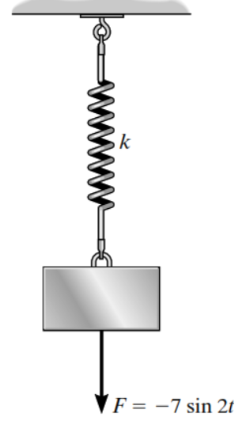

**Çözüm:**\
"Göçme" (rezonans) durumu, dış kuvvetin frekansının sistemin doğal frekansına eşit olması durumunda gerçekleşir.

1.  Dış kuvvet F(t) = -7 sin(2t). Buradan kuvvetin frekansı ω_f = 2 rad/s.

2.  Rezonans şartı: ω_n = ω_f.

3.  Sistemin doğal frekansı ω_n = √(k/m).

4.  √(k/m) = 2\
    Her iki tarafın karesini alırsak:\
    **k/m = 4**

**Soru 28**

**Soru:** Sistemde göçme olabilmesi için doğal periyot ne olmalıdır? (F = -7 sin 2t)

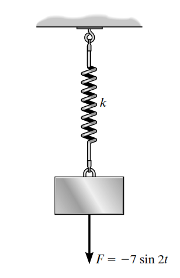

**Çözüm:**\
Rezonans için doğal frekansın, kuvvetin frekansına (2 rad/s) eşit olması gerekir.

1.  ω_n = 2 rad/s

2.  Doğal Periyot T_n = 2π / ω_n\
    T_n = 2π / 2\
    T_n = **π**

**Soru 29**

**Soru:** Sistemde göçme olabilmesi için m değeri ne olmalıdır? (k = 10 N/m olan iki paralel yay, F = 8 cos 3t)

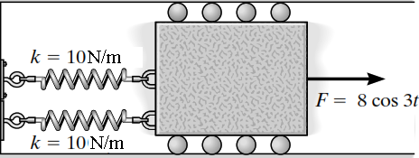

**Çözüm:**

1.  **Sistem Özellikleri:**\
    Kuvvet frekansı ω_f = 3 rad/s (cos 3t'den).\
    Yaylar paralel bağlı olduğu için eşdeğer yay sabiti: k_eş = 10 + 10 = 20 N/m (Görselde kutunun iki tarafında yaylar var, paralel çalışırlar).

2.  **Rezonans Şartı:**\
    ω_n = ω_f = 3\
    √(k_eş / m) = 3\
    √(20 / m) = 3\
    20 / m = 9 (Karesini aldık)\
    m = 20 / 9\
    m ≈ **2,22 kg**

**Soru 30**

**Soru:** Sistemin titreşim hareketi yapabilmesi için c değeri ne olmalıdır? (Kütle: Q29'da bulunan m=2.22 kg, Yay: k=20 N/m varsayımıyla)

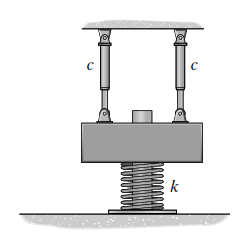

**Çözüm:**\
Bir sistemin titreşim hareketi yapabilmesi için "Sönümlü" (Underdamped) olması gerekir. Bu da sönüm katsayısı c'nin kritik sönüm değeri c_kritik'ten küçük olması demektir (ζ \< 1).

1.  **Kritik Sönüm Hesabı:**\
    c_kritik = 2 \* √(k_eş \* m)\
    Önceki sorudan m ≈ 2.22 kg ve k_eş = 20 N/m alırsak:\
    c_kritik = 2 \* √(20 \* 2.22)\
    c_kritik = 2 \* √44.4\
    c_kritik ≈ 2 \* 6.66 = 13.32 Ns/m

2.  **Şart:**\
    c \< 13.32 olmalıdır.\
    Şıklarda bu durumu sağlayan ve en yakın mantıklı üst sınır **c \< 10**'dur. (Not: Soru Q29 ile bağlantılı düşünülmüştür).

**Soru 31**

**Soru:** Sistemin titreşim hareketi yapabilmesi için c değeri ne olmalıdır? (Şekilde 30 kN/m yay ve 35 kg kütle verilmiş)

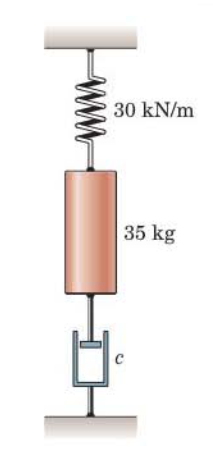

**Çözüm:**\
Titreşim (salınım) olabilmesi için sistem "Az Sönümlü" (Underdamped) olmalıdır.\
Şart: c \< c_kritik

1.  **Verilenler:**\
    k = 30 kN/m = 30,000 N/m\
    m = 35 kg

2.  **Kritik Sönüm Hesabı:**\
    c_kritik = 2 \* √(k \* m)\
    c_kritik = 2 \* √(30000 \* 35)\
    c_kritik = 2 \* √(1,050,000)\
    c_kritik ≈ 2 \* 1024.7\
    c_kritik ≈ 2049.4 Ns/m

3.  **Sonuç:**\
    Titreşim olması için **c \< 2049,4** olmalıdır.

**Soru 32**

**Soru:** Modelde 1000kg kütleli sonsuz rijit kiriş, elastik kolonlarla ankastre olarak zemine bağlanmıştır. Tek kolona yatay P kuvveti uygulandığında kolon δ = (PL³)/12EI ötelenmektedir. Yapıya deprem yükü etki ediyor ve rezonans nedeniyle yapı yıkılıyor. Periyot T = 3,14s olduğuna göre yapının yüksekliği L kaç m'dir? (EI = 36x10⁴)

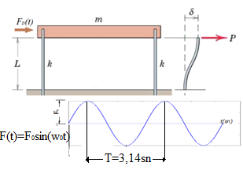

**Çözüm:**

1.  **Verilenler:**\
    m = 1000 kg\
    T = 3.14 sn ≈ π sn\
    EI = 360,000\
    Yapı: 2 adet kolon var (Şekilde iki ayaklı bir çerçeve görülüyor).

2.  **Rijitlik (k) Hesabı:**\
    Tek kolon için deplasman formülü verilmiş: δ = P / k_tek =\> k_tek = 12EI / L³.\
    Sistemde 2 kolon paralel olduğu için toplam rijitlik: k_toplam = 2 \* (12EI / L³) = 24EI / L³.

3.  **Frekans Hesabı:**\
    Periyot T ≈ π ise, doğal frekans ω_n = 2π / T = 2 rad/s olur.

4.  **L'nin Çekilmesi:**\
    ω_n² = k_toplam / m\
    2² = (24EI / L³) / 1000\
    4 = (24 \* 360,000) / (1000 \* L³)\
    4 = 8,640 / L³\
    L³ = 8,640 / 4\
    L³ = 2160\
    L = ∛2160\
    **L ≈ 12,93 m**
