# İNM 203 Dinamik - Tam Soru Bankası

> **Ders:** İNM 203 Dinamik  
> **Toplam Soru Sayısı:** 317 Soru (149 Sözel Test Sorusu, 168 Çözümlü Sayısal Problem)  
> **Biçim:** Markdown + GitHub Flavored Math (LaTeX)  

---

## İçindekiler

1. [Ünite 1: Giriş ve Temel Kavramlar](#ünite-1-giriş-ve-temel-kavramlar)
   - [Sözel Sorular (20 Soru)](#ünite-1-giriş-ve-temel-kavramlar-sözel-sorular)
2. [Ünite 2: Parçacığın Kinematiği](#ünite-2-parçacığın-kinematiği)
   - [Sözel Sorular (30 Soru)](#ünite-2-parçacığın-kinematiği-sözel-sorular)
   - [Sayısal Sorular ve Çözümleri (30 Soru)](#ünite-2-parçacığın-kinematiği-sayısal-sorular-ve-çözümleri)
3. [Ünite 3: Parçacığın Kinetiği - Kuvvet ve İvme](#ünite-3-parçacığın-kinetiği---kuvvet-ve-i̇vme)
   - [Sözel Sorular (30 Soru)](#ünite-3-parçacığın-kinetiği---kuvvet-ve-i̇vme-sözel-sorular)
   - [Sayısal Sorular ve Çözümleri (20 Soru)](#ünite-3-parçacığın-kinetiği---kuvvet-ve-i̇vme-sayısal-sorular-ve-çözümleri)
4. [Ünite 4: Parçacığın Kinetiği - İş ve Enerji](#ünite-4-parçacığın-kinetiği---i̇ş-ve-enerji)
   - [Sözel Sorular (20 Soru)](#ünite-4-parçacığın-kinetiği---i̇ş-ve-enerji-sözel-sorular)
   - [Sayısal Sorular ve Çözümleri (20 Soru)](#ünite-4-parçacığın-kinetiği---i̇ş-ve-enerji-sayısal-sorular-ve-çözümleri)
5. [Ünite 5: Parçacığın Kinetiği - İtme ve Momentum](#ünite-5-parçacığın-kinetiği---i̇tme-ve-momentum)
   - [Sözel Sorular (10 Soru)](#ünite-5-parçacığın-kinetiği---i̇tme-ve-momentum-sözel-sorular)
   - [Sayısal Sorular ve Çözümleri (26 Soru)](#ünite-5-parçacığın-kinetiği---i̇tme-ve-momentum-sayısal-sorular-ve-çözümleri)
6. [Ünite 6: Rijit Cismin Düzlemsel Kinematiği](#ünite-6-rijit-cismin-düzlemsel-kinematiği)
   - [Sözel Sorular (10 Soru)](#ünite-6-rijit-cismin-düzlemsel-kinematiği-sözel-sorular)
   - [Sayısal Sorular ve Çözümleri (27 Soru)](#ünite-6-rijit-cismin-düzlemsel-kinematiği-sayısal-sorular-ve-çözümleri)
7. [Ünite 7: Rijit Cismin Düzlemsel Kinetiği](#ünite-7-rijit-cismin-düzlemsel-kinetiği)
   - [Sözel Sorular (11 Soru)](#ünite-7-rijit-cismin-düzlemsel-kinetiği-sözel-sorular)
   - [Sayısal Sorular ve Çözümleri (31 Soru)](#ünite-7-rijit-cismin-düzlemsel-kinetiği-sayısal-sorular-ve-çözümleri)
8. [Ünite 8: Mekanik Titreşimler](#ünite-8-mekanik-titreşimler)
   - [Sözel Sorular (18 Soru)](#ünite-8-mekanik-titreşimler-sözel-sorular)
   - [Sayısal Sorular ve Çözümleri (14 Soru)](#ünite-8-mekanik-titreşimler-sayısal-sorular-ve-çözümleri)

---

# Ünite 1: Giriş ve Temel Kavramlar

## Ünite 1: Giriş ve Temel Kavramlar - Sözel Sorular

**Dinamik Dersi Sözel Çoktan Seçmeli Sorular- Ünite 1: Giriş**

**1. Aşağıdakilerden hangisi dinamik bir olay değildir?**\
- A) Gökdelenin rüzgarda hafifçe sallanması
- B) Toprağa düşen bir elmanın yere çarpması
- C) Masanın üzerinde duran bir kitabın konumu
- D) Uçan bir uçağın havada ilerlemesi
- E) Salıncakta sallanan bir çocuğun hareketi

**2. Dinamiğin alt dallarından biri olan kinematik aşağıdakilerden hangisini incelemez?**\
- A) Hareketin nedenleri
- B) Hız ve ivme arasındaki ilişki
- C) Cismin konumunun zamanla değişimi
- D) Hareketin matematiksel tanımı
- E) Yol, hız ve zaman arasındaki bağıntılar

**3. Bir cismin boyutları ihmal edilebiliyorsa ve tek bir nokta olarak kabul ediliyorsa, bu cisme ne ad verilir?**\
- A) Rijit cisim
- B) Esnek cisim
- C) Parçacık
- D) Sistem
- E) Kütle

**4. Aşağıdakilerden hangisi vektörel bir büyüklük değildir?**\
- A) Hız
- B) İvme
- C) Kuvvet
- D) Kütle
- E) Yer değiştirme

**5. Aşağıdakilerden hangisi skaler bir büyüklük örneğidir?**\
- A) Zaman
- B) Hız
- C) Kuvvet
- D) İvme
- E) Yer değiştirme

**6. SI birim sisteminde kuvvet birimi nedir?**\
- A) Newton
- B) Dyne
- C) Joule
- D) Kilogram
- E) Metre

**7. Bir parçacığın üç boyutta kaç serbestlik derecesi vardır?**\
- A) 1
- B) 2
- C) 3
- D) 4
- E) 6

**8. Bir parçacığın iki boyutta kaç serbestlik derecesi vardır?**\
- A) 1
- B) 2
- C) 3
- D) 4
- E) 6

**9. Rijit bir cismin üç boyutta kaç serbestlik derecesi vardır?**\
- A) 1
- B) 2
- C) 3
- D) 4
- E) 6

**10. Rijit bir cismin iki boyutta kaç serbestlik derecesi vardır?**\
- A) 1
- B) 2
- C) 3
- D) 4
- E) 6

**11. Aşağıdakilerden hangisi dönme hareketi örneğidir?**\
- A) Düz bir yolda sabit hızla giden araba
- B) Serbest düşen bir top
- C) Dönme dolapta dönen bir çocuk
- D) Havada asılı duran bir balon
- E) Yukarı doğru fırlatılan bir taş

**12. Aşağıdakilerden hangisi öteleme hareketi örneğidir?**\
- A) Dönen bir tekerlek
- B) Salıncakta sallanan bir çocuk
- C) Düz bir yolda sabit hızla giden tren
- D) Dönme dolapta dönen bir çocuk
- E) Topaç

**13. Hangisi kinematiğin inceleme alanına girer?**\
- A) Cismin hareketine neden olan kuvvetler
- B) Cismin ivmesi ve hızı arasındaki ilişki
- C) Cismin enerjisi ve momentumu
- D) Cismin kütlesi ve ağırlığı
- E) Cismin üzerindeki sürtünme kuvveti

**14. Hangisi sadece kinetiğin inceleme alanına girer?**\
- A) Cismin hızı ve konumu
- B) Cismin ivmesi ve zaman
- C) Cismin hareketine neden olan kuvvetler
- D) Cismin yer değiştirmesi ve yönü
- E) Cismin hızı ve ivmesi arasındaki ilişki

**15. CGS birim sisteminde uzunluk birimi nedir?**\
- A) metre (m)
- B) santimetre (cm)
- C) feet (ft)
- D) kilometre (km)
- E) mil

**16. MKS birim sisteminde kütle birimi nedir?**\
- A) gram (g)
- B) kilogram (kg)
- C) pound (lb)
- D) ton
- E) ons

**17. Bir cismin konumu hangi matematiksel terim ile ifade edilir?**\
- A) Skaler
- B) Vektör
- C) Sayı
- D) Birim
- E) Nicelik

**18. Zaman nasıl bir niceliktir?**\
- A) Skaler ve vektörel
- B) Sadece vektörel
- C) Sadece skaler
- D) Birimsiz
- E) Boyutsuz

**19. İlk ciddi dinamik gözlemleri kim yapmıştır?**\
- A) Newton
- B) Galileo
- C) Einstein
- D) Kepler
- E) Archimedes

**20. Tek serbestlik dereceli sistem denilince akla ne gelir?**\
- A) Tek kütle
- B) Tek kuvvet
- C) Tek hız
- D) Tek ivme
- E) Tek hareket

**Cevap Anahtarı**

1.  **C)** Masanın üzerinde duran bir kitabın konumu

2.  **A)** Hareketin nedenleri

3.  **C)** Parçacık

4.  **D)** Kütle

5.  **A)** Zaman

6.  **A)** Newton

7.  **C)** 3

8.  **B)** 2

9.  **E)** 6

10. **C)** 3

11. **C)** Dönme dolapta dönen bir çocuk

12. **C)** Düz bir yolda sabit hızla giden tren

13. **B)** Cismin ivmesi ve hızı arasındaki ilişki

14. **C)** Cismin hareketine neden olan kuvvetler

15. **B)** santimetre (cm)

16. **B)** kilogram (kg)

17. **B)** Vektör

18. **C)** Sadece skaler

19. **B)** Galileo

20. **E)** Tek hareket

---

# Ünite 2: Parçacığın Kinematiği

## Ünite 2: Parçacığın Kinematiği - Sözel Sorular

**Dinamik Dersi Sözel Çoktan Seçmeli Sorular - Ünite 2: Parçacığın Kinematiği**

**1. Düzlemde bir parçacığın hareketini analiz ederken, parçacığın izlediği geometrik yola ne ad verilir?**\
- A) Yörünge
- B) Yer değiştirme
- C) Kat edilen mesafe
- D) Hız
- E) İvme

**2. Bir parçacığın hareketini analiz ederken, parçacığın başlangıç konumundan son konumuna olan vektörel büyüklüğü (düz çizgi uzunluğunu) hangi terim tanımlar?**\
- A) Yörünge
- B) Yer değiştirme
- C) Kat edilen mesafe
- D) Hız
- E) İvme

**3. Bir parçacığın hareketini analiz ederken, yörünge üzerinde kat ettiği toplam yolu hangi terim tanımlar?**\
- A) Yörünge
- B) Yer değiştirme
- C) Kat edilen mesafe
- D) Hız
- E) İvme

**4. Bir parçacığın belirli bir zaman aralığındaki ortalama hızını hesaplamak için hangi iki nicelik gereklidir?**\
- A) Yer değiştirme ve zaman
- B) Kat edilen mesafe ve zaman
- C) Hız ve zaman
- D) İvme ve zaman
- E) Yer değiştirme ve ivme

**5. Bir parçacığın belirli bir andaki anlık hızını temsil eden matematiksel ifade hangisidir?**\
- A) ∆𝒓 ⃗/∆𝑡
- B) 𝑑𝒓 ⃗/𝑑𝑡
- C) ∆𝒗 ⃗/∆𝑡
- D) 𝑑𝒗 ⃗/𝑑𝑡
- E) 𝑑²𝒓 ⃗/𝑑𝑡²

**6. Bir parçacığın belirli bir zaman aralığındaki ortalama ivmesini hesaplamak için hangi iki nicelik gereklidir?**\
- A) Hızdaki değişim ve zaman aralığı
- B) Kat edilen mesafe ve zaman
- C) Son hız ve zaman
- D) Yer değiştirme ve hız
- E) Yer değiştirme ve ivme

**7. Bir parçacığın belirli bir andaki anlık ivmesini temsil eden matematiksel ifade hangisidir?**\
- A) ∆𝒗 ⃗/∆𝑡
- B) 𝑑𝒗 ⃗/𝑑𝑡
- C) 𝑑²𝒓 ⃗/𝑑𝒗²
- D) 𝑑𝒓 ⃗/𝑑𝑡
- E) ∆𝒓 ⃗/∆𝑡

**8. Aşağıdakilerden hangisi bir parçacığın hızının zamana göre değişme oranını temsil eder?**\
- A) Konum
- B) Yer Değiştirme
- C) Hız
- D) İvme
- E) Sürat

**9. Bir parçacığın hızı zamana göre doğrusal olarak azalıyorsa, ivmesi hakkında ne söylenebilir?**\
- A) İvme doğrusal azalır
- B) İvme doğrusal artar
- C) İvme parabolik azalır
- D) İvme sabittir ve değeri negatiftir
- E) İvme sabittir ve değeri pozitiftir

**10. Aşağıdaki niceliklerden hangisi vektörel bir niceliktir?**\
- A) Sürat
- B) Kat edilen mesafe
- C) Konum
- D) Kütle
- E) Zaman

**11. Aşağıdaki niceliklerden hangisi skaler bir niceliktir?**\
- A) Kat edilen mesafe
- B) Hız
- C) İvme
- D) Yer değiştirme
- E) Kuvvet

**12. Bir parçacığın hareketinin sabit hızla olduğu durumda, ivmesi ne olur?**\
- A) Sıfır
- B) Sabit ve negatif
- C) Sabit ve pozitif
- D) Doğrusal olarak artar
- E) Doğrusal olarak azalır

**13. Aşağıdaki ifadelerden hangisi kesinlikle yanlıştır?**

I. Bir cismin ivmesinin büyüklüğü, cismin hızının büyüklüğünden daha büyük olabilir.\
II\. Bir cismin ivmesi sıfır ise, cismin hızı mutlaka sıfırdır.\
III\. Bir cismin ivmesinin yönü, cismin hızının yönüyle aynı yönde olabilir.

- A) Yalnız I
- B) Yalnız II
- C) I ve II
- D) II ve III
- E) I, II, ve III

**14. Aşağıdaki koordinat takımlarından hangisinin temel eksenleri, hareket yörüngesine teğet ve normal (dik) olarak tanımlanır?**\
- A) Kartezyen
- B) Silindirik
- C) Küresel
- D) Kutupsal
- E) Doğal (n-t)

**15. Aşağıdaki koordinat takımlarından hangisi sadece düzlemsel (2-D) hareketleri tanımlamak için kullanılır?**\
- A) Kartezyen
- B) Silindirik
- C) Küresel
- D) Kutupsal
- E) Bağıl

**16. Aşağıdaki kavramlardan hangileri doğrudur?**

I. Doğrusal harekette hız, ivme ve konumu skaler büyüklük olarak değerlendirebiliriz.\
II\. Anlık hız daima yörüngeye teğettir.\
III\. Kutupsal koordinatta birim vektörlerin zamana göre türevi sıfırdır.

- A) Yalnız I
- B) Yalnız II
- C) I ve II
- D) II ve III
- E) I, II ve III

**17. Doğal (n-t) koordinat takımında ivmenin normal bileşeni (an) hangi iki parametreye bağlıdır?**\
- A) Hız artışı ve zaman
- B) Yörünge fonksiyonu ve hız artışı
- C) Yörüngenin eğrilik yarıçapı ve hızın karesi
- D) Konum ve hız
- E) Yörünge fonksiyonu ve zaman

**18. Açısal ivmenin birimi ne olabilir?**\
- A) m/sn
- B) m/sn²
- C) rad
- D) rad/sn
- E) rad/sn²

**19. Kutupsal takım koordinatlarına göre çözülen bir sistemde yarıçap (r) sabitse, radyal hız (v_r) nedir?**\
- A) Sıfır
- B) Yarıçap × Açısal hız
- C) Yarıçap × Açısal ivme
- D) 2 × Yarıçap × Açısal ivme
- E) Yetersiz bilgi, bulunamaz

**20. Bir cismin hız vektörü daima yörüngeye teğet iken, ivme vektörü için aşağıdakilerden hangisi söylenebilir?**\
- A) Daima yörüngeye teğettir.
- B) Daima yörüngeye normaldir (diktir).
- C) Daima hodografa teğettir.
- D) Daima sıfırdır.
- E) Daima hız ile aynı yöndedir.

**21. "ads = vdv" kinematik denklemi, aşağıdaki hangi iki temel denklemden türetilmiştir?**\
- A) v = ds/dt ve a = sabit
- B) a = dv/dt ve s = v₀t + ½at²
- C) s = s(t) ve a = a(t)
- D) a = dv/dt ve v = ds/dt
- E) v² = v₀² + 2as ve v = ds/dt

**22. Bir roketin doğrusal hareketi sırasında yüksekliği s = s(t) olarak ölçülüyorsa, ivmesi hangi işlemle bulunur?**\
- A) a = ds/dt
- B) a = d²s/dt²
- C) a = ∫s(t) dt
- D) a = (ds/dt)²
- E) a = ds/dv

**23. Eğer bir parçacığın s-t (konum-zaman) grafiği ikinci dereceden bir parabol ise, a-t (ivme-zaman) grafiği nasıl olur?**\
- A) Üçüncü dereceden bir eğri
- B) İkinci dereceden bir parabol
- C) Eğik bir doğru
- D) Yatay bir doğru (sabit)
- E) Dikey bir doğru

**24. v-t (hız-zaman) grafiğinin altında kalan alan hangi niceliği verir?**\
- A) İvme
- B) Ortalama hız
- C) Anlık hız
- D) Yer değiştirme
- E) Yörünge

**25. a-s (ivme-konum) grafiği biliniyorsa, hızı bulmak için aşağıdaki integrallerden hangisi kullanılır?**\
- A) v = ∫a dt
- B) s = ∫v dt
- C) ∫v dv = ∫a ds
- D) v = da/dt
- E) a = v(dv/ds)

**26. Silindirik koordinatlar (r, θ, z), Kartezyen koordinatlara göre hangi iki koordinat sisteminin birleşimi olarak düşünülebilir?**\
- A) İki farklı Kartezyen sistemin
- B) Küresel ve Doğal sistemlerin
- C) Kutupsal ve tek eksenli Doğrusal sistemin
- D) Sadece Kutupsal sistemin
- E) Sadece Doğal sistemin

**27. Bağımlı hareket analizinde, birbirine esnemeyen iplerle bağlı cisimlerin hareketlerini ilişkilendirmek için temel prensip nedir?**\
- A) Newton'un ikinci yasası
- B) Enerjinin korunumu
- C) İpin toplam uzunluğunun sabit kalması
- D) Momentumun korunumu
- E) Her cismin ivmesinin eşit olması

**28. "A cisminin B cismine göre hızı" ifadesi (v_A/B) matematiksel olarak nasıl gösterilir?**\
- A) v_B - v_A
- B) v_A - v_B
- C) v_A + v_B
- D) v_A / v_B
- E) v_B / v_A

**29. Bir parçacığın yavaşladığı söylendiğinde (decelerating), bu ne anlama gelir?**\
- A) Hızı negatiftir.
- B) İvmesi negatiftir.
- C) Hızının büyüklüğü (sürati) azalmaktadır.
- D) Konumu azalmaktadır.
- E) Hızı ve ivmesi zıt yönlüdür.

**30. Eğrisel harekette, hızın sadece yönü değişiyor, büyüklüğü (sürati) sabit kalıyorsa, aşağıdakilerden hangisi doğrudur?**\
- A) Normal ivme sıfırdır.
- B) Teğetsel ivme sıfırdır.
- C) Hem normal hem teğetsel ivme sıfırdır.
- D) Bileşke ivme sıfırdır.
- E) Açısal hız sıfırdır.

**Cevap Anahtarı**

1.  **A)** Yörünge

2.  **B)** Yer değiştirme

3.  **C)** Kat edilen mesafe

4.  **A)** Yer değiştirme ve zaman

5.  **B)** 𝑑𝒓 ⃗/𝑑𝑡

6.  **A)** Hızdaki değişim ve zaman aralığı

7.  **B)** 𝑑𝒗 ⃗/𝑑𝑡

8.  **D)** İvme

9.  **D)** İvme sabittir ve değeri negatiftir

10. **C)** Konum

11. **A)** Kat edilen mesafe

12. **A)** Sıfır

13. **B)** Yalnız II (Sabit hızla hareket eden bir cismin ivmesi sıfırdır)

14. **E)** Doğal (n-t)

15. **D)** Kutupsal

16. **C)** I ve II (Kutup birim vektörlerinin yönü değiştiği için türevleri sıfır değildir)

17. **C)** Yörüngenin eğrilik yarıçapı ve hızın karesi

18. **E)** rad/sn²

19. **A)** Sıfır (Çünkü v_r = dr/dt ve r sabit olduğu için türevi sıfırdır)

20. **C)** Daima hodografa teğettir.

21. **D)** a = dv/dt ve v = ds/dt

22. **B)** a = d²s/dt²

23. **D)** Yatay bir doğru (sabit)

24. **D)** Yer değiştirme

25. **C)** ∫v dv = ∫a ds

26. **C)** Kutupsal ve tek eksenli Doğrusal sistemin

27. **C)** İpin toplam uzunluğunun sabit kalması

28. **B)** v_A - v_B

29. **C)** Hızının büyüklüğü (sürati) azalmaktadır.

30. **B)** Teğetsel ivme sıfırdır.

---

## Ünite 2: Parçacığın Kinematiği - Sayısal Sorular ve Çözümleri

**Soru 1** Bir aracın hızı v(t) = 3t² + 2t m/sn fonksiyonu ile ifade edilmiştir. t= 3sn'de aracın aldığı mesafe nedir?

**Çözüm:**\
Alınan mesafe (x), hız fonksiyonunun (v(t)) zamana (t) göre integralidir. t=0'dan t=3'e kadar belirli integral alınır.

1.  **İntegral denkleminin kurulması:**\
    x = ∫v(t) dt = ∫₀³ (3t² + 2t) dt

2.  **İntegralin alınması:**\
    ∫(3t² + 2t) dt = (3 \* t³/3) + (2 \* t²/2) = t³ + t²

3.  **Belirli integralin hesaplanması:**\
    x = \[t³ + t²\]₀³\
    x = (3³ + 3²) - (0³ + 0²)\
    x = (27 + 9) - 0\
    x = 36 m

**Soru 2** Bir aracın hızı v(t) = 3t² + 2t m/sn fonksiyonu ile ifade edilmiştir. t= 3sn'de aracın ivmesi nedir?

**Çözüm:**\
İvme (a), hızın (v) zamana göre türevidir.

1.  **Türev denkleminin kurulması:**\
    a(t) = dv/dt = d/dt (3t² + 2t)

2.  **Türev alınması:**\
    a(t) = 6t + 2

3.  **Değerin hesaplanması:**\
    a(3) = 6(3) + 2\
    a(3) = 18 + 2 = 20 m/sn²

**Soru 3** Bir parçacığın konumu x(t) = 8t - t² (t: saniye) fonksiyonu ile temsil ediliyor. 5. saniyede parçacığın kat ettiği toplam mesafe nedir?

**Çözüm:**\
Parçacığın yön değiştirip değiştirmediğini anlamak için önce hız fonksiyonu bulunur.

1.  **Hız fonksiyonunu bulma:**\
    v(t) = dx/dt = 8 - 2t

2.  **Yön değiştirme noktasını bulma (v(t)=0):**\
    8 - 2t = 0 =\> t = 4 saniye\
    Parçacık 4. saniyede yön değiştirmiştir. Bu nedenle 0-4 sn ve 4-5 sn aralıkları ayrı ayrı incelenmelidir.

3.  **Konumları hesaplama:**

    - x(0) = 8(0) - 0² = 0 m

    - x(4) = 8(4) - 4² = 32 - 16 = 16 m

    - x(5) = 8(5) - 5² = 40 - 25 = 15 m

4.  **Kat edilen mesafeyi hesaplama:**

    - 0-4 sn arası mesafe: \|x(4) - x(0)\| = \|16 - 0\| = 16 m

    - 4-5 sn arası mesafe: \|x(5) - x(4)\| = \|15 - 16\| = 1 m

    - Toplam Mesafe = 16 m + 1 m = **17 m**

**Soru 4** Başlangıç hızı sıfır olan bir parçacığın ivmesi a(v) = 0.5 \* v⁻¹ m/sn² fonksiyonu ile temsil ediliyor. 25 saniye sonunda parçacığın hızı ne olur?

**Çözüm:**\
a = dv/dt ilişkisi kullanılarak diferansiyel denklem çözülür.

1.  **Diferansiyel denklemi kurma ve düzenleme:**\
    a = dv/dt =\> 0.5 / v = dv/dt\
    v dv = 0.5 dt

2.  **İntegral alma (t=0, v=0'dan t=25, v=v_son'a):**\
    ∫₀ᵛ v dv = ∫₀²⁵ 0.5 dt

3.  **İntegralleri çözme:**

    - Sol taraf: \[v²/2\]₀ᵛ = v²/2

    - Sağ taraf: \[0.5t\]₀²⁵ = 0.5 \* 25 = 12.5

4.  **Hızı bulma:**\
    v²/2 = 12.5\
    v² = 25\
    v = 5 m/sn

**Soru 5** Bir parçacığın hızı v(x) = 0.5 \* x⁻¹ m/sn (x: konum) fonksiyonu ile temsil ediliyor. Parçacığın t=0 anında x=0 konumunda olduğu varsayılırsa, 25 saniyede ne kadar yer değiştirir?

**Çözüm:**\
v = dx/dt ilişkisi kullanılarak diferansiyel denklem çözülür.

1.  **Diferansiyel denklemi kurma ve düzenleme:**\
    v = dx/dt =\> 0.5 / x = dx/dt\
    x dx = 0.5 dt

2.  **İntegral alma (t=0, x=0'dan t=25, x=x_son'a):**\
    ∫₀ˣ x dx = ∫₀²⁵ 0.5 dt

3.  **İntegralleri çözme:**

    - Sol taraf: \[x²/2\]₀ˣ = x²/2

    - Sağ taraf: \[0.5t\]₀²⁵ = 12.5

4.  **Konumu bulma:**\
    x²/2 = 12.5\
    x² = 25\
    x = 5 m\
    Parçacık **5 metre** yer değiştirmiştir.

**Soru 6** Başlangıç hızı 4 m/sn olan bir parçacığın ivmesi a(v) = 0.5 \* v⁻¹ m/sn² ile veriliyor. Parçacık hızını 5 m/sn'ye kaç saniyede çıkarır?

**Çözüm:**\
a = dv/dt ilişkisinden v dv = 0.5 dt denklemi kurulur.

1.  **İntegral alma (v=4'ten v=5'e, t=0'dan t'ye):**\
    ∫₄⁵ v dv = ∫₀ᵗ 0.5 dt

2.  **İntegralleri çözme:**

    - Sol taraf: \[v²/2\]₄⁵ = (5²/2) - (4²/2) = 12.5 - 8 = 4.5

    - Sağ taraf: \[0.5t\]₀ᵗ = 0.5t

3.  **Zamanı bulma:**\
    4.5 = 0.5t\
    t = 9 saniye

**Soru 7** Başlangıç konumu 3 m olan bir parçacığın hızı v(x) = 0.5 \* x⁻¹ m/sn ile veriliyor. Parçacık 5 m konumuna ne kadar sürede ulaşır?

**Çözüm:**\
v = dx/dt ilişkisinden x dx = 0.5 dt denklemi kurulur.

1.  **İntegral alma (x=3'ten x=5'e, t=0'dan t'ye):**\
    ∫₃⁵ x dx = ∫₀ᵗ 0.5 dt

2.  **İntegralleri çözme:**

    - Sol taraf: \[x²/2\]₃⁵ = (5²/2) - (3²/2) = 12.5 - 4.5 = 8

    - Sağ taraf: \[0.5t\]₀ᵗ = 0.5t

3.  **Zamanı bulma:**\
    8 = 0.5t\
    t = 16 saniye

**Soru 8** Başlangıç hızı sıfır olan parçacığın ivmesi a(x) = 4x m/sn² fonksiyonu ile temsil ediliyor. 2 m yer değiştirince hızı ne olur?

**Çözüm:**\
İvme, hız ve konum arasındaki zamandan bağımsız a dx = v dv ilişkisi kullanılır.

1.  **Formülde yerine koyma:**\
    (4x) dx = v dv

2.  **İntegral alma (x=0'dan 2'ye, v=0'dan v'ye):**\
    ∫₀² (4x) dx = ∫₀ᵛ v dv

3.  **İntegralleri çözme:**

    - Sol taraf: \[2x²\]₀² = 2(2)² - 0 = 8

    - Sağ taraf: \[v²/2\]₀ᵛ = v²/2

4.  **Hızı bulma:**\
    8 = v²/2 =\> v² = 16 =\> v = 4 m/sn

**Soru 9** Başlangıç hızı sıfır olan parçacığın ivmesi a(x) = 4x m/sn² ile veriliyor. Hızı 36 m/sn olduğunda ne kadar yer değiştirmiştir?

**Çözüm:**\
a dx = v dv ilişkisi kullanılır.

1.  **İntegral alma (x=0'dan x'e, v=0'dan 36'ya):**\
    ∫₀ˣ (4x) dx = ∫₀³⁶ v dv

2.  **İntegralleri çözme:**

    - Sol taraf: \[2x²\]₀ˣ = 2x²

    - Sağ taraf: \[v²/2\]₀³⁶ = 36²/2 = 1296/2 = 648

3.  **Yer değiştirmeyi bulma:**\
    2x² = 648 =\> x² = 324 =\> x = 18 m

**Soru 10** Şekildeki hava balonunun yatay konumu x = 8t (m), yörüngesi ise y = x²/10 ile tanımlanmıştır. t=2 saniye olduğunda bileşke hızın büyüklüğü m/sn cinsinden nedir?

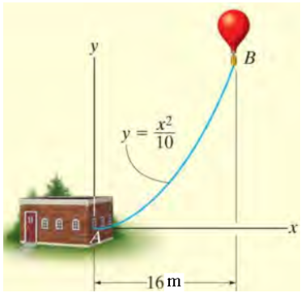

**Çözüm:**

1.  **Hızın x-Bileşenini (vx) Bulma:**\
    vx = dx/dt = d/dt (8t) = 8 m/sn (sabit)

2.  **Hızın y-Bileşenini (vy) Bulma (Zincir Kuralı):**\
    vy = dy/dt = (dy/dx) \* (dx/dt)\
    dy/dx = d/dx (x²/10) = 2x/10 = x/5\
    vy = (x/5) \* vx = (x/5) \* 8 = 8x/5

3.  **Değerleri t=2 saniye için Hesaplama:**

    - x(2) = 8 \* 2 = 16 m

    - vx = 8 m/sn

    - vy = 8 \* (16) / 5 = 128 / 5 = 25.6 m/sn

4.  **Bileşke Hızın Büyüklüğünü Bulma:**\
    v = √(vx² + vy²) = √(8² + 25.6²) = √(64 + 655.36)\
    v = √(719.36) ≈ 26.82 m/sn

**Soru 11** Şekildeki hava balonunun yatay konumu x = 8t (m), yörüngesi ise y = x²/10 ile tanımlanmıştır. t=2 saniye olduğunda bileşke hızın x ekseni ile yaptığı açı derece cinsinden nedir?

**Çözüm:**

1.  **Hız Bileşenlerini Bulma:** vx = dx/dt = 8 m/sn, vy = (x/5) \* vx ve x(2) = 16 m olduğundan:

    - vx = 8 m/sn

    - vy = 25.6 m/sn

2.  **Açıyı Hesaplama:**\
    tan(θ) = vy / vx = 25.6 / 8 = 3.2\
    θ = arctan(3.2) ≈ 72.65°

**Soru 12**\
Şekildeki hava balonunun yatay konumu x = 8t (m), yörüngesi ise y = x²/10 ile tanımlanmıştır. t=2 saniye olduğunda balonun düşey hızı (v_y) ne kadardır?

**Çözüm:**\
1.  **t=2 anındaki x konumu:** x(2) = 8 \* 2 = 16 m

2.  **vy denklemi:** vy = 8x/5

3.  **Değeri yerine koyma:** vy = 8 \* 16 / 5 = 128 / 5 = 25.6 m/sn

**Soru 13** Şekilde gösterilen bir çuval, 12 m/s yatay hızla 6 m yükseklikteki bir rampadan kaymaktadır. Çuvalın yere çarpması için gereken süre nedir? (g = 9.81 m/sn²)

**Çözüm:**\
Düşme süresi sadece dikey hareketle ilgilidir. Yatay hız süreyi etkilemez.\
h = v_y₀\*t + ½gt²

- Başlangıç dikey hız (v_y₀) = 0

- Yükseklik (h) = 6 m\
  6 = 0 \* t + ½ \* (9.81) \* t²\
  6 = 4.905 \* t²\
  t² = 6 / 4.905 ≈ 1.2232\
  t ≈ 1.11 saniye

**Soru 14** Şekilde gösterilen bir çuval, 12 m/s yatay hızla 6 m yükseklikteki bir rampadan kaymaktadır. Çuvalın yatayda kat ettiği mesafe (R) nedir? (g = 9.81 m/sn²)

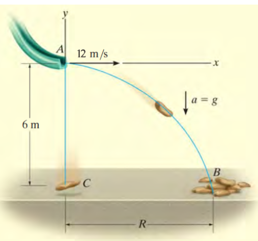

**Çözüm:**\
Önce düşme süresi dikey hareketten bulunur: 6 = ½ \* 9.81 \* t² =\> t ≈ 1.11 sn.\
Yatay hareket sabit hızlıdır: R = vx \* t

- Yatay hız (vx) = 12 m/sn

- Uçuş süresi (t) ≈ 1.11 sn\
  R = 12 \* 1.11 ≈ 13.32 metre

**Soru 15** 3 m yükseklikteki bir rampadan 30° açıyla fırlatılan bir motosiklet 2 sn sonra yere düşüyor. Rampadan ayrılma hızı (v_A) nedir? (g = 10 m/sn²)

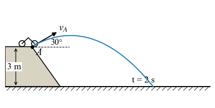

**Çözüm:**\
Dikey hareket denklemi kullanılır.\
y = y₀ + (v_A \* sinα) \* t - ½gt²

- y = 0 (son konum)

- y₀ = 3 m (ilk konum)

- α = 30°

- t = 2 sn\
  0 = 3 + (v_A \* sin30°) \* 2 - ½ \* 10 \* 2²\
  0 = 3 + (v_A \* 0.5) \* 2 - 5 \* 4\
  0 = 3 + v_A - 20\
  0 = v_A - 17\
  v_A = 17 m/sn

**Soru 16** P noktasında hızı 6m/sn olan bir buz patencisi, hızını sabit 1 m/sn² ivmeyle artırıyor. 4 saniye sonra ivmenin teğetsel bileşeni ne olur?

**Çözüm:**\
Teğetsel ivme (at), hızın büyüklüğündeki değişim oranıdır. Soruda bu değerin hareket boyunca sabit ve 1 m/sn² olduğu doğrudan verilmiştir. Dolayısıyla 4 saniye sonra da teğetsel ivme **1 m/sn²**'dir.

**Soru 17** P noktasında hızı 6m/sn olan bir buz patencisi, hızını sabit 1 m/sn² ivmeyle artırıyor. 4 saniye sonra ivmenin normal bileşeni (an) nedir? (r=20m)

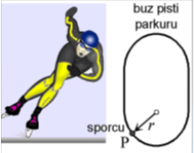

**Çözüm:**\
Normal ivme an = v²/r formülü ile bulunur. Önce 4 saniye sonraki hız bulunmalıdır.

1.  **4 Saniye Sonraki Hızı Hesaplama:**\
    v = v₀ + at \* t = 6 + (1 \* 4) = 10 m/sn

2.  **Normal İvmenin Hesaplanması:**\
    an = v²/r = 10² / 20 = 100 / 20 = 5 m/sn²

**Soru 18** Parabolik bir yörüngede kayan bir kayakçının hızı 6 m/sn ve hızının artış oranı (teğetsel ivme) 2 m/sn²'dir. O andaki normal ivmesi 1.27 m/sn² ise, bileşke ivmenin büyüklüğü nedir?

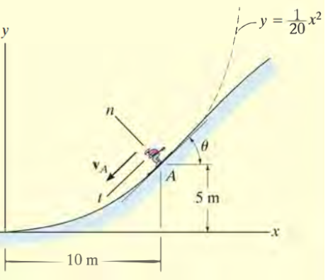

**Çözüm:**\
Bileşke ivme, teğetsel ve normal bileşenlerin vektörel toplamıdır.\
a = √(at² + an²)

- at = 2 m/sn²

- an ≈ 1.27 m/sn²\
  a = √(2² + 1.27²) = √(4 + 1.61) = √5.61 ≈ 2.37 m/sn²

**Soru 19** Parabolik bir yörüngede kayan bir kayakçının hızının artış oranı (teğetsel ivme) 2 m/sn², normal ivmesi 1.27 m/sn²'dir. Bileşke ivme vektörünün x ekseni ile yaptığı açı nedir? (Kayakçının bulunduğu noktadaki eğim açısı 45°'dir.)

**Çözüm:**\
Bu karmaşık bir problemdir. İvme bileşenlerini x-y koordinatlarına dönüştürmek gerekir.

1.  **Eksenleri Tanımlama:** Teğet yönü, pozitif x-ekseniyle 225° açı yapar. Normal yönü ise buna dik ve eğrilik merkezine doğru, yani 135° açı yapar.

2.  **Teğetsel İvmenin Bileşenleri:**

    - a_tx = at \* cos(225°) = 2 \* (-√2/2) ≈ -1.414 m/sn²

    - a_ty = at \* sin(225°) = 2 \* (-√2/2) ≈ -1.414 m/sn²

3.  **Normal İvmenin Bileşenleri:**

    - a_nx = an \* cos(135°) = 1.27 \* (-√2/2) ≈ -0.9 m/sn²

    - a_ny = an \* sin(135°) = 1.27 \* (√2/2) ≈ 0.9 m/sn²

4.  **Bileşke İvmenin x ve y Bileşenleri:**

    - ax = a_tx + a_nx = -1.414 - 0.9 = -2.314 m/sn²

    - ay = a_ty + a_ny = -1.414 + 0.9 = -0.514 m/sn²

5.  **Açının Hesaplanması:**\
    Vektör 3. bölgededir. Referans açı: φ_ref = arctan(\|ay/ax\|) = arctan(0.514/2.314) ≈ 12.5°\
    Pozitif x-ekseninden ölçülen açı: φ = 180° + 12.5° = 192.5°

**Soru 20**\
r=10m (sabit) yarıçaplı bir yörüngede dönen bir sepetin açısal konumu θ = 0.1t rad'dır. t=1sn'de sepetin bileşke hızı nedir?

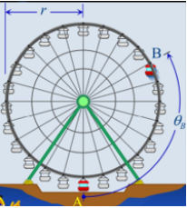

**Çözüm:**

1.  **Radyal Hız (v_r):** Yarıçap sabit olduğundan ṙ = 0. Dolayısıyla v_r = 0.

2.  **Enine Hız (v_θ):**

    - Açısal hız: θ̇ = d/dt(0.1t) = 0.1 rad/sn (sabit)

    - v_θ = r \* θ̇ = 10 \* 0.1 = 1 m/sn

3.  **Bileşke Hız:**\
    v = √(v_r² + v_θ²) = √(0² + 1²) = 1 m/sn

**Soru 21** Bir mekanizmada B bileziğinin radyal konumu r = 100t² (mm) ve açısal konumu θ = t³ (rad) olarak verilmiştir. t=1 saniye anında bileziğin bileşke hızı nedir?

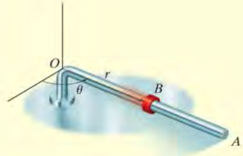

**Çözüm:**

1.  **Gerekli Değerleri t=1 için bulma:**

    - r(1) = 100(1)² = 100 mm

    - ṙ = dr/dt = 200t =\> ṙ(1) = 200 mm/sn

    - θ̇ = dθ/dt = 3t² =\> θ̇(1) = 3 rad/sn

2.  **Hız Bileşenlerini Hesaplama:**

    - Radyal hız: v_r = ṙ = 200 mm/sn

    - Enine hız: v_θ = r \* θ̇ = 100 \* 3 = 300 mm/sn

3.  **Bileşke Hızı Bulma:**\
    v = √(v_r² + v_θ²) = √(200² + 300²) = √(40000 + 90000)\
    v = √130000 ≈ 360.56 mm/sn

**Soru 22** Şekildeki makara sisteminde, motor (M) halatı 10 m/s sabit hızla kendine doğru çekmektedir. Silindir A'nın hızı nedir ve hangi yöndedir?

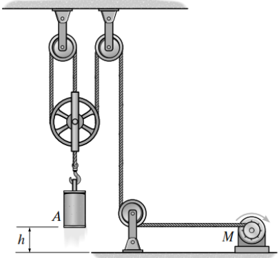

**Çözüm:**

1.  **İp Uzunluğu Denklemi:** Referans (datum) olarak üst sabit makaraların seviyesini alalım. Silindirin konumu s_A, motorun çektiği ipin ucu s_M olsun. Silindire bağlı 3 adet dikey ip segmenti vardır.\
    L = 3s_A + s_M

2.  **Zamana Göre Türev Alma:**\
    dL/dt = 3(ds_A/dt) + (ds_M/dt)\
    0 = 3v_A + v_M

3.  **Hızı Hesaplama:** Motor ipi kendine doğru çektiği için s_M artar, yani v_M = +10 m/s.\
    0 = 3v_A + 10\
    v_A = -10/3 m/sn ≈ -3.33 m/sn\
    Negatif işaret, s_A mesafesinin azaldığını, yani silindirin **yukarı doğru** hareket ettiğini gösterir. Hızı **3.33 m/sn**'dir.

**Soru 23** A ve B motorları kabloları a = 0.2t m/s² ivmesiyle çekiyor. Başlangıçta durgun olan yükün h = 4 m yükselmesi ne kadar zaman alır?

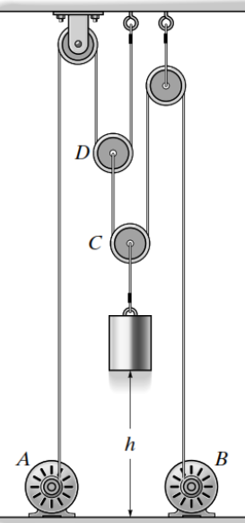

**Çözüm:**

1.  **Kinematik İlişkiyi Kurma:** İp uzunluğundan 4v_yük = 3v_motor bulunur. Bu ivmeler için de geçerlidir: a_yük = (3/4)a_motor.

2.  **Yükün İvmesi:** a_yük = (3/4) \* (0.2t) = 0.15t m/s²

3.  **İvmeden Hıza, Hızdan Konuma Geçiş (İntegral):**

    - v_yük(t) = ∫(0.15t) dt = 0.075t²

    - h(t) = ∫(0.075t²) dt = 0.025t³

4.  **Zamanı Bulma:**\
    4 = 0.025t³\
    t³ = 4 / 0.025 = 160\
    t = (160)^(1/3) ≈ 5.43 saniye

**Soru 24** A motoru kabloyu 2 m/s, B motoru ise 4 m/s hızla çekiyorsa, yükün merkezinin hızı nedir?

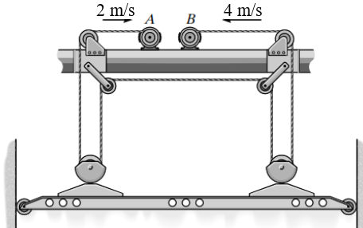

**Çözüm:**\
Yük rijit bir cisim gibi davranır. Sol tarafının hızı A motoruna, sağ tarafının hızı B motoruna bağlıdır.

1.  **Sol Tarafın Hızı:** v_sol = v_A / 2 = 2 / 2 = 1 m/s (yukarı)

2.  **Sağ Tarafın Hızı:** v_sağ = v_B / 2 = 4 / 2 = 2 m/s (yukarı)

3.  **Merkezin Hızı:** Yükün merkezinin hızı, uç noktaların hızlarının aritmetik ortalamasıdır.\
    v_yük = (v_sol + v_sağ) / 2 = (1 + 2) / 2 = 1.5 m/s (yukarı)

**Soru 25** C motoru kabloyu a_C = 3t² ivmesiyle, D motoru ise a_D = 5 m/s² ivmesiyle çekiyor. Başlangıçta aralarında 3 m olan A ve B bloklarının d=0 konumunda buluşması ne kadar sürer?

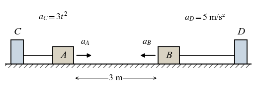

**Çözüm:**

1.  **Blokların İvmeleri:**

    - Blok A: a_A = a_C / 2 = 1.5t² (sağa, pozitif yön)

    - Blok B: a_B = a_D = 5 m/s² (sola, negatif yön, a_B = -5)

2.  **Konum Denklemleri (İki kez integral):**

    - Blok A: x_A(t) = ∫(∫1.5t² dt) dt = ∫(0.5t³) dt = 0.125t⁴

    - Blok B: x_B(t) = 3 + ∫(∫-5 dt) dt = 3 + ∫(-5t) dt = 3 - 2.5t²

3.  **Konumları Eşitleme:**\
    x_A = x_B =\> 0.125t⁴ = 3 - 2.5t²\
    0.125t⁴ + 2.5t² - 3 = 0\
    u = t² değişken değiştirmesi ile 0.125u² + 2.5u - 3 = 0. Karesel denklem çözüldüğünde pozitif kök u ≈ 1.136 bulunur.\
    t = √u ≈ √1.136 ≈ 1.07 saniye

**Soru 26** Batıya 4 m/sn hızla giden bir araba, doğuya 3 m/sn hızla giden başka bir arabayı nasıl görür?

**Çözüm:**\
Bu bir bağıl hız problemidir. Gözlemci (batıya giden) ve gözlenen (doğuya giden) belirlenir. Doğu yönü (+) olsun.\
v_bağıl = v_gözlenen - v_gözlemci\
v_bağıl = (+3) - (-4) = +7 m/sn\
Sonuç pozitif olduğu için, batıya giden araba diğer arabayı **doğuya doğru 7 m/sn hızla** gidiyormuş gibi görür.

**Soru 27** A uçağı batıya 400 km/h, B uçağı ise kuzeye 300 km/h hızla uçmaktadır. A'nın B'ye göre hızının büyüklüğü nedir?

**Çözüm:**\
Bu iki boyutlu bir bağıl hız problemidir. Doğu (+i), Kuzey (+j) olsun.

- v_A = -400i

- v_B = +300j\
  "A'nın B'ye göre hızı" v_A/B demektir.\
  v_A/B = v_A - v_B = -400i - 300j\
  Büyüklüğü: \|v_A/B\| = √((-400)² + (-300)²) = √(160000 + 90000) = √250000 = 500 km/h

**Soru 28** Bir trenin hızı şekildeki v-t grafiği ile verilmiştir. 60 saniye boyunca kat ettiği toplam mesafeyi bulunuz. (Grafikte t=0'da v=0, t=20'de v=16, t=40'da v=21, t=60'da v=24, noktalar arası geçişler doğru olacak)

**Çözüm:**\
Toplam mesafe, v-t grafiğinin altındaki alana eşittir. Alanı trapezlere bölerek hesaplayabiliriz.

- Alan 1 (0-20s): ½ \* (0 + 16) \* 20 = 160 m

- Alan 2 (20-40s): ½ \* (16 + 21) \* (40-20) = ½ \* 37 \* 20 = 370 m

- Alan 3 (40-60s): ½ \* (21 + 24) \* (60-40) = ½ \* 45 \* 20 = 450 m\
  Toplam Mesafe = 160 + 370 + 450 = **980 m**

**Soru 29** y² = 4x parabolik yolu üzerinde hareket eden bir parçacığın hızı sabit 4 m/s'dir. Parçacık x=4 m konumundayken ivmesinin büyüklüğü nedir?

**Çözüm:**\
Sabit hız, teğetsel ivmenin sıfır olduğu (at = 0) anlamına gelir. İvme, sadece normal bileşenden oluşur: a = an = v²/ρ.

1.  **Eğrilik Yarıçapını (ρ) Bulma:**

    - dy/dx: 2y(dy/dx) = 4 =\> dy/dx = 2/y

    - d²y/dx²: -2/y² \* (dy/dx) = -4/y³

    - x=4 iken y=√(4\*4) = 4.

    - dy/dx = 2/4 = 0.5

    - d²y/dx² = -4/4³ = -4/64 = -0.0625

    - ρ = \[1 + (dy/dx)²\]³/² / \|d²y/dx²\| = \[1 + 0.5²\]³/² / \|-0.0625\| = \[1.25\]³/² / 0.0625 ≈ 22.36 m

2.  **İvmeyi Bulma:**\
    a = an = v²/ρ = 4² / 22.36 = 16 / 22.36 ≈ 0.716 m/s²

**Soru 30** Bir parçacığın ivmesi a = (12t - 3t¹/²) m/s²'dir. t=0'da parçacık durgun ve konumu s=15 m ise, t=4 saniyedeki konumunu bulunuz.

**Çözüm:**

1.  **Hız Fonksiyonunu Bulma (İntegral):**\
    v(t) = ∫a dt = ∫(12t - 3t¹/²) dt = 6t² - 2t³/² + C₁\
    v(0)=0 olduğundan C₁=0. Yani v(t) = 6t² - 2t³/².

2.  **Konum Fonksiyonunu Bulma (İntegral):**\
    s(t) = ∫v dt = ∫(6t² - 2t³/²) dt = 2t³ - (4/5)t⁵/² + C₂\
    s(0)=15 olduğundan C₂=15. Yani s(t) = 2t³ - (4/5)t⁵/² + 15.

3.  **t=4 için Konumu Hesaplama:**\
    s(4) = 2(4)³ - (4/5)(4)⁵/² + 15\
    s(4) = 2(64) - (0.8)(32) + 15\
    s(4) = 128 - 25.6 + 15 = 117.4 m

---

# Ünite 3: Parçacığın Kinetiği - Kuvvet ve İvme

## Ünite 3: Parçacığın Kinetiği - Kuvvet ve İvme - Sözel Sorular

**Dinamik Dersi Sözel Çoktan Seçmeli Sorular - Ünite 3: Parçacığın Kinetiği**

**1. Newton’un ikinci hareket yasası aşağıdakilerden hangisini ifade eder?**\
- A) Bir cisme etkiyen bileşke kuvvet sıfır ise cisim hareket etmez veya sabit hızla hareket eder.
- B) Eğer bir cismin üzerine net (dengesiz) bir kuvvet etki ediyorsa, cisim o kuvvet yönünde ivmelenir.
- C) Cisim hareketsiz ise cisme etkiyen etki ve tepki kuvvetleri eşittir.
- D) Cisimler kütleçekim alanında birbirlerini kütleleri ile doğru, aralarındaki mesafenin karesi ile ters orantılı olarak çekerler.
- E) Bir cismin momentumu sadece dış kuvvetlerin etkisiyle değişir.

**2. Kinetik, dinamiğin bir alt dalı olarak temel olarak neyi inceler?**\
- A) Sadece hareketin geometrisini
- B) Cisimlerin durma koşullarını
- C) Hareketin nedenleri olan kuvvetler ile hareket arasındaki ilişkiyi
- D) Sadece cisimlerin hız ve konumlarını
- E) Cisimlerin esneklik özelliklerini

**3. Bir cismin kütlesi için aşağıdakilerden hangisi doğrudur?**\
- A) Cismin bulunduğu yere göre değişir.
- B) Vektörel bir büyüklüktür.
- C) Cismin hızındaki bir değişikliğe karşı gösterdiği direncin ölçüsüdür (eylemsizlik).
- D) SI birim sisteminde birimi Newton'dur.
- E) Yer çekimi ivmesi ile ters orantılıdır.

**4. Bir cismin ağırlığı ile ilgili aşağıdakilerden hangisi yanlıştır?**\
- A) Bir kuvvettir.
- B) Cismin bulunduğu gezegenin kütleçekim alanına bağlıdır.
- C) Cismin kütlesi ile yer çekimi ivmesinin çarpımına eşittir.
- D) Mutlak bir büyüklüktür ve evrenin her yerinde aynıdır.
- E) Yönü daima gezegenin merkezine doğrudur.

**5. Newton'un Hareket Denklemleri (ΣF = ma) hangi tür referans sisteminde geçerlidir?**\
- A) İvmelenen bir referans sistemi
- B) Sabit bir eksen etrafında dönen referans sistemi
- C) Eylemsizlik (Inertial) referans sistemi
- D) Cismin üzerine sabitlenmiş referans sistemi
- E) Herhangi bir referans sistemi

**6. Bir araba aniden hızlandığında yolcunun koltuğa doğru itilmesi hissinin temel nedeni nedir?**\
- A) Arabanın arkasından yolcuyu iten bir "eylemsizlik kuvveti"
- B) Yolcunun kütlesinin hıza karşı koyma eğilimi (eylemsizliği)
- C) Hava direncinin artması
- D) Motorun oluşturduğu tork
- E) Yer çekimi kuvvetinin artması

**7. Yay Kuvveti (Fs = ks) ile ilgili ifadelerden hangisi doğrudur?**\
- A) Büyüklüğü, yayın toplam uzunluğu ile yay sabitinin çarpımıdır.
- B) Yönü daima yayın uzama veya kısalma yönüyle aynıdır.
- C) Yönü daima yayı serbest (denge) konumuna geri getirmeye yöneliktir.
- D) Sadece çekme durumunda ortaya çıkar, sıkışma durumunda oluşmaz.
- E) Birimi Newton/metre'dir.

**8. Bir cismin serbest cisim diyagramı (Free-Body Diagram) neyi gösterir?**\
- A) Cismin hareket ettiği yörüngeyi
- B) Cismin hız ve ivme vektörlerini
- C) Cisme etki eden tüm dış kuvvetleri
- D) Cismin iç kuvvetlerinin dağılımını
- E) ma vektörünü

**9. Bir parçacıklar sistemine etki eden dış kuvvetlerin toplamı (ΣF_dış), sistemin hangi özelliği ile ilişkilidir?**\
- A) Sistemdeki her bir parçacığın ivmelerinin toplamı
- B) Sistemin toplam kütlesi ile kütle merkezinin ivmesinin çarpımı
- C) Sistemin toplam kinetik enerjisi
- D) Sistemdeki iç kuvvetlerin toplamı
- E) Sistemin toplam ağırlığı

**10. Kinetik sürtünme kuvveti (Ff = μkN) için aşağıdakilerden hangisi doğrudur?**\
- A) Hareket yönünde etki eder.
- B) Cismin hızına bağlı olarak büyüklüğü değişir.
- C) Daima cismin hareketine zıt yönde etki eder.
- D) Yüzeye dik olarak etki eder.
- E) Sadece cisim durmak üzereyken etki eder.

**11. Eğrisel bir yolda hareket eden bir parçacığın hareket denklemleri normal (n) ve teğet (t) koordinatlarda incelenmektedir. ΣFt = mat denklemi neyi ifade eder?**\
- A) Hızın yönünün nasıl değiştiğini
- B) Hızın büyüklüğünün (süratin) zamana göre nasıl değiştiğini
- C) Cismin yörüngede kalmasını sağlayan merkezcil kuvveti
- D) Yörüngenin eğrilik yarıçapını
- E) Hızın sabit olduğunu

**12. Eğrisel bir yolda hareket eden bir parçacığın hareket denklemleri normal (n) ve teğet (t) koordinatlarda incelenmektedir. ΣFn = man denklemi neyi ifade eder?**\
- A) Hızın büyüklüğünün zamana göre nasıl değiştiğini
- B) Cismin yavaşladığını veya hızlandığını
- C) Hız vektörünün yönünün zamana göre nasıl değiştiğini
- D) Cismin yörüngeden saptığını
- E) Teğetsel ivmenin sıfır olduğunu

**13. Sabit bir hızla dairesel bir yolda hareket eden bir araba için aşağıdakilerden hangisi doğrudur?**\
- A) Teğetsel ivme sıfırdır, normal ivme sıfırdan farklıdır.
- B) Normal ivme sıfırdır, teğetsel ivme sıfırdan farklıdır.
- C) Hem teğetsel hem de normal ivme sıfırdır.
- D) Net kuvvet sıfırdır.
- E) İvme, hız vektörü ile aynı yöndedir.

**14. "Merkezcil kuvvet" (Centripetal Force) ile ilgili en doğru tanım hangisidir?**\
- A) Cisme etki eden yeni ve bağımsız bir kuvvettir.
- B) Cismi yörüngeden dışarı savuran kuvvettir.
- C) Hızın büyüklüğünü değiştiren kuvvettir.
- D) Yörüngenin merkezine doğru yönelmiş olan net kuvvetin normal bileşenidir.
- E) Sadece dairesel hareketlerde ortaya çıkan sürtünme kuvvetidir.

**15. Bir parçacığın hareketi silindirik koordinatlarla (r, θ, z) inceleniyorsa, ΣFθ = maθ denklemi hangi yöndeki kuvvet ve ivme ilişkisini gösterir?**\
- A) Radyal yön
- B) Enine (Transverse) yön
- C) Dikey yön
- D) Teğetsel yön
- E) Binormal yön

**16. Bir gezegenin etrafında dairesel yörüngede dönen bir uyduya etki eden net kuvvet hangi yöndedir?**\
- A) Uydunun hız vektörü yönünde
- B) Gezegenin merkezine doğru
- C) Gezegenin merkezinden dışarı doğru
- D) Yörüngeye teğet ve hızına zıt yönde
- E) Net kuvvet sıfırdır

**17. FPS (Foot-Pound-Second) birim sisteminde kütle birimi nedir ve nasıl hesaplanır?**\
- A) Pound (lb), doğrudan ölçülür.
- B) Kilogram (kg), dönüştürülür.
- C) Slug, cismin ağırlığının (lb) yer çekimi ivmesine (ft/s²) bölünmesiyle bulunur.
- D) Gram (g), cismin ağırlığının 1000'e bölünmesiyle bulunur.
- E) Slug, cismin ağırlığı ile yer çekimi ivmesinin çarpılmasıyla bulunur.

**18. Kinetik problemlerini çözerken, kuvvet denklemlerinden (ΣF=ma) sonra genellikle hangi denklemlere ihtiyaç duyulur?**\
- A) Statik denge denklemlerine
- B) Termodinamik yasalarına
- C) Kinematik denklemlerine (hız, ivme, konum ilişkileri)
- D) Akışkanlar mekaniği denklemlerine
- E) Malzeme bilimi denklemlerine

**19. Bir parçacık yörüngesinin teğetine dik ve eğrilik merkezine doğru olan eksene ne ad verilir?**\
- A) Radyal eksen
- B) Binormal eksen
- C) Teğetsel eksen
- D) Normal eksen
- E) Z ekseni

**20. Newton'un Evrensel Kütle Çekim Yasası F = G(m₁m₂)/r² ile Ağırlık W = mg arasındaki temel fark nedir?**\
- A) Hiçbir fark yoktur, ikisi de aynı şeyi ifade eder.
- B) W=mg sadece Dünya yüzeyine yakın cisimler için geçerli bir yaklaşımdır.
- C) Evrensel Kütle Çekim Yasası sadece gezegenler için geçerlidir.
- D) W=mg daha genel bir denklemdir.
- E) G sabiti Dünya'ya özeldir.

**21. Bir kinetik probleminde, bir kuvvet bileşeni negatif (-) bir skaler değer olarak bulunursa bu ne anlama gelir?**\
- A) Hesaplamada hata yapılmıştır.
- B) Kuvvetin büyüklüğü negatiftir.
- C) Kuvvet, başlangıçta varsayılan pozitif yönün tersine etki etmektedir.
- D) Cisim yavaşlamaktadır.
- E) Cisim dönme hareketi yapmaktadır.

**22. Normal ve Teğetsel (n-t) koordinat sistemi, hangi tür hareketlerin analizinde özellikle kullanışlıdır?**\
- A) Sadece doğrusal hareketlerin
- B) Yörüngesi bilinen eğrisel hareketlerin
- C) Sadece dairesel hareketlerin
- D) Sabit ivmeli hareketlerin
- E) Rastgele üç boyutlu hareketlerin

**23. Bir parçacığın ivme vektörü daima nereye teğettir?**\
- A) Hareket yörüngesine
- B) Hız vektörüne
- C) Hodografa (hız vektörlerinin uç noktalarının geometrik yeri)
- D) Konum vektörüne
- E) Normal eksene

**24. Silindirik koordinatlarda enine yöndeki ivme bileşeni (aθ) aşağıdakilerden hangisidir?**\
- A) r̈ - rθ̇²
- B) rθ̈ + 2ṙθ̇
- C) v²/ρ
- D) v̇
- E) z̈

**25. Bir cisim üzerindeki dengesiz bir kuvvetin varlığı her zaman neye neden olur?**\
- A) Hızın artmasına
- B) Sabit hızlı harekete
- C) Yön değişikliğine
- D) İvmeye
- E) Cismin durmasına

**26. Bir kinetik problemini çözmek için en temel ve ilk adım nedir?**\
- A) Kinematik denklemlerini yazmak
- B) Serbest cisim diyagramını çizmek
- C) Bilinmeyenleri listelemek
- D) Koordinat sistemini seçmek
- E) Enerjinin korunumunu uygulamak

**27. Üç boyutlu eğrisel harekette, teğet ve normal eksenlere dik olan üçüncü eksene ne ad verilir?**\
- A) Z ekseni
- B) Radyal eksen
- C) Binormal eksen
- D) Enine eksen
- E) Dikey eksen

**28. ΣF = ma denklemi bir vektör denklemi olduğundan, Kartezyen koordinatlarda kaç adet skaler denkleme ayrılabilir?**\
- A) 1
- B) 2
- C) 3
- D) 4
- E) 6

**29. Bir cisim düz bir yolda yavaşlıyorsa, net kuvvet hangi yöndedir?**\
- A) Hareket yönünde
- B) Harekete zıt yönde
- C) Harekete dik yönde
- D) Net kuvvet sıfırdır
- E) Yönü bilinemez

**30. Bir parçacığın ivmesi biliniyorsa, hızı ve konumu bulmak için hangi matematiksel işlem uygulanır?**\
- A) Türev
- B) İntegrasyon
- C) Vektörel çarpım
- D) Logaritma
- E) Trigonometrik fonksiyonlar

**Cevap Anahtarı**

1.  **B)** Eğer bir cismin üzerine net (dengesiz) bir kuvvet etki ediyorsa, cisim o kuvvet yönünde ivmelenir.

2.  **C)** Hareketin nedenleri olan kuvvetler ile hareket arasındaki ilişkiyi

3.  **C)** Cismin hızındaki bir değişikliğe karşı gösterdiği direncin ölçüsüdür (eylemsizlik).

4.  **D)** Mutlak bir büyüklüktür ve evrenin her yerinde aynıdır.

5.  **C)** Eylemsizlik (Inertial) referans sistemi

6.  **B)** Yolcunun kütlesinin hıza karşı koyma eğilimi (eylemsizliği)

7.  **C)** Yönü daima yayı serbest (denge) konumuna geri getirmeye yöneliktir.

8.  **C)** Cisme etki eden tüm dış kuvvetleri

9.  **B)** Sistemin toplam kütlesi ile kütle merkezinin ivmesinin çarpımı

10. **C)** Daima cismin hareketine zıt yönde etki eder.

11. **B)** Hızın büyüklüğünün (süratin) zamana göre nasıl değiştiğini

12. **C)** Hız vektörünün yönünün zamana göre nasıl değiştiğini

13. **A)** Teğetsel ivme sıfırdır, normal ivme sıfırdan farklıdır.

14. **D)** Yörüngenin merkezine doğru yönelmiş olan net kuvvetin normal bileşenidir.

15. **B)** Enine (Transverse) yön

16. **B)** Gezegenin merkezine doğru

17. **C)** Slug, cismin ağırlığının (lb) yer çekimi ivmesine (ft/s²) bölünmesiyle bulunur.

18. **C)** Kinematik denklemlerine (hız, ivme, konum ilişkileri)

19. **D)** Normal eksen

20. **B)** W=mg sadece Dünya yüzeyine yakın cisimler için geçerli bir yaklaşımdır.

21. **C)** Kuvvet, başlangıçta varsayılan pozitif yönün tersine etki etmektedir.

22. **B)** Yörüngesi bilinen eğrisel hareketlerin

23. **C)** Hodografa (hız vektörlerinin uç noktalarının geometrik yeri)

24. **B)** rθ̈ + 2ṙθ̇

25. **D)** İvmeye

26. **B)** Serbest cisim diyagramını çizmek

27. **C)** Binormal eksen

28. **C)** 3

29. **B)** Harekete zıt yönde

30. **B)** İntegrasyon

---

## Ünite 3: Parçacığın Kinetiği - Kuvvet ve İvme - Sayısal Sorular ve Çözümleri

# 

**Soru 1** 

Başlangıçta durmakta olan 3000 kg'lık bir döküm parçası, sabit bir ivme ile 0.3 saniyede 0.2 m/s'lik bir hıza ulaştırılıyor. Parçanın ivmesi nedir?

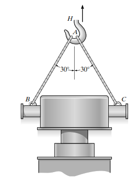

**Çözüm:**\
Bu bir kinematik problemidir. Sabit ivmeli hareket denklemlerinden biri kullanılır.\
Verilenler:

- Başlangıç hızı (v₀) = 0 m/s (durgun halden)

- Son hız (v) = 0.2 m/s

- Süre (t) = 0.3 s

Kullanılacak denklem: v = v₀ + a\*t\
0.2 = 0 + a \* (0.3)\
a = 0.2 / 0.3\
a = 0.667 m/s²

# Soru 2 

160 Mg (160,000 kg) kütleli bir tren, eğimli bir yolda yukarı doğru hareket etmektedir. Motorun uyguladığı çekiş kuvveti 196,200 N ve eğimden dolayı trene etki eden yer çekimi kuvvetinin bileşeni 155,440 N'dur. Trenin ivmesi nedir? (Sürtünme ihmal edilmiştir).

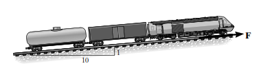

**Çözüm:**\
Newton'un İkinci Yasası (ΣF = m\*a) kullanılır.\
Verilenler:

- Kütle (m) = 160,000 kg

- Çekiş Kuvveti (F_çekiş) = 196,200 N

- Yer çekimi bileşeni (F_g) = 155,440 N (harekete ters yönde)

Yokuş yukarı yönde net kuvvet:\
ΣF = F_çekiş - F_g\
ΣF = 196,200 - 155,440 = 40,760 N

Şimdi ivmeyi bulalım:\
a = ΣF / m\
a = 40,760 / 160,000\
a ≈ 0.25 m/s²

# Soru 3 

30°'lik eğik düzlem üzerinde duran 10 kg'lık A bloğuna etki eden normal kuvvet ne kadardır? (g = 9.81 m/s²)

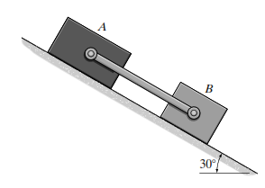

**Çözüm:**\
Normal kuvvet, yüzeye dik olan kuvvetlerin dengesinden bulunur. Serbest cisim diyagramında, ağırlığın (mg) yüzeye dik bileşeni normal kuvvete eşittir.\
Verilenler:

- Kütle (m) = 10 kg

- Eğim açısı (θ) = 30°

- Yer çekimi ivmesi (g) = 9.81 m/s²

N = mg \* cos(θ)\
N = 10 \* 9.81 \* cos(30°)\
N = 98.1 \* 0.866\
N = 84.96 N

# Soru 4 30°'lik eğik düzlemde sabit hızla aşağı kayan 100 N ağırlığındaki bir bloğa etki eden kinetik sürtünme kuvveti ne kadardır?

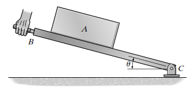

**Çözüm:**\
Blok "sabit hızla" hareket ettiği için ivme sıfırdır (a=0). Bu, net kuvvetin de sıfır olduğu anlamına gelir (ΣF=0). Eğim boyunca aşağı yönde hareket olduğundan, sürtünme kuvveti yukarı yöndedir.\
Ağırlığın eğime paralel bileşeni:\
W_paralel = W \* sin(θ) = 100 \* sin(30°) = 100 \* 0.5 = 50 N\
Net kuvvetin sıfır olması için sürtünme kuvveti bu kuvvete eşit olmalıdır:\
F_sürtünme = W_paralel = 50 N

# Soru 5 

Bir römorkör, her biri 2 kN'luk su direncine maruz kalan üç özdeş barcı sabit hızla çekmektedir. Sadece son barç düşünüldüğünde, ikinci ve üçüncü barç arasındaki kablodaki gerilme kuvveti nedir?

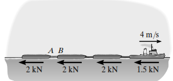

**Çözüm:**\
Sistem "sabit hızla" hareket ettiğinden, her bir parçası için net kuvvet sıfırdır. Sadece üçüncü (en sondaki) barç için serbest cisim diyagramı çizilirse:

- İleri yönde kablo gerilmesi (T)

- Geri yönde su direnci (F_direnç = 2 kN)\
  Net kuvvetin sıfır olması için:\
  ΣF = T - F_direnç = 0\
  T = F_direnç = 2 kN

# Soru 6 

Bir vinç, 3500 kg'lık bir motoru 4 m/s²'lik sabit bir ivme ile yukarı doğru kaldırmaktadır. Motoru tutan dikey kablodaki gerilme kuvveti nedir? (g = 9.81 m/s²)

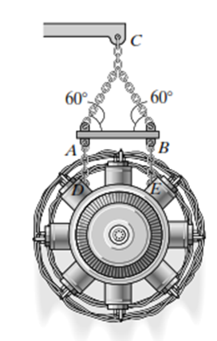

**Çözüm:**\
Newton'un İkinci Yasası (ΣF = m\*a) dikey yönde uygulanır.\
Verilenler:

- Kütle (m) = 3500 kg

- İvme (a) = 4 m/s² (yukarı yönlü)\
  Yukarı yönde net kuvvet:\
  ΣF_y = T - mg\
  T - mg = m\*a\
  T = m\*a + mg = m \* (a + g)\
  T = 3500 \* (4 + 9.81)\
  T = 3500 \* 13.81\
  T = 48,335 N

# Soru 7 

Dikey düzlemde hareket eden 50 kg'lık bir merminin yörüngesinin eğrilik yarıçapı 200 m'dir. Şekildeki konumda (eğim 30°) mermiye etki eden normal ivme 4.25 m/s² olduğuna göre, merminin hızı nedir?

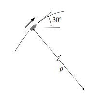

**Çözüm:**\
Normal ivme formülü a_n = v²/ρ kullanılır.\
Verilenler:

- Normal ivme (a_n) = 4.25 m/s²

- Eğrilik yarıçapı (ρ) = 200 m\
  Formülden hızı (v) çekelim:\
  v² = a_n \* ρ\
  v = √(a_n \* ρ)\
  v = √(4.25 \* 200)\
  v = √850\
  v ≈ 29.15 m/s\
  *Not: Sorudaki orijinal değerler yerine basitleştirilmiş bir normal ivme değeri kullanılmıştır.*

**Soru 8**

Dikey düzlemde hareket eden bir mermiye sadece yer çekimi kuvveti etki etmektedir. Yörüngesinin teğetinin yatayla 30° açı yaptığı bir anda, merminin teğetsel ivmesi nedir? (g = 9.81 m/s²)

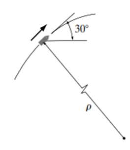

**Çözüm:**\
Teğetsel ivme, net kuvvetin hareket yönündeki (teğet) bileşeninden kaynaklanır. Tek kuvvet olan yer çekimi (mg) düşey aşağı yönlüdür. Bu kuvvetin teğet bileşeni bulunur.\
ΣF_t = m \* a_t\
-mg \* sin(30°) = m \* a_t\
a_t = -g \* sin(30°)\
a_t = -9.81 \* 0.5\
a_t = -4.905 m/s² (Negatif işaret hızın azaldığını gösterir)

# 

**Soru 9** 

100 m yarıçaplı dairesel bir pistte hareket eden bir aracın hızı 20 m/s'dir. Aracın merkezcil (normal) ivmesi nedir?

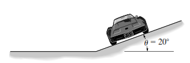

**Çözüm:**\
Merkezcil ivme (normal ivme) formülü a_n = v²/ρ kullanılır.\
Verilenler:

- Hız (v) = 20 m/s

- Yarıçap (ρ) = 100 m\
  a_n = (20)² / 100\
  a_n = 400 / 100\
  a_n = 4 m/s²

# Soru 10 

4 metre uzunluğundaki bir ipe bağlı 30 kg'lık bir top, en alt noktasından 4 m/s hızla geçiyor. Bu anda ipteki gerilme kuvveti ne kadardır? (g = 9.81 m/s²)

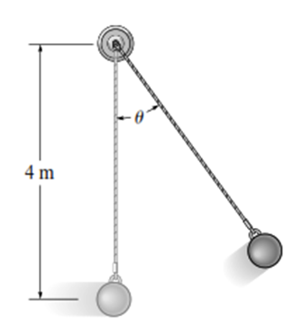

**Çözüm:**\
En alt noktada, normal ivme yukarı doğrudur. Net kuvvet denklemi dikey yönde yazılır.\
ΣF_n = m \* a_n\
T - mg = m \* (v²/r)\
T = mg + m \* (v²/r)\
Verilenler:

- Kütle (m) = 30 kg

- Hız (v) = 4 m/s

- Yarıçap (r) = 4 m\
  T = (30 \* 9.81) + 30 \* (4² / 4)\
  T = 294.3 + 30 \* (4)\
  T = 294.3 + 120\
  T = 414.3 N

# 

**Soru 11**

Bir araba, m kütlesi ile dikey bir tepenin zirvesinden (yarıçap r) geçmektedir. Arabanın yolla temasını kaybetmemesi için sahip olabileceği maksimum hız nedir? 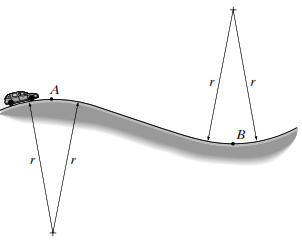

**Çözüm:**\
Yolla temasın tam kesilme anında, yüzeyin normal kuvveti (N) sıfır olur. Bu durumda, merkezcil kuvveti sağlayan tek kuvvet ağırlıktır (mg).\
ΣF_n = m \* a_n\
mg = m \* (v_max² / r)\
g = v_max² / r\
v_max² = gr\
v_max = √(gr)

**Soru 12**

Yatay düzlemde dönen bir çubuğa takılı 0.5 kg'lık bir bilezik, merkezden 0.6 m uzaktadır. Çubuğun açısal hızı 2 rad/s ise, bileziğe etki eden merkezcil ivme (radyal ivme) nedir?

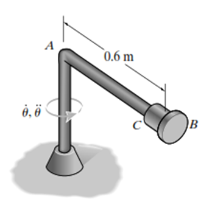

**Çözüm:**\
Kutupsal koordinatlarda radyal ivme formülü a_r = r̈ - rθ̇² dir. Bilezik sabit bir konumda (r=0.6m) olduğu için ṙ ve r̈ sıfırdır.

Verilenler:

- r = 0.6 m

- Açısal hız (θ̇) = 2 rad/s\
  a_r = 0 - (0.6) \* (2)²\
  a_r = -0.6 \* 4\
  a_r = -2.4 m/s²\
  Büyüklüğü 2.4 m/s²'dir ve merkeze doğrudur.

**Soru 13**

2 Mg'luk (2000 kg) bir kamyon 15 m/s hızla giderken fren yaparak 10 metrede duruyor. Kamyonun yavaşlama ivmesinin büyüklüğü nedir?

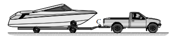

**Çözüm:**\
Zamandan bağımsız kinematik denklemi kullanılır: v² = v₀² + 2a(s - s₀)\
Verilenler:

- Başlangıç hızı (v₀) = 15 m/s

- Son hız (v) = 0 m/s (duruyor)

- Mesafe (s - s₀) = 10 m\
  0² = 15² + 2 \* a \* 10\
  0 = 225 + 20a\
  -225 = 20a\
  a = -225 / 20 = -11.25 m/s²\
  İvmenin büyüklüğü 11.25 m/s²'dir.

**Soru 14**A bloğu 300 N ağırlığındadır. Şekildeki makara sisteminde kordona 150 N'luk bir kuvvet uygulanıyor. A bloğuna etki eden net kuvvet nedir? (Makara ağırlıkları ihmal edilmiştir).

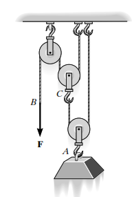

**Çözüm:**\
Uygulanan 150 N'luk kuvvet, kordon boyunca her yerde aynı gerilmeyi oluşturur (T = 150 N). Şekilde 150 N'luk kuvvet iki makara aşamasında ikiye katlanarak A bloğunu çeken kablolar üzerinde toplam 4F = 4 \* 150 = 600 N'luk yukarı yönlü kuvvet oluşturur. A bloğunun ağırlığı 300 N'dur.\
ΣF = F_yukarı - W_aşağı = 600 - 300 = 300 N (yukarı)

**Soru 15**

Şekildeki A arabasının üzerinde duran B bloğu sürtünmesiz yüzeyden aşağı kaymaktadır. B bloğunun kütlesi 'm' ise, B bloğuna arabanın yüzeyi tarafından uygulanan normal kuvvet (N_B) nedir? (Açı θ)

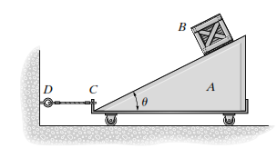

**Çözüm:**\
B bloğunun serbest cisim diyagramı çizilir. Yüzeye dik doğrultuda ivme olmadığı varsayılır (kayma hareketi yüzeye paraleldir). Bu doğrultudaki kuvvetler dengededir.\
ΣF_dik = 0\
N_B - mg \* cos(θ) = 0\
N_B = mg \* cos(θ)

**Soru 16**

500 kg'lık bir balona 6000 N'luk bir kaldırma kuvveti etki ediyor. Balonun başlangıçtaki (hava direnci yokken) yukarı yönlü ivmesi nedir? (g = 9.81 m/s²)

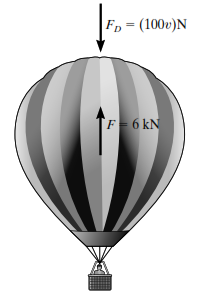

**Çözüm:**\
Newton'un İkinci Yasası (ΣF = m\*a) dikey yönde uygulanır.\
Verilenler:

- Kütle (m) = 500 kg

- Kaldırma kuvveti (F_kaldırma) = 6000 N\
  ΣF_y = F_kaldırma - mg\
  ΣF_y = 6000 - (500 \* 9.81)\
  ΣF_y = 6000 - 4905 = 1095 N\
  a = ΣF_y / m = 1095 / 500\
  a = 2.19 m/s²

**Soru 17**

0.2 kg'lık bir blok, pürüzsüz bir koni yüzeyinde 0.120 m'lik bir yarıçapta 0.5 m/s'lik sabit bir hızla dönmektedir. Bloğa etki eden net merkezcil kuvvet ne kadardır? 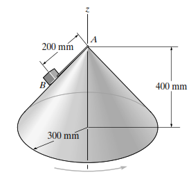

**Çözüm:**\
Net merkezcil kuvvet F_n = m \* a_n = m \* (v²/r) formülüyle bulunur.\
Verilenler:

- Kütle (m) = 0.2 kg

- Hız (v) = 0.5 m/s

- Yarıçap (r) = 0.120 m\
  F_n = 0.2 \* (0.5² / 0.120)\
  F_n = 0.2 \* (0.25 / 0.120)\
  F_n = 0.2 \* 2.0833\
  F_n ≈ 0.417 N

**Soru 18**

5000 kg'lık bir uçak, 3000 m yarıçaplı yatay bir dairesel yörüngede 97 m/s'lik sabit bir hızla uçmaktadır. Uçağın maruz kaldığı merkezcil ivme nedir?

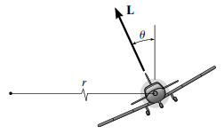**Çözüm:**\
Merkezcil ivme a_n = v²/r formülüyle bulunur.\
Verilenler:

- Hız (v) = 97 m/s

- Yarıçap (r) = 3000 m\
  a_n = 97² / 3000\
  a_n = 9409 / 3000\
  a_n ≈ 3.14 m/s²

**Soru 19**

80 kg'lık bir sandık, yatayla 20°'lik açı yapan bir zincirle çekilmektedir. Kinetik sürtünme katsayısı 0.3'tür. Sandık hareket halindeyken yüzeyin normal kuvveti 664 N ise, sürtünme kuvveti ne kadardır?

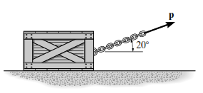

**Çözüm:**\
Kinetik sürtünme kuvveti F_s = μ_k \* N formülüyle bulunur.\
Verilenler:

- Kinetik sürtünme katsayısı (μ_k) = 0.3

- Normal kuvvet (N) = 664 N\
  F_s = 0.3 \* 664\
  F_s = 199.2 N

**Soru 20**

Şekildeki sistemde A bloğu (25 kg) pürüzsüz eğik düzlemde, C bloğu (10 kg) ise sürtünmeli yatay düzlemde hareket etmektedir. C bloğuna etki eden normal kuvvet ne kadardır? (g = 9.81 m/s²)

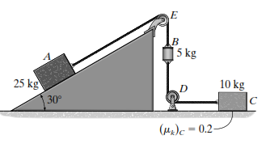

**Çözüm:**\
Sadece C bloğunun dikey kuvvet dengesine bakılır. C bloğu yatay hareket ettiği için dikey ivmesi sıfırdır.\
ΣF_y = 0\
N_C - m_C\*g = 0\
N_C = m_C \* g\
N_C = 10 \* 9.81\
N_C = 98.1 N

---

# Ünite 4: Parçacığın Kinetiği - İş ve Enerji

## Ünite 4: Parçacığın Kinetiği - İş ve Enerji - Sözel Sorular

**Dinamik Dersi Sözel Çoktan Seçmeli Sorular - Ünite 4: Parçacığın Kinetiği (İş ve Enerji)**

**1. Bir kuvvetin bir parçacık üzerinde iş yapabilmesi için gerekli olan temel koşul nedir?**\
- A) Kuvvetin sabit olması
- B) Parçacığın hızının değişmesi
- C) Parçacığın kuvvet yönünde bir yer değiştirmeye maruz kalması
- D) Kuvvetin parçacığın ağırlığından büyük olması
- E) Parçacığın kütlesinin olması

**2. Bir kuvvet tarafından yapılan iş, aşağıdaki durumlardan hangisinde kesinlikle negatiftir?**\
- A) Kuvvet ve yer değiştirme vektörleri arasındaki açı 0° olduğunda
- B) Kuvvet ve yer değiştirme vektörleri arasındaki açı 90° olduğunda
- C) Kuvvet ve yer değiştirme vektörleri arasındaki açı 90° ile 180° arasında olduğunda
- D) Kuvvet, parçacığın hızını artırdığında
- E) Yer değiştirme sıfır olduğunda

**3. Bir parçacığın kinetik enerjisi (T = ½mv²) hakkında aşağıdakilerden hangisi doğrudur?**\
- A) Vektörel bir büyüklüktür.
- B) Hareketin yönüne bağlı olarak negatif olabilir.
- C) Cismin hareketinden dolayı iş yapabilme kapasitesinin bir ölçüsüdür.
- D) Cismin ivmesi ile doğru orantılıdır.
- E) Birimi Newton'dur.

**4. "İş-Enerji Prensibi" (T₁ + ΣU₁-₂ = T₂) temel olarak neyi ifade eder?**\
- A) Bir sistemin toplam enerjisinin daima korunduğunu
- B) Bir parçacığın başlangıçtaki kinetik enerjisi ile üzerine yapılan net işin toplamının, son kinetik enerjisine eşit olduğunu
- C) Potansiyel enerjinin daima kinetik enerjiye dönüştüğünü
- D) Bir cisme etkiyen kuvvetlerin toplamının sıfır olduğunu
- E) Cismin momentumunun sabit kaldığını

**5. Bir cismin ağırlığı tarafından yapılan iş neye bağlıdır?**\
- A) Sadece cismin kat ettiği toplam yola
- B) Sadece cismin yatay yer değiştirmesine
- C) Sadece cismin dikey yer değiştirmesine
- D) Cismin hızına
- E) Cismin ivmesine

**6. Aşağıdakilerden hangisi "korunumlu kuvvet" (conservative force) örneğidir?**\
- A) Sürtünme kuvveti
- B) Hava direnci
- C) Bir yayın uyguladığı kuvvet
- D) Bir roketin itki kuvveti
- E) Bir insanın uyguladığı itme kuvveti

**7. Korunumlu bir kuvvetin yaptığı işin temel özelliği nedir?**\
- A) Her zaman pozitiftir.
- B) Cismin izlediği yola bağlıdır.
- C) Cismin sadece başlangıç ve son konumlarına bağlı olup, izlediği yoldan bağımsızdır.
- D) Her zaman kinetik enerjiyi artırır.
- E) Sadece dairesel hareketlerde ortaya çıkar.

**8. Bir cismin potansiyel enerjisi neyin bir ölçüsüdür?**\
- A) Cismin hareketinden dolayı sahip olduğu enerji
- B) Cisme etkiyen net kuvvetin yapacağı iş
- C) Korunumlu bir kuvvetin, cismi belirli bir konumdan referans (datum) noktasına hareket ettirdiğinde yapacağı iş
- D) Cismin sıcaklığından kaynaklanan enerji
- E) Cismin ataletinin (eylemsizliğinin) bir ölçüsü

**9. Bir yayın elastik potansiyel enerjisi (Ve = ½ks²) için aşağıdakilerden hangisi doğrudur?**\
- A) Yay sıkıştırıldığında negatif, uzatıldığında pozitif olur.
- B) Daima pozitif bir değerdir.
- C) Yayın serbest boyu ile doğru orantılıdır.
- D) Yaya etki eden dış kuvvete bağlıdır.
- E) Yayın malzemesine bağlı değildir.

**10. Mekanik enerjinin korunumu (T₁ + V₁ = T₂ + V₂) prensibi hangi koşulda geçerlidir?**\
- A) Cisme sadece sürtünme kuvveti etki ettiğinde
- B) Cisme etkiyen tüm kuvvetler korunumlu olduğunda
- C) Cisim sabit hızla hareket ettiğinde
- D) Cismin ivmesi sabit olduğunda
- E) Cisim dairesel bir yörüngede hareket ettiğinde

**11. Bir sistemde hem korunumlu hem de korunumsuz kuvvetler (örneğin sürtünme) varsa, iş-enerji denklemi nasıl yazılır?**\
- A) T₁ + V₁ = T₂ + V₂
- B) T₁ = T₂
- C) ΣU_korunumsuz = 0
- D) T₁ + V₁ + ΣU_korunumsuz = T₂ + V₂
- E) V₁ = V₂

**12. Güç (Power) kavramı en iyi nasıl tanımlanır?**\
- A) Bir cisme uygulanan toplam kuvvet
- B) Bir cismin sahip olduğu toplam enerji
- C) Birim zamanda yapılan iş veya enerjinin aktarılma hızı
- D) Bir cismin hızını değiştirme yeteneği
- E) Bir cismin yerini değiştirme miktarı

**13. Bir motorun verimi (efficiency) nasıl tanımlanır?**\
- A) Motora verilen güç ile motordan alınan gücün toplamı
- B) Motora verilen gücün, motordan alınan güce oranı
- C) Motordan alınan faydalı gücün, motora verilen toplam güce oranı
- D) Birim zamanda harcanan enerji
- E) Motorun hızı ile ürettiği kuvvetin çarpımı

**14. Bir makinenin verimi neden her zaman 1'den küçüktür?**\
- A) Enerjinin bir kısmı ısıya dönüştüğü için
- B) Sürtünme gibi kayıplar nedeniyle enerjinin bir kısmı faydalı işe dönüşemediği için
- C) Newton'un üçüncü yasası gereği
- D) Termodinamiğin birinci yasası gereği
- E) Güç girişinin her zaman güç çıkışından az olması nedeniyle

**15. SI birim sisteminde güç birimi nedir ve neye eşittir?**\
- A) Joule (J)
- B) Newton (N)
- C) Watt (W), 1 Joule/saniye'ye eşittir
- D) Beygir Gücü (hp)
- E) Kalori (cal)

**16. Kayan bir cisim ile yüzey arasındaki sürtünme kuvvetinin yaptığı iş (-μkN \* s) nereye harcanır?**\
- A) Cismin kinetik enerjisini artırmak için
- B) Cismin potansiyel enerjisini artırmak için
- C) Isı gibi iç enerji formlarına dönüşerek sistemden kaybolur
- D) Tamamen yüzey tarafından emilir
- E) Cismin ağırlığına karşı iş yapar

**17. Bir kuvvetin yaptığı iş, F cosθ - s grafiğinin altında kalan alan olarak hesaplanabilir mi?**\
- A) Evet, bu alan doğrudan yapılan işi verir.
- B) Hayır, bu alan ivmeyi verir.
- C) Hayır, bu alan gücü verir.
- D) Sadece kuvvet sabit ise evet.
- E) Sadece yer değiştirme sabit ise evet.

**18. Bir cisim dikey olarak yukarı doğru hareket ederken, yer çekimi kuvveti (ağırlık) nasıl bir iş yapar?**\
- A) Pozitif iş
- B) Negatif iş
- C) Sıfır iş
- D) Kinetik enerjiye eşit iş
- E) Potansiyel enerjiye eşit iş

**19. Bir parçacıklar sisteminde, iç kuvvetlerin yaptığı net iş, sistem bir bütün olarak öteleme hareketi yapıyorsa genellikle nedir?**\
- A) Sistemin toplam kinetik enerjisine eşittir.
- B) Her zaman pozitiftir.
- C) Her zaman negatiftir.
- D) Sıfırdır, çünkü iç kuvvetler etki-tepki çiftleri oluşturur ve yer değiştirmeleri aynıdır.
- E) Sistemin potansiyel enerjisindeki değişime eşittir.

**20. Bir kuvvetin potansiyel fonksiyonu (V) biliniyorsa, kuvvet (F) bu fonksiyondan nasıl elde edilebilir?**\
- A) F = ∫V ds
- B) F = dV/dt
- C) F = -∇V (Potansiyelin gradyanının negatifi)
- D) F = V²
- E) F = V/s

**Cevap Anahtarı**

1.  **C)** Parçacığın kuvvet yönünde bir yer değiştirmeye maruz kalması

2.  **C)** Kuvvet ve yer değiştirme vektörleri arasındaki açı 90° ile 180° arasında olduğunda

3.  **C)** Cismin hareketinden dolayı iş yapabilme kapasitesinin bir ölçüsüdür.

4.  **B)** Bir parçacığın başlangıçtaki kinetik enerjisi ile üzerine yapılan net işin toplamının, son kinetik enerjisine eşit olduğunu

5.  **C)** Sadece cismin dikey yer değiştirmesine

6.  **C)** Bir yayın uyguladığı kuvvet

7.  **C)** Cismin sadece başlangıç ve son konumlarına bağlı olup, izlediği yoldan bağımsızdır.

8.  **C)** Korunumlu bir kuvvetin, cismi belirli bir konumdan referans (datum) noktasına hareket ettirdiğinde yapacağı iş

9.  **B)** Daima pozitif bir değerdir.

10. **B)** Cisme etkiyen tüm kuvvetler korunumlu olduğunda

11. **D)** T₁ + V₁ + ΣU_korunumsuz = T₂ + V₂

12. **C)** Birim zamanda yapılan iş veya enerjinin aktarılma hızı

13. **C)** Motordan alınan faydalı gücün, motora verilen toplam güce oranı

14. **B)** Sürtünme gibi kayıplar nedeniyle enerjinin bir kısmı faydalı işe dönüşemediği için

15. **C)** Watt (W), 1 Joule/saniye'ye eşittir

16. **C)** Isı gibi iç enerji formlarına dönüşerek sistemden kaybolur

17. **A)** Evet, bu alan doğrudan yapılan işi verir.

18. **B)** Negatif iş

19. **D)** Sıfırdır, çünkü iç kuvvetler etki-tepki çiftleri oluşturur ve yer değiştirmeleri aynıdır.

20. **C)** F = -∇V (Potansiyelin gradyanının negatifi)

---

## Ünite 4: Parçacığın Kinetiği - İş ve Enerji - Sayısal Sorular ve Çözümleri

**Soru 1** 100 kg kütleli bir sandık, yatayla 15° açı yapan bir kablo ile 500 N'luk sabit bir kuvvet uygulanarak çekilmektedir. Kablo kuvvetinin sandığı 10 m hareket ettirdiğinde yaptığı iş ne kadardır?

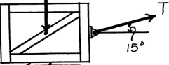

**Çözüm:**\
Sabit bir kuvvetin yaptığı iş U = F \* s \* cos(θ) formülü ile hesaplanır.

- Kuvvet (F) = 500 N

- Mesafe (s) = 10 m

- Açı (θ) = 15°

U = 500 \* 10 \* cos(15°)\
U = 5000 \* 0.966\
U = 4830 J ≈ 4.83 kJ

**Soru 2** 1.5 kg kütleli bir blok, Fs = 900s² (N) direncine sahip doğrusal olmayan bir yaya çarpmaktadır. Yayın 0.2 m sıkışması sırasında yay kuvvetinin yaptığı iş ne kadardır?

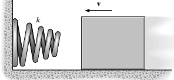

**Çözüm:**\
Değişken bir kuvvetin yaptığı iş, kuvvetin mesafeye göre integralini alarak bulunur. Yay kuvveti harekete zıt yönde olduğu için iş negatiftir.\
U_yay = -∫ Fs ds\
U_yay = -∫₀⁰·² 900s² ds\
U_yay = -\[300s³\]₀⁰·²\
U_yay = -\[300 \* (0.2)³ - 300 \* (0)³\]\
U_yay = -\[300 \* 0.008\]\
U_yay = -2.4 J

**Soru 3** 2000 kg kütleli bir araba, yatay bir yolda 100 km/h (27.78 m/s) hızla giderken fren yaparak duruyor. Lastikler ile yol arasındaki kinetik sürtünme katsayısı 0.25'tir. Arabayı durdurmak için sürtünme kuvvetinin yaptığı işi, durma mesafesi (s') cinsinden ifade ediniz. (g = 9.81 m/s²)

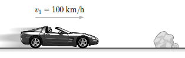

**Çözüm:**\
Önce sürtünme kuvvetinin büyüklüğü bulunur. Yatay düzlemde N = mg'dir.

- Normal Kuvvet (N) = 2000 kg \* 9.81 m/s² = 19620 N

- Sürtünme Kuvveti (Ff) = μk \* N = 0.25 \* 19620 = 4905 N

Sürtünme kuvveti harekete zıt olduğu için yaptığı iş negatiftir.\
U_sürtünme = -Ff \* s'\
U_sürtünme = -4905s' J

**Soru 4** Yay sabiti 2000 N/m olan bir tabanca yayının ilk sıkışma miktarı 0.05 m'dir. Yay serbest bırakıldığında son sıkışma miktarı 0.0375 m oluyor. Bu esnada yayın potansiyel enerjisindeki değişim ne kadardır?

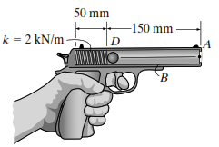

**Çözüm:**\
Yayın potansiyel enerjisi Ve = ½ks² dir. Potansiyel enerjideki değişim, yayın yaptığı işin negatifidir.

- İlk Potansiyel Enerji (Ve₁) = ½ \* 2000 \* (0.05)² = 1000 \* 0.0025 = 2.5 J

- Son Potansiyel Enerji (Ve₂) = ½ \* 2000 \* (0.0375)² = 1000 \* 0.001406 = 1.406 J

- Potansiyel Enerji Değişimi (ΔVe) = Ve₂ - Ve₁ = 1.406 - 2.5 = -1.094 J

**Soru 5** 2000 kg'lık bir arabanın kinetik enerjisi, hızı 100 km/h (27.78 m/s) iken ne kadardır?

**Çözüm:**\
Kinetik enerji T = ½mv² formülü ile hesaplanır.

- Kütle (m) = 2000 kg

- Hız (v) = 27.78 m/s

T = ½ \* 2000 \* (27.78)²\
T = 1000 \* 771.73\
T = 771730 J ≈ 772 kJ

------------------------------------------------------------------------

**Soru 6** 70 kg kütleli bir kayakçı, durgun halden kaymaya başlayarak B noktasına ulaşıyor. A ve B noktaları arasındaki dikey yükseklik farkı 46 m olduğuna göre, kayakçının B noktasındaki hızı nedir? (Sürtünme ihmal edilmiştir, g = 9.81 m/s²)

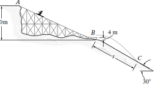

**Çözüm:**\
Enerjinin korunumu ilkesi kullanılır: T₁ + V₁ = T₂ + V₂. Başlangıç noktası (A) potansiyel enerji için referans (datum) alınırsa V₁ = 0. Durgun halden başladığı için T₁ = 0.\
0 + mgh = ½mv₂² + 0\
g \* h = ½ \* v₂²\
v₂ = √(2gh)\
v₂ = √(2 \* 9.81 \* 46)\
v₂ = √(902.52) = 30.04 m/s

**Soru 7** Bir motor, 2000 N ağırlığındaki bir yükü 2 m/s sabit hızla yukarı kaldırıyor. Motorun çıkış gücü kaç kW'tır?

**Çözüm:**\
Güç P = F \* v formülü ile hesaplanır. Sabit hızla kaldırmak için gereken kuvvet, yükün ağırlığına eşittir (F = 2000 N).\
P_out = 2000 N \* 2 m/s = 4000 W = 4 kW

**Soru 8** 10 kN ağırlığındaki bir otomobil, 7°'lik bir yokuşu 20 m/s sabit hızla tırmanıyor. Motorun bu hızı korumak için ürettiği güç ne kadardır? (Sürtünme ihmal edilmiştir).

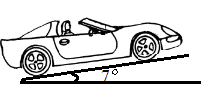

**Çözüm:**\
Sabit hızla yokuş yukarı çıkmak için motorun, ağırlığın yokuşa paralel bileşenini yenmesi gerekir.\
F = W \* sin(θ) = 10000 \* sin(7°) = 10000 \* 0.1219 = 1219 N\
Güç:\
P = F \* v = 1219 \* 20 = 24380 W ≈ 24.4 kW

**Soru 9** Verimi %80 (ε = 0.8) olan bir motorun 19.5 kW'lık giriş gücü vardır. Motorun ürettiği çıkış gücü ne kadardır?

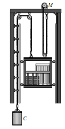

**Çözüm:**\
Verim ε = P_çıkış / P_giriş formülü ile bulunur.\
P_çıkış = ε \* P_giriş\
P_çıkış = 0.8 \* 19.5 kW\
P_çıkış = 15.6 kW

**Soru 10** Yatay düzlemdeki 20 kg'lık bir yaka, sıkıştırılmış iki yaya bağlıdır. Yayların toplam potansiyel enerjisi 18.75 J iken sistem serbest bırakılıyor. Yaylar tamamen gevşediğinde (potansiyel enerji sıfırlandığında) yakanın hızı ne olur?

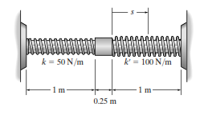

**Çözüm:**\
Enerjinin korunumu ilkesi kullanılır: T₁ + V₁ = T₂ + V₂. Başlangıçta sistem durduğu için T₁ = 0.

- V₁ (elastik potansiyel enerji) = 18.75 J

- V₂ (son potansiyel enerji) = 0

- T₂ (son kinetik enerji) = ½mv₂²

0 + 18.75 = ½ \* (20) \* v₂² + 0\
18.75 = 10 \* v₂²\
v₂² = 1.875\
v₂ = 1.37 m/s

**Soru 11** Bir motor, 60 kg'lık bir sandığı 5 metrelik bir yüksekliğe 2 saniyede sabit hızla çıkarıyor. Motorun ortalama çıkış gücü ne kadardır? (g = 9.81 m/s²)

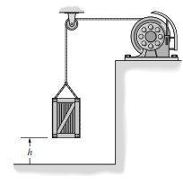

**Çözüm:**\
Yapılan iş, potansiyel enerjideki değişime eşittir:\
İş (U) = mgh = 60 \* 9.81 \* 5 = 2943 J\
Ortalama güç, yapılan işin zamana bölünmesiyle bulunur:\
P_ort = U / t = 2943 J / 2 s = 1471.5 W ≈ 1.47 kW

**Soru 12** 1000 kg'lık bir dragster'a 20 kN'luk sabit bir itki kuvveti uygulanıyor. Dragster 50 m/s hıza ulaştığı anda, motorun anlık gücü ne kadardır?

**Çözüm:**\
Anlık güç P = F \* v formülüyle hesaplanır.

- Kuvvet (F) = 20 kN = 20000 N

- Hız (v) = 50 m/s

P = 20000 N \* 50 m/s = 1,000,000 W = 1 MW

**Soru 13** 5 gramlık (0.005 kg) bir bilye, 3 m yükseklikten serbest bırakılıyor. Tam yere çarpmadan önceki hızı nedir? (Sürtünme ihmal edilmiştir, g = 9.81 m/s²)

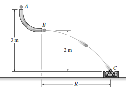

**Çözüm:**\
Enerjinin korunumu kullanılır. Başlangıçtaki potansiyel enerji, sondaki kinetik enerjiye dönüşür.\
mgh = ½mv²\
gh = ½v²\
v = √(2gh)\
v = √(2 \* 9.81 \* 3)\
v = √(58.86) ≈ 7.67 m/s

**Soru 14** 100 kg'lık bir sandık, 45°'lik eğik düzlemde 10 m yukarıda durmaktadır. Sandık serbest bırakıldığında, aşağı kayarken 10 metrelik yolu kat ettiğinde yer çekimi kuvvetinin yaptığı iş ne kadardır? (g = 9.81 m/s²)

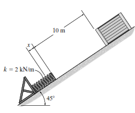

**Çözüm:**\
Yer çekimi kuvvetinin yaptığı iş, dikey yer değiştirmeye bağlıdır.

- Dikey yer değiştirme (h) = 10 \* sin(45°) = 7.07 m

- Yapılan iş (U_g) = W \* h = (mg) \* h

U_g = (100 \* 9.81) \* 7.07 = 981 \* 7.07 ≈ 6936 J\
(Sandık aşağı hareket ettiği için iş pozitiftir.)

**Soru 15** Gerilmemiş uzunluğu 200 mm ve yay sabiti 50 N/m olan bir lastik bant, 245 mm'ye kadar geriliyor. Bantta depolanan elastik potansiyel enerji ne kadardır?

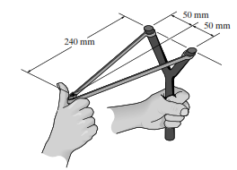

**Çözüm:**\
Önce yayın ne kadar uzadığı (s) bulunur.\
s = Son uzunluk - İlk uzunluk = 245 mm - 200 mm = 45 mm = 0.045 m\
Elastik potansiyel enerji: Ve = ½ks²\
Ve = ½ \* 50 \* (0.045)²\
Ve = 25 \* 0.002025 = 0.0506 J

**Soru 16** 400 Mg'lık (400,000 kg) bir trenin hızı, 100 saniyede düzgün bir şekilde 0'dan 10 m/s'ye çıkıyor. Bu 100 saniye boyunca trene aktarılan toplam iş (kinetik enerji değişimi) ne kadardır?

**Çözüm:**\
İş-Enerji Prensibi'ne göre yapılan net iş, kinetik enerjideki değişime eşittir.\
ΣU = T₂ - T₁

- T₁ (ilk kinetik enerji) = 0 (durgun halden)

- T₂ (son kinetik enerji) = ½mv₂²

ΣU = ½ \* 400,000 \* (10)² - 0\
ΣU = 200,000 \* 100 = 20,000,000 J = 20 MJ

**Soru 17** Bir arabanın motoru 15 kW'lık sabit bir güç üretiyor. Araba 10 m/s hıza ulaştığında, motorun tekerleklere uyguladığı itki kuvveti ne kadardır? (Verim ve sürtünme ihmal edilmiştir).

**Çözüm:**\
P = F \* v formülünden kuvvet çekilir.

- Güç (P) = 15 kW = 15000 W

- Hız (v) = 10 m/s

F = P / v = 15000 / 10 = 1500 N

**Soru 18** Bir top, yaylı bir mekanizmadan fırlatılacaktır. Yayı sıkıştırmak için 1000 N'luk bir kuvvet gerekmektedir ve yay 0.5 m sıkıştırılmıştır. Bu durumda yayın yay sabiti (k) nedir? (F = ks)

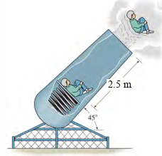

**Çözüm:**\
Hooke Yasası'ndan k = F / s bulunur.

- Kuvvet (F) = 1000 N

- Sıkışma (s) = 0.5 m

k = 1000 / 0.5 = 2000 N/m

**Soru 19** 300 N ağırlığındaki A bloğu, iki yayın üzerine düşürülüyor. Blok yaylara çarptıktan sonra en fazla 3 m'lik bir yüksekliğe geri fırlıyor. Bloğun bu yüksekliğe ulaşması için yer çekimine karşı yapılan iş ne kadardır?

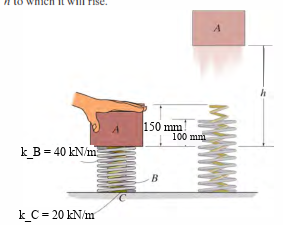

**Çözüm:**\
Yapılan iş, potansiyel enerji değişimine eşittir.

- Yükseklik (h) = 3 m

- Ağırlık (W) = 300 N

U_g = W \* h = 300 \* 3 = 900 J\
(Blok yukarı hareket ettiği için yer çekiminin yaptığı iş negatiftir, ancak bloğun yer çekimine *karşı* yaptığı iş pozitiftir.)

**Soru 20** Bir uydu, Dünya'nın kütle çekim potansiyel enerjisi alanında hareket etmektedir. A noktasında potansiyel enerjisi -1.19x10⁹ J ve kinetik enerjisi 0.37x10⁹ J'dür. Uydunun A noktasındaki toplam mekanik enerjisi nedir?

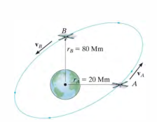

**Çözüm:**\
Toplam mekanik enerji, kinetik ve potansiyel enerjilerin toplamıdır.\
E = T + V\
E = (0.37 \* 10⁹ J) + (-1.19 \* 10⁹ J)\
E = -0.82 \* 10⁹ J

---

# Ünite 5: Parçacığın Kinetiği - İtme ve Momentum

## Ünite 5: Parçacığın Kinetiği - İtme ve Momentum - Sözel Sorular

**Parçacık Kinetiği: İtme ve Momentum" -Ünite 5 Sözel Test Soruları**

**Soru 1**

**Doğrusal itme ve momentum ilkesi, hareket denkleminin (F = ma) hangi değişkene göre entegre edilmesiyle elde edilir?**

- A) Konum (ds)
- B) Zaman (dt)
- C) Hız (dv)
- D) İvme (da)
- E) Kütle (dm)

**Doğru Cevap: B**

**Açıklama:** Hareket denklemi F = ma, ivme yerine dv/dt yazılarak düzenlendiğinde F dt = m dv elde edilir. Bu ifadenin zaman (dt) üzerinden integrali alındığında itme ve momentum ilkesine ulaşılır.

**Soru 2**

**Aşağıdakilerden hangisi "Doğrusal İtme"nin tanımıdır?**

- A) Bir kuvvetin, etki ettiği süre boyunca yarattığı etkinin vektörel ölçüsüdür.
- B) Bir cismin kütlesi ile hızının çarpımıdır.
- C) Bir cismin kütlesi ile ivmesinin çarpımıdır.
- D) Bir kuvvetin, etki ettiği yol boyunca yaptığı iştir.
- E) Bir cismin sahip olduğu toplam kinetik enerjidir.

**Doğru Cevap: A**

**Açıklama:** Doğrusal itme (I = integral F dt), kuvvetin zamanla çarpımı veya integrali olarak tanımlanır ve kuvvetin belirli bir süre boyunca yarattığı etkiyi ölçen vektörel bir büyüklüktür.

**Soru 3**

**Kuvvet-zaman grafiğinin altında kalan alan fiziksel olarak neyi ifade eder?**

- A) Yapılan işi
- B) Gücü
- C) İtmeyi (Impulse)
- D) Kinetik enerjiyi
- E) Potansiyel enerjiyi

**Doğru Cevap: C**

**Açıklama:** İtme, kuvvetin zamana göre integrali olduğundan, bir kuvvet-zaman grafiğinde eğrinin altında kalan alan itmenin büyüklüğünü verir.

**Soru 4**

**Bir parçacık sisteminin toplam doğrusal momentumunun korunabilmesi için gerekli koşul nedir?**

- A) İç kuvvetlerin toplamının sıfır olması
- B) Sisteme etki eden dış itmelerin toplamının sıfır olması
- C) Parçacıkların kütlelerinin eşit olması
- D) Sistemin kütle merkezinin sabit olması
- E) Çarpışmanın esnek olması

**Doğru Cevap: B**

**Açıklama:** Bir parçacık sisteminde, sisteme etki eden dış kuvvetlerin itmelerinin toplamı sıfır olduğunda (veya kuvvetler dengelendiğinde), sistemin toplam doğrusal momentumu sabit kalır ve korunur.

**Soru 5**

**Çarpışma sırasında çok kısa sürede etki eden ve momentumda büyük değişikliğe neden olan kuvvetlere ne ad verilir?**

- A) Statik kuvvetler
- B) Korunumlu kuvvetler
- C) İtici (Impulsive) kuvvetler
- D) Merkezcil kuvvetler
- E) Sönümleyici kuvvetler

**Doğru Cevap: C**

**Açıklama:** Patlama veya çarpışma gibi olaylarda, çok kısa zaman aralıklarında etki eden ve momentumda önemli değişikliklere yol açan büyük kuvvetlere itici veya darbe (impulsive) kuvvetleri denir.

**Soru 6**

**Restitüsyon katsayısı (e), çarpışma sırasında hangi iki aşamadaki itmelerin oranıdır?**

- A) Deformasyon itmesi / Restitüsyon itmesi
- B) İlk momentum / Son momentum
- C) Restitüsyon (Geri kazanım) itmesi / Deformasyon itmesi
- D) Kinetik enerji / Potansiyel enerji
- E) Ayrılma hızı / Yaklaşma hızı (Tersi)

**Doğru Cevap: C**

**Açıklama:** Restitüsyon katsayısı (e), çarpışmanın geri kazanım (restitüsyon) aşamasındaki itmenin, şekil değiştirme (deformasyon) aşamasındaki itmeye oranı olarak tanımlanır.

**Soru 7**

**Eğer iki cisim arasındaki çarpışma "Plastik Çarpışma" (Inelastic/Plastic Impact) ise, restitüsyon katsayısı (e) kaçtır?**

- A) e = 1
- B) e = 0.5
- C) e = -1
- D) e = 0
- E) e \> 1

**Doğru Cevap: D**

**Açıklama:** Tam plastik veya inelastik çarpışmada, cisimler çarpışma sonrası birbirine yapışır ve birlikte hareket ederler. Geri tepme (restitüsyon) itmesi oluşmadığı için restitüsyon katsayısı e sıfırdır.

**Soru 8**

**Bir parçacığın O noktasına göre Açısal Momentum'u (Ho), skaler formülasyonla (Ho = d \* mv) hesaplanırken, "d" neyi ifade eder?**

- A) Parçacığın O noktasına olan uzaklığını
- B) Hız vektörünün büyüklüğünü
- C) Parçacığın kütlesini
- D) O noktasından momentum vektörünün (mv) etki çizgisine olan dik uzaklığı (moment kolu)
- E) Parçacığın yörünge eğrilik yarıçapını

**Doğru Cevap: D**

**Açıklama:** Açısal momentumun skaler formülünde yer alan d, moment alınan referans noktasından (O), parçacığın doğrusal momentum vektörünün (mv) etki çizgisine inilen dik mesafeyi (moment kolunu) ifade eder.

**Soru 9**

**Açısal itme ve momentum ilkesine göre, bir parçacığın açısal momentumunun değişimi neye eşittir?**

- A) Cisme etki eden net kuvvete
- B) Cisme etki eden kuvvetlerin momentlerinin zamanla integraline (Açısal İtme)
- C) Cismin doğrusal momentum değişimine
- D) Cismin kinetik enerji değişimine
- E) Cisme etki eden sürtünme kuvvetine

**Doğru Cevap: B**

**Açıklama:** Açısal itme ve momentum ilkesine göre, bir parçacığın açısal momentumundaki değişim, o parçacığa etki eden kuvvetlerin momentlerinin belirli bir süre boyunca entegre edilmesiyle elde edilen açısal itmeye eşittir.

**Soru 10**

**Sadece merkezi bir kuvvete maruz kalan bir parçacık için aşağıdakilerden hangisi korunur?**

- A) Doğrusal momentum
- B) İvme
- C) Kuvvet merkezine göre Açısal Momentum
- D) Hız
- E) Potansiyel Enerji (her zaman değil)

**Doğru Cevap: C**

**Açıklama:** Merkezi kuvvet, her zaman sabit bir noktaya (merkeze) doğru yöneldiğinden, bu noktaya göre oluşturduğu moment sıfırdır. Momentin (açısal itmenin) sıfır olması, o noktaya göre açısal momentumun korunduğu anlamına gelir.

**Soru:** 20 kg'lık bir blok, 40 kg'lık bir arabanın üzerindeki rampada durmaktadır. Sisteme dışarıdan yatay bir kuvvet etki etmemektedir. Blok rampa üzerinde hareket etmeye başlarsa sistemin yatay momentumu korunur mu?

**Çözüm:**\
Sisteme dışarıdan (x ekseninde) etki eden bir kuvvet olmadığı için, iç kuvvetler birbirini götürür ve sistemin lineer momentumu x ekseni boyunca korunur. Cevap: Evet.

**Soru:** 30 tonluk bir kamyon kum taşımaktadır. Kum, kamyonun altındaki bir kapaktan 50 kg/s hızla yere dökülmektedir. Kumun dökülmesi kamyonun hızını artırır mı, azaltır mı yoksa değiştirmez mi? (Sürtünmesiz ortam).\
**Çözüm:**\
Kum dökülürken yatayda kamyonla aynı hıza sahiptir. Kamyona göre yatay çıkış hızı 0'dır. Bu durumda sisteme etkiyen ekstra bir itki oluşmaz. Kamyonun kütlesi azalır ancak momentum korunumuna göre dış kuvvet yoksa hız değişmez ($m$ )azalırsa momentumun sabit kalması için $v$ artmalı mantığı yanlıştır, çünkü dökülen kum da momentum taşır).\
Doğru cevap: Hız değişmez (Sadece kütle azalır, ivmelenme kolaylaşır ancak anlık hız değişmez).

---

## Ünite 5: Parçacığın Kinetiği - İtme ve Momentum - Sayısal Sorular ve Çözümleri

# BÖLÜM 1: KOLAY SEVİYE (8 Soru)

**Soru 1:** Şekildeki yatay düzlemde duran bir taşa 200 N'luk sabit bir kuvvet şekildeki gibi uygulanmaktadır. Kuvvetin 10 saniye boyunca taşa uyguladığı itme (impuls) nedir?

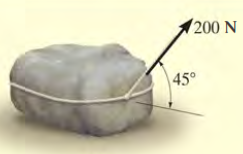\
**Çözüm:**\
İmpuls (I) = Kuvvet ($F_{x}$) $\times \$Zaman (t) $I = 200\cos 45\text{ N} \times 10\text{ s} = 1414.214\text{ N} \cdot \text{s}$

**Soru 2:** Kütlesi 100 kg olan ve sürtünmesiz yatay düzlemde duran bir taşa, yatay bileşeni hareket yönünde olan 200 N'luk net bir kuvvet etki etmektedir. 10 saniye sonra taşın hızı ne olur?

\
**Çözüm:**\
İmpuls = Momentum Değişimi ($\int_{}^{}{F \cdot dt} = F \cdot \mathrm{\Delta}t = m \cdot \Delta v$)\
$200\cos 45 = 100 \cdot (v_{son} - 0)$

$$
1414.214 = 100 \cdot v_{son} \Rightarrow v_{son} = 14.142\text{ m/s}
$$

**Soru 3:** 2 kg kütleli bir blok, sürtünmesiz $45^{\circ}$eğimli bir yüzeyden yukarı doğru 3 m/s ilk hızla fırlatılıyor. Bloğun durana kadar geçen süreyi hesaplayınız. ($g = 9.81\text{ m/s}^{2}$)\
**Çözüm:**

Hareket yönü yukarı pozitif olsun. Aşağı doğru ağırlık bileşeni kuvvet uygular.\
Momentum İlkesi:

$m(v_{1}) + \Sigma\int Fdt = m(v_{2})$

$$
2(3) - (2 \cdot 9.81 \cdot \sin(45^{\circ})) \cdot t = 0
$$

$$
6 - 13.87t = 0 \Rightarrow t \approx 0.432\text{ s}
$$

**Soru 4:** Bir cisme etki eden kuvvetin zamana bağlı grafiği verilmiştir. Kuvvet 0-2 saniye arasında 0'dan 10 N'a doğrusal artmakta, 2-4 saniye arasında 10 N sabit kalmaktadır. Cisme etki eden toplam itmeyi (impuls) bulunuz.

**Çözüm:**\
İtme = Kuvvet-Zaman grafiğinin altındaki alan.\
Alan 1 (Üçgen): $(2 \times 10)/2 = 10\text{ N} \cdot \text{s}$\
Alan 2 (Dikdörtgen): $(4 - 2) \times 10 = 20\text{ N} \cdot \text{s}$\
Toplam İtme $= 10 + 20 = 30\text{ N} \cdot \text{s}$

**Soru 5:** 15.000 kg kütleli bir vagon 1.5 m/s hızla giderken, ters yönden gelen 12.000 kg kütleli ve 0.75 m/s hıza sahip başka bir vagonla çarpışıp kenetleniyor. Kenetlendikten sonraki ortak hızları ne olur?

**Çözüm:**\
Momentum Korunumu: $\Sigma mv_{1} = \Sigma mv_{2}$

$$
{(15000 \cdot 1.5) + (12000 \cdot - 0.75) = (15000 + 12000) \cdot v_{ortak}
}{22500 - 9000 = 27000 \cdot v_{ortak}}
$$

$$
13500 = 27000 \cdot v_{ortak} \Rightarrow v_{ortak} = 0.5\text{ m/s}
$$

**Soru 6:** A aracı 2000 kg kütleli ve sağa doğru 2 m/s hızla, B aracı 1500 kg kütleli ve sola doğru 4 m/s hızla hareket etmektedir. Kafa kafaya çarpışıp kenetlenirlerse çarpışma sonrası hız ne olur?

**Çözüm:**

$$
\Sigma mv_{1} = \Sigma mv_{2}
$$

$$
(2000 \cdot 2) + (1500 \cdot - 4) = (2000 + 1500) \cdot v_{ortak}
$$

$$
4000 - 6000 = 3500 \cdot v_{ortak}
$$

$- 2000 = 3500 \cdot v_{ortak} \Rightarrow v_{ortak} = - 0.57\text{ m/s}$(Sola doğru)

**Soru 7:** 500 m/s namlu çıkış hızına sahip 0.002 kg'lık bir mermi 0.001 saniye içinde namludan çıkmaktadır. Mermiye etki eden ortalama kuvveti bulunuz.

**Çözüm:**

$$
F_{ort} \cdot \Delta t = m \cdot \Delta v
$$

$$
F_{ort} \cdot 0.001 = 0.002 \cdot (500 - 0)
$$

$$
F_{ort} = 1000\text{ N}
$$

# BÖLÜM 2: ORTA SEVİYE (16 Soru)

**Soru 8:** Sürtünmesiz ray üzerinde duran 50 kg kütleli A aracı üzerindeki 75 kg kütleli çocuk, araca göre 3 m/s bağıl hızla yatay olarak atlıyor. Çocuğun yere göre hızı nedir?

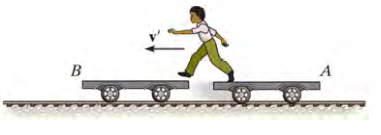

**Çözüm:**\
Momentum korunumu:

$$
0 = m_{c} \cdot v_{c} + m_{a} \cdot v_{a}
$$

Bağıl hız denklemi:

$$
v_{c} = v_{a} + v_{c/a} \Rightarrow v_{c} = v_{a} + 3
$$

$$
0 = 75(v_{a} + 3) + 50v_{a} \Rightarrow 125v_{a} = - 225 \Rightarrow v_{a} = - 1.8\text{ m/s}
$$

$$
v_{c} = - 1.8 + 3 = 1.2\text{ m/s}
$$

**Soru 9:** Sürtünmesiz ray üzerinde duran 50 kg kütleli A aracı üzerindeki 75 kg kütleli çocuk, araca göre 3 m/s bağıl hızla yatay olarak atlıyor. Çocuk atladıktan hemen sonra A aracının hızı (büyüklük olarak) nedir?

**Çözüm:**

\
Momentum korunumu:

$$
0 = m_{c} \cdot v_{c} + m_{a} \cdot v_{a}
$$

Bağıl hız denklemi:

$$
v_{c} = v_{a} + v_{c/a} \Rightarrow v_{c} = v_{a} + 3
$$

$0 = 75(v_{a} + 3) + 50v_{a} \Rightarrow 125v_{a} = - 225 \Rightarrow v_{a} = - 1.8\text{ m/s}$

**Soru 10:** 50 tonluk bir lokomotif ve her biri 30 tonluk 3 vagon duruştan harekete geçiyor. Trenin 80 saniyede 40 km/h (11.11 m/s) hıza ulaşması için lokomotifin tekerleklerine etki eden **ortalama** çekiş kuvveti (F) ne olmalıdır? (Sürtünmeleri ihmal ediniz).

**Çözüm:**

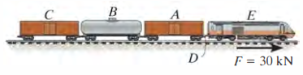\
Toplam Kütle $= 50 + 3(30) = 140\text{ ton} = 140.000\text{ kg}$

$$
F \cdot \Delta t = m \cdot \Delta v
$$

$$
F \cdot 80 = 140.000 \cdot 11.11
$$

$$
F = 19.442\text{ N} \approx 19.4\text{ kN}
$$

**Soru 11:** 2500 kg'lık bir cip (A), 1250 kg'lık bir arabayı (B) vinç halatı kendine göre 2 m/s hızla çekmektedir. Çarpıştıkları andaki hızlarını momentum korunumu ile ilişkilendiriniz (Başlangıçta duruyorlar, sürtünmeyi ihmal ediniz).\
**Çözüm:**

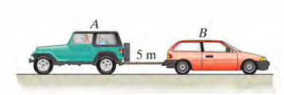\
Momentum korunumu: $m_{A}v_{A} + m_{B}v_{B} = 0$

$$
2500v_{A} + 1250v_{B} = 0 \Rightarrow v_{B} = - 2v_{A}
$$

Bağıl Hız: $v_{A/B} = v_{A} - v_{B} = 2$(halat sarma hızı)

$$
v_{A} - \left( - 2v_{A} \right) = 2 \Rightarrow 3v_{A} = 2 \Rightarrow v_{A} = 0.67\text{ m/s, }v_{B} = - 1.33\text{ m/s}
$$

**Soru 12:** 300 kg'lık bir araba üzerindeki 75 kg'lık bir adam, 0.1 kg'lık bir mermiyi arabaya göre 900 m/s hızla yatay olarak ateşliyor. Ateşleme sonrası arabanın hızı ne olur? (Başlangıçta duruyorlar, sürtünmeyi ihmal ediniz).

**Çözüm:**

\
Sistem momentumu korunur (Başlangıçta 0).

$0 = m_{mermi}v_{mermi} + (m_{adam} + m_{araba})v_{araba}$

$$
v_{mermi} = v_{araba} + 900
$$

$$
0 = 0.1(v_{araba} + 900) + (375)v_{araba}
$$

$$
0 = 0.1v_{araba} + 90 + 375v_{araba} \Rightarrow 375.1v_{araba} = - 90
$$

$$
v_{araba} \approx - 0.24\text{ m/s}
$$

**Soru 13:** Buz pateni yapan 70 kg kütleli bir sporcu, elindeki 8 kg'lık bir bloğu kendisine göre 2 m/s hızla yatay olarak fırlatıyor. Başlangıçta duran sporcunun fırlatma sonrası hızı ne olur?

**Çözüm:**

$$
0 = m_{blok}v_{blok} + m_{sporcu}v_{sporcu}
$$

$$
v_{blok} = v_{sporcu} + 2
$$

(Bağıl hız)

$$
0 = 8(v_{sporcu} + 2) + 70v_{sporcu}
$$

$$
78v_{sporcu} = - 16 \Rightarrow v_{sporcu} = - 0.205\text{ m/s}
$$

**Soru 14:** 0.5 kg kütleli A topu 6 m/s hızla sağa giderken, durmakta olan 5 kg kütleli B bloğuna çarpıyor. Geri dönme (Restitüsyon) katsayısı $e = 0.6$ise çarpışmadan hemen sonra B'nin hızı ne olur? $e = (v_{B2} - v_{A2})/(v_{A1} - v_{B1})$\
**Çözüm:**

Momentum Korunumu:

$$
0.5(6) + 0 = 0.5v_{A2} + 5v_{B2} \Rightarrow 3 = 0.5v_{A2} + 5v_{B2}\ldots(1)
$$

Restitüsyon:

$$
e = (v_{B2} - v_{A2})/(v_{A1} - v_{B1}) \Rightarrow 0.6 = (v_{B2} - v_{A2})/6
$$

$$
3.6 = v_{B2} - v_{A2} \Rightarrow v_{A2} = v_{B2} - 3.6\ldots(2)
$$

(2)🡪(1):

$$
3 = 0.5(v_{B2} - 3.6) + 5v_{B2}
$$

$$
3 = 0.5v_{B2} - 1.8 + 5v_{B2} \Rightarrow 4.8 = 5.5v_{B2} \Rightarrow v_{B2} \approx 0.87\text{ m/s}
$$

**Soru 15:** 5000 kg'lık kamyon 30 km/h hızla giderken, aynı yönde 10 km/h hızla giden 2000 kg'lık araca arkadan çarpıyor. Çarpışma sonrası araçlar kenetlenirse (plastik çarpışma), ortak hız ne olur?

**Çözüm:**

$30\text{ km/h} = 8.33\text{ m/s}$, $10\text{ km/h} = 2.78\text{ m/s}$

$$
\Sigma mv_{1} = \Sigma mv_{2}
$$

$$
5000(8.33) + 2000(2.78) = (7000)v_{ortak}
$$

$$
41650 + 5560 = 7000v_{ortak} \Rightarrow 47210 = 7000v_{ortak}
$$

$$
v_{ortak} \approx 6.74\text{ m/s}(24.3\text{ km/h})
$$

**Soru 16:** 10 kg'lık A silindiri aşağı doğru 2 m/s hızla hareket ederken, ipe bağlı 8 kg'lık B silindiri yukarı doğru hareket etmektedir. 3 saniye sonraki hızları bulmak için kullanılacak temel impuls-momentum denklemini (A cismi için) yazınız. (İp gerilmesi T).

\
**Çözüm:**\
A cismi için (Aşağı yön pozitif):

$$
m_{A}v_{A1} + \Sigma\int Fdt = m_{A}v_{A2}
$$

$$
10(2) + (10 \cdot 9.81 \cdot 3) - (T \cdot 3) = 10v_{A2}
$$

**Soru 17:** Makaralı sistemde A bloğu 10 kg, B bloğu 50 kg'dır. Sistem serbest bırakıldıktan 2 saniye sonra B bloğunun hızı ne olur? (İp gerilmesini ve ivmeyi sabit varsayınız, basit dinamik de kullanılabilir ancak impuls ile çözünüz).

\
**Çözüm:**\
Sistem ivmesi

$$
a = (m_{B} - m_{A})g/(m_{B} + m_{A}) = (40 \cdot 9.81)/60 = 6.54\text{ m/s}^{2}
$$

$$
v = v_{0} + at = 0 + 6.54 \cdot 2 = 13.08\text{ m/s}
$$

**Soru 18:** Şekildeki sistemde elastik ip ucundaki 3 kg'lık disk yatay düzlemde dönmektedir. $r_{1} = 1.5$m'de teğetsel hız 5 m/s ise, ip kısaltılıp $r_{2} = 1.2$ m olduğunda diskin hızı ne olur?

\
**Çözüm:**\
Açısal Momentum Korunumu:

$$
H_{1} = H_{2} \Rightarrow m \cdot v_{1} \cdot r_{1} = m \cdot v_{2} \cdot r_{2}
$$

$$
3 \cdot 5 \cdot 1.5 = 3 \cdot v_{2} \cdot 1.2
$$

$$
7.5 = 1.2v_{2} \Rightarrow v_{2} = 6.25\text{ m/s}
$$

**Soru 19:** 2 kg'lık bir top, ipe asılı 20 kg'lık duran bir bloğa 4 m/s hızla çarpıyor. Restitüsyon katsayısı $e = 0.8$. Çarpışmadan hemen sonra bloğun hızı nedir?

\
**Çözüm:**

Momentum:

$$
2(4) + 0 = 2v_{A2} + 20v_{B2} \Rightarrow 4 = v_{A2} + 10v_{B2}
$$

Restitüsyon:

$$
0.8 = (v_{B2} - v_{A2})/4 \Rightarrow 3.2 = v_{B2} - v_{A2}
$$

Taraf tarafa topla:

$$
7.2 = 11v_{B2} \Rightarrow v_{B2} \approx 0.65\text{ m/s}
$$

**Soru 20:** 1500 kg'lık bir roket kızağına etki eden itki kuvvetinin zamana göre değişimi şekilde (kN cinsinden) verilmiştir. Kızağın t = 2.5 s'deki hızı nedir? (Başlangıç hızı 0, sürtünme ihmal edilecektir.)

\
**Çözüm:**\
İtme, kuvvet-zaman grafiğinin altında kalan alandır. Grafik 0.5 s genişliğinde 5 basamaktan oluşur: 30, 60, 90, 60 ve 30 kN.

$$
I = 0.5 \cdot (30 + 60 + 90 + 60 + 30) = 135\text{ kN} \cdot \text{s} = 135000\text{ N} \cdot \text{s}
$$

$$
I = m\Delta v \Rightarrow 135000 = 1500 \cdot v_{son}
$$

$$
v_{son} = 90\text{ m/s}
$$

**Soru 21:** 2 kg'lık top, 0.5 m yarıçaplı dairesel yolda 5 m/s hızla dönmektedir. Topa teğetsel bir kuvvet etki etmemektedir. İp çekilerek yarıçap 0.25 m'ye düşürülürse yeni hız ne olur?\
**Çözüm:**\
Açısal Momentum Korunumu

$$
mv_{1}r_{1} = mv_{2}r_{2}
$$

$$
5 \cdot 0.5 = v_{2} \cdot 0.25
$$

$$
2.5 = 0.25v_{2} \Rightarrow v_{2} = 10\text{ m/s}
$$

# BÖLÜM 3: ZOR SEVİYE (8 Soru)

**Soru 22:** 4 kg'lık bir mermi yatayda 20 m/s hızla giderken havada patlayarak iki parçaya ayrılıyor: A parçası (1.5 kg) ve B parçası (2.5 kg). A parçası yatayla 45 derece yukarı sola doğru B parçası yatayla 30 derece aşağı sağa doğru fırlıyor. A parçasının hızını bulunuz.

\
**Çözüm:** (Patlamadan önce dikey momentum 0)\
Dikey Momentum Korunumu: $0 = m_{A}(v_{A}\sin 45) - m_{B}(v_{B}\sin 30)$

$$
1.5\frac{v_{A}}{\sqrt{2}} - 2.5\frac{v_{B}}{2} = 0 \rightarrow v_{B} = 0.8485v_{A}\ldots(1)
$$

Yatay Momentum korunumu:

$$
4(20) = 1.5(v_{A}\cos 45) + 2.5(v_{B}\cos 30)
$$

$$
80 = - 1.5\frac{v_{A}}{\sqrt{2}} + 2.5v_{B}\frac{\sqrt{3}}{2} \rightarrow - 1.061v_{A} + 2.165v_{B} = 80..(2)
$$

(1)🡪2\
$$
- 1.061v_{A} + 2.165 \bullet 0.8485v_{A} = 80
$$

$$
0.7765v_{A} = 80 \rightarrow v_{A} \approx 103.0\ m/sn
$$

**Soru 23:** 800 kg'lık bir kazık (pile), 300 kg'lık bir çekiç ile 0.5 m yükseklikten vurularak kuma çakılıyor. Çarpışma plastik değil, $e = 0.1$ . Çekiç kazığa çarptığında kazığın ilk hızı ne olur?

\
**Çözüm:**\
Çekiç hızı

$v_{c1} = \sqrt{2 \cdot 9.81 \cdot 0.5} \approx 3.13\text{ m/s}$

Momentum:

$$
300(3.13) + 0 = 300v_{c2} + 800v_{p2}\ldots(1)
$$

$$
e = 0.1 = \frac{v_{p2} - v_{c2}}{3.13} \Rightarrow v_{p2} - v_{c2} = 0.313 \rightarrow v_{c2} = - 0.313 + v_{p2}\ldots(2)
$$

(2)🡪(1)

$$
300(3.13) = 300 \bullet \left( - 0.313 + v_{p2} \right) + 800 \bullet v_{p2}
$$

$$
v_{p2} \approx 0.94\text{ m/s}
$$

**Soru 24:** 0.4 kg'lık A bilardo topu 5 m/s hızla duran B topuna çarpıyor. Çarpışma merkezi değil, eğik çarpışmadır. Çarpışma düzleminin normali ile A'nın geliş doğrultusu arasında 30 derece açı vardır. $e = 0.8$ . B topunun çarpışma sonrası hızı nedir? (B topu normal doğrultusunda hareket eder).

\
**Çözüm:**\
Teğetsel momentum korunur: $v_{At2} = v_{At1} = 5\sin 30 = 2.5\text{ m/s}$\
Normal momentum: $m(5\cos 30) = mv_{An2} + mv_{Bn2}$

Restitüsyon (Normal eksen): $0.8 = (v_{Bn2} - v_{An2})/(5\cos 30)$

Çözümden $v_{Bn2}$ bulunur.

**Soru 25:** 3 kg kütleli bir top eğri bir yoldan aşağı kayarak B noktasına geliyor. B noktasındaki eğrilik yarıçapı 10 m'dir. Topun hızı 20 m/s ise ve B noktası eğrilik merkezine (O) göre yatay konumdaysa, topun O noktasına göre açısal momentumu nedir?

\
**Çözüm:**

$H_{O} = m \cdot v \cdot r$

(Hız vektörü yarıçap vektörüne diktir)

$H_{O} = 3\text{ kg} \cdot 20\text{ m/s} \cdot 10\text{ m} = 600\text{ kg} \cdot \text{m}^{2}/\text{s}$

**Soru 26:** Bir lunapark aracı $r = 3\$m yarıçaplı yörüngede 10 m/s hızla dönerken, kol içeri doğru çekilerek yarıçap saniyede 1 m/s hızla kısaltılıyor. Yarıçap 2 m olduğunda aracın teğetsel hızı ne olur?

**Çözüm:**\
Merkezi kuvvet moment oluşturmaz, Açısal Momentum Korunur.

$$
mv_{1}r_{1} = mv_{2}r_{2}
$$

$$
10 \cdot 3 = v_{2} \cdot 2 \Rightarrow v_{2} = 15\text{ m/s}
$$

---

# Ünite 6: Rijit Cismin Düzlemsel Kinematiği

## Ünite 6: Rijit Cismin Düzlemsel Kinematiği - Sözel Sorular

**Cismin Kinematiği – Ünite 6 Sözel Test Soruları ve Çözümleri**

**Soru 1**

**Bir rijit cisim üzerindeki herhangi bir doğru parçası, hareket boyunca orijinal konumuna paralel kalıyorsa bu hareket türü aşağıdakilerden hangisidir?**

- A) Sabit eksen etrafında dönme
- B) Genel düzlemsel hareket
- C) Öteleme (Translation)
- D) Açısal ivmelenme
- E) Göreli hareket

**Doğru Cevap: C**

**Açıklama:** Öteleme hareketi, cisim üzerindeki bir çizginin hareket süresince orijinal yönelimine paralel kaldığı durumdur. Bu, doğrusal veya eğrisel öteleme şeklinde olabilir.

**Soru 2**

**Sabit bir eksen etrafında dönen rijit bir cisim üzerindeki bir P noktasının hız büyüklüğü (v), açısal hız (omega) ve dönme eksenine olan uzaklık (r) cinsinden nasıl ifade edilir?**

- A) v = omega \* r^2
- B) v = omega / r
- C) v = alfa \* r
- D) v = omega \* r
- E) v = r / omega

**Doğru Cevap: D**

**Açıklama:** Dönen bir cisim üzerindeki bir noktasının teğetsel hızı, cismin açısal hızı ile noktanın dönme eksenine olan dik uzaklığının çarpımına eşittir.

**Soru 3**

**Sabit bir eksen etrafında dönen bir cisimdeki P noktasının "normal ivme" (an) bileşeni fiziksel olarak neyi temsil eder?**

- A) Hızın büyüklüğündeki değişimi
- B) Hızın yönündeki değişimi
- C) Açısal ivmenin değişimini
- D) Coriolis ivmesini
- E) Teğetsel yer değiştirmeyi

**Doğru Cevap: B**

**Açıklama:** Normal ivme (an = omega^2 \* r), hız vektörünün yönündeki değişimi ifade eder ve her zaman dönme merkezine doğru yönelmiştir.

**Soru 4**

**Kaymadan yuvarlanan (rolls without slipping) r yarıçaplı bir tekerleğin merkezinin ivmesi (aG) ile açısal ivmesi (alfa) arasındaki ilişki nasıldır?**

- A) aG = 0
- B) aG = omega \* r
- C) aG = alfa \* r
- D) aG = alfa / r
- E) aG = omega^2 \* r

**Doğru Cevap: C**

**Açıklama:** Kaymadan yuvarlanma şartında, temas noktası anlık olarak durduğu için kütle merkezinin ivmesi, açısal ivme ile yarıçapın çarpımına eşittir.

**Soru 5**

**Genel düzlemsel hareket yapan bir rijit cisim için, hızı anlık olarak sıfır olan noktaya ne ad verilir?**

- A) Kütle merkezi
- B) Geometrik merkez
- C) Anlık sıfır hız merkezi (IC)
- D) Dönme ekseni
- E) Eylemsizlik merkezi

**Doğru Cevap: C**

**Açıklama:** Genel düzlemsel harekette, cismin sanki o nokta etrafında dönüyormuş gibi davrandığı ve hızının sıfır olduğu nokta "Anlık Sıfır Hız Merkezi" (IC) olarak adlandırılır.

**Soru 6**

**Bağıl hareket analizinde kullanılan hız denklemi vB = vA + vB/A şeklinde yazıldığında, vB/A terimi (B'nin A'ya göre hızı) neyi ifade eder?**

- A) B noktasının mutlak hızını
- B) A noktasının öteleme hızını
- C) B noktasının A etrafındaki dairesel hareketinden kaynaklanan hızı
- D) Coriolis hızını
- E) A ve B noktalarının ortalama hızını

**Doğru Cevap: C**

**Açıklama:** vB/A terimi, gözlemcinin A noktasına sabitlendiği durumda B noktasının hızını temsil eder. Bu, cismin A noktası etrafındaki dönme hareketinden kaynaklanır (vB/A = omega \* r).

**Soru 7**

**İki nokta arasındaki bağıl ivme denklemi aB = aA + (aB/A)t + (aB/A)n şeklinde yazıldığında, (aB/A)n normal ivme bileşeninin büyüklüğü nedir?**\
*(Not: omega = açısal hız, alfa = açısal ivme, r = mesafe)*

- A) alfa \* r
- B) omega \* r
- C) omega^2 \* r
- D) alfa^2 \* r
- E) v / r

**Doğru Cevap: C**

**Açıklama:** Bir noktanın diğerine göre bağıl hareketindeki normal ivme bileşeni, açısal hızın karesi ile aralarındaki mesafenin çarpımına (omega^2 \* r) eşittir.

**Soru 8**

**Dönen eksenler kullanılarak yapılan bağıl hareket analizinde ortaya çıkan "2 \* Omega \* (vB/A)xyz" terimi hangi ivme türünü ifade eder?**

- A) Teğetsel ivme
- B) Normal ivme
- C) Coriolis ivmesi
- D) Açısal ivme
- E) Öteleme ivmesi

**Doğru Cevap: C**

**Açıklama:** Dönen bir referans çerçevesi üzerinde hareket eden bir parçacığın analizinde, referans sisteminin dönmesinden ve parçacığın bu sisteme göre hareketinden kaynaklanan ek terime Coriolis ivmesi denir.

**Soru 9**

**Bir rijit cismin açısal ivmesi (alfa) sabit ise, açısal hız (omega) ile zaman (t) arasındaki ilişkiyi veren denklem hangisidir?**\
*(omega0: ilk açısal hız)*

- A) omega = omega0 + alfa \* t
- B) omega = omega0 \* t + alfa
- C) omega = alfa \* t^2
- D) omega = omega0 + 0.5 \* alfa \* t^2
- E) omega^2 = omega0^2 + 2 \* alfa

**Doğru Cevap: A**

**Açıklama:** Sabit açısal ivmeli harekette, son açısal hız; ilk açısal hız ile açısal ivmenin zamanla çarpımının toplamına eşittir (doğrusal hareketteki v = v0 + at denkleminin benzeridir).

**Soru 10**

**Anlık hız merkezi (IC) yöntemi ile ilgili aşağıdaki ifadelerden hangisi yanlıştır?**

- A) IC noktasının hızı o an için sıfırdır.
- B) Cismin açısal hızı, herhangi bir noktanın hızının IC'ye olan uzaklığa bölünmesiyle bulunabilir (omega = v / r).
- C) IC'nin konumu zamanla değişebilir (bir yörünge çizer).
- D) IC noktası her zaman cismin fiziksel sınırları içinde olmalıdır.
- E) Bir noktanın hız vektörü, o noktayı IC'ye birleştiren doğruya diktir.

**Doğru Cevap: D**

**Açıklama:** Anlık hız merkezi (IC), cismin fiziksel sınırları üzerinde olmak zorunda değildir; cismin dışında, uzayda hayali bir nokta da olabilir. Diğer şıklar IC yönteminin doğru özellikleridir.

---

## Ünite 6: Rijit Cismin Düzlemsel Kinematiği - Sayısal Sorular ve Çözümleri

**Cismin Kinematiği – Ünite 6 Sayısal Test Soruları ve Çözümleri**

# BÖLÜM 1: KOLAY SEVİYE (8 Soru)

**Soru 1:** Şekildeki çubuk duvara ve yere dayalı olarak kaymaktadır. A ucu sağa doğru $v_{A} = 3$ m/s hızla hareket etmektedir. $\theta = 30^{\circ}$ olduğu anda çubuğun açısal hızı ($\omega$) kaç rad/s'dir? (Çubuk boyu $L = 1.5$m)

\
**Çözüm:**\
Kinematik ilişki: $v_{A} = - L \cdot \omega \cdot \sin(\theta)$ (Yatay hız bileşeni türevi)\
Veya Ani Dönme Merkezi (IC) yöntemiyle: A noktasındaki hız vektörüne dik ve B noktasındaki hız vektörüne dik doğruların kesişimi IC noktasıdır.\
$r_{A/IC} = L \cdot \sin(30^{\circ}) = 1.5 \cdot 0.5 = 0.75$ m

$\omega = v_{A}/r_{A/IC} = 3/0.75 = 4$ rad/s.

**Soru 2:** Şekildeki sistemde çubuğun açısal hızı 4 rad/s ise, $\theta = 30^{\circ}$olduğu anda B noktasının (duvar üzerindeki uç) hızı kaç m/s olur? (Çubuk boyu $L = 1.5$ m)\
**Çözüm:**\
IC Yöntemi ile:

$r_{A/IC} = L \cdot \sin(30^{\circ}) = 1.5 \cdot 0.5 = 0.75$ m

$\omega = v_{A}/r_{A/IC} = 3/0.75 = 4$ rad/s.

$r_{B/IC} = L \cdot \cos(30^{\circ}) = 1.5 \cdot \frac{\sqrt{3}}{2} \approx 1.3$ m

$v_{B} = \omega \cdot r_{B/IC} = 4 \cdot 1.3 = 5.2$ m/s.

**Soru 3:** Yarıçapı $r = 0.15$ m olan bir disk, $\omega_{0} = 2$ rad/s ilk açısal hızıyla dönmekte ve $\alpha = 1$ rad/s² sabit açısal ivmeyle hızlanmaktadır. $t = 2$ saniye sonra diskin kenarındaki bir noktanın teğetsel hızı ($v$) ne olur?

**Çözüm:**

$\omega = \omega_{0} + \alpha t = 2 + 1(2) = 4$ rad/s\
$v = \omega \cdot r = 4 \cdot 0.15 = 0.6$ m/s.

**Soru 4:** Bir diske sarılı ip aşağıya doğru $a(t) = 2.4t$m/s² ivmesiyle inmektedir. Diskin yarıçapı $r = 0.$<!-- -->2 ve başlangıç hızı sıfırdır. Diskin açısal konumunu ($\theta$) veren fonksiyon nedir?\
**Çözüm:**\
Teğetsel ivme:

$a_{t} = \alpha \cdot r \Rightarrow 2.4t = \alpha \cdot 0.2 \Rightarrow \alpha = 12t$rad/s²

$\omega = \int\alpha dt = \int 12tdt = 6t^{2}$

$\theta = \int\omega dt = \int 6t^{2}dt = 2t^{3}$ rad.

**Soru 5:** Bir diske sarılı ip aşağıya doğru $a(t) = 2.4t$m/s² ivmesiyle inmektedir. Diskin yarıçapı $r = 0.$<!-- -->2 ve başlangıç hızı sıfırdır. Diskin açısal hızının ($\omega$) zamana bağlı değişim fonksiyonu nedir?\
**Çözüm:**\
$$
a_{t} = \alpha \cdot r \Rightarrow 2.4t = \alpha \cdot 0.2 \Rightarrow \alpha = 12t
$$

$\omega = \int\alpha dt = 6t^{2}$ rad/s.

**Soru 6:** Bir diske sarılı ip aşağıya doğru $a(t) = 2.4t$m/s² ivmesiyle inmektedir. Diskin yarıçapı $r = 0.$<!-- -->2 ve başlangıç hızı sıfırdır. $t = 2$ saniye anındaki açısal hız kaç rad/s olur?\
**Çözüm:**

$$
a_{t} = \alpha \cdot r \Rightarrow 2.4t = \alpha \cdot 0.2 \Rightarrow \alpha = 12t
$$

$\omega = \int\alpha dt = 6t^{2}$ rad/s.

$\omega(2) = 6 \cdot (2^{2}) = 6 \cdot 4 = 24$ rad/s.

**Soru 7:** Bir elektrik motoru A dişlisini $\omega_{A} = 40$ rad/s sabit hızla döndürmektedir. A dişlisinin yarıçapı 20 mm, buna temas eden B dişlisinin yarıçapı 50 mm'dir. B dişlisinin açısal hızı nedir?\
**Çözüm:**\
Temas noktasındaki hızlar eşittir

$$
v = \omega_{A}r_{A} = \omega_{B}r_{B}
$$

$$
40 \cdot 20 = \omega_{B} \cdot 50
$$

$\omega_{B} = 800/50 = 16$ rad/s.

**Soru 8:** Bir makaranın iç göbeğine sarılı ip $v = 2$ m/s sabit hızıyla çekilmektedir. Makara kaymadan yuvarlanmaktadır. İç yarıçap $r = 0.1$ m, dış yarıçap $R = 0.2$ m ise makaranın açısal hızı nedir?\
**Çözüm:**\
Kaymadan yuvarlanma durumunda yerle temas noktası anlık dönme merkezidir (IC).\
İpin çıktığı noktanın yere uzaklığı: $R - r = 0.2 - 0.1 = 0.1$ m.\
$v = \omega \cdot (R - r) \Rightarrow 2 = \omega \cdot 0.1 \Rightarrow \omega = 20$ rad/s.

# BÖLÜM 2: ORTA SEVİYE (16 Soru)

**Soru 9:** Şekildeki sistemde açının zamanla değişimi $\theta(t) = 1.5\sin(3t)$ radyan olarak verilmiştir. Yarıçapı $r = 2$ m olan diskin A noktasındaki (çember üzerinde) teğetsel hızın ulaşabileceği maksimum değer nedir?

\
**Çözüm:**\
Açısal hız: $\omega = d\theta/dt = 1.5 \cdot 3 \cdot \cos(3t) = 4.5\cos(3t)$\
Maksimum açısal hız : $\omega_{\max} = 4.5$ rad/s (kosinüs 1 olduğunda).\
Maksimum hız: $v_{\max} = \omega_{\max} \cdot r = 4.5 \cdot 2 = 9$m/s.

**Soru 10:** Kaynak 2 (Google Form, Sayfa 11, Soru 11)\
**Soru:** Bir disk $\omega_{0} = 8$ rad/s ilk hızıyla dönmeye başlıyor ve $\alpha = 6$rad/s² sabit ivmeyle hızlanıyor. $t = 0.5$ saniye sonraki açısal hızı nedir?\
**Çözüm:**\
$$
\omega = \omega_{0} + \alpha t
$$

$\omega = 8 + 6(0.5) = 8 + 3 = 11$ rad/s.

**Soru 11:** $\omega_{0} = 8$ rad/s ve $\alpha = 6$ rad/s² olan bir disk, 2 tam tur attıktan sonraki açısal hızı kaç rad/s olur?

**Çözüm:**

$\theta = 2\text{ tur} = 2 \cdot 2\pi = 4\pi \approx 12.57$ rad.\
$$
\omega^{2} = \omega_{0}^{2} + 2\alpha\theta
$$

$\omega^{2} = 8^{2} + 2 \cdot 6 \cdot 12.57 = 64 + 150.84 = 214.84$

$\omega = \sqrt{214.84} \approx 14.66$ rad/s.

**Soru 12:** $\omega_{0} = 8$ rad/s, $\alpha = 6$ rad/s² olan bir diskin yarıçapı $r = 2$ m'dir. $t = 0.5$ saniyede, diskin kenarındaki bir noktanın ivmesinin *normal* (merkezcil) bileşeni kaç m/s² olur?

**Çözüm:**\
Önce $t = 0.5\$s'deki $\omega$ bulunur:

$\omega = 8 + 6(0.5) = 11$ rad/s.

$a_{n} = \omega^{2} \cdot r = 11^{2} \cdot 2 = 121 \cdot 2 = 242$ m/s².

**Soru 13:** $\omega_{0} = 8$ rad/s, $\alpha = 6$ rad/s² olan bir diskin yarıçapı $r = 2$ m'dir. Diskin $t = 0.5$ saniyede ivmenin *teğetsel* bileşeni kaç m/s² olur?\
**Çözüm:**

$a_{t} = \alpha \cdot r \rightarrow a_{t} = 6 \cdot 2 = 12$m/s².

**Soru 14:** Pinyon dişlisi A, sabit B dişli rafı üzerinde yuvarlanmaktadır. A'nın açısal hızı $\omega = 4$ rad/s ise, A'nın merkezine bağlı olan ve A ile birlikte hareket eden üstteki C dişli rafının hızı nedir? (A'nın yarıçapı $r = 0.15$ m).

<figure>

</figure>

**Çözüm:**\
Ani Dönme Merkezi (IC), A'nın B ile temas noktasıdır.\
A'nın merkez hızı: $v_{A} = \omega \cdot r = 4 \cdot 0.15 = 0.6$ m/s.\
C rafı, A dişlisinin en üst noktasına temas eder (IC'ye uzaklık $2r$).\
$v_{C} = \omega \cdot (2r) = 4 \cdot 0.3 = 1.2$ m/s.

**Soru 15:** Bir tekerlek yatay düzlemde kaymadan yuvarlanıyor. Tekerleğin merkezinin hızı sağa doğru 2 m/s ise, tekerleğin yere temas eden noktasının (A) ve en üst noktasının (B) hızları nedir?\
**Çözüm:**\
Kaymadan yuvarlanma $\rightarrow v_{A} = 0$

(IC noktası).\
Merkez hızı: $v_{O} = 2$ m/s.\
En üst nokta (B), merkezin IC'ye olan uzaklığının iki katı uzaklıktadır.\
$v_{B} = 2 \cdot v_{O} = 2 \cdot 2 = 4$ m/s (Sağa doğru).

**Soru 16:** Yarıçapı 0.5 m olan bir disk sola doğru yuvarlanıyor. Merkezinin hızı $v_{O} = 3$ m/s ve açısal ivmesi $\alpha = 8$ rad/s²'dir. Kaymadan yuvarlanıyorsa, diskin en üst noktasının teğetsel ivmesi ($a_{t}$) nedir ($\omega = 0$)?

**Çözüm:**\
En üst noktanın (B) ivmesi:

${\vec{a}}_{B} = {\vec{a}}_{O} + {\vec{a}}_{B/O}$

\
Merkez ivmesi

$a_{O} = \alpha \bullet r = 8 \cdot 0.5 = 4$ m/s² (sola).\
B'nin O'ya göre teğetsel ivmesi

$a_{t,B/O} = \alpha \bullet r = 4$ m/s² (sola).\
Toplam teğetsel ivme (yatay bileşen): $4 + 4 = 8$ m/s².

2\. yol

$$
{\vec{a}}_{B} = {\vec{a}}_{O} + \vec{\alpha} \times {\vec{r}}_{B/O} - \omega^{2}{\vec{r}}_{B/O}
$$

$$
{\vec{a}}_{B} = - 4\vec{i} - 8\vec{k} \times 0.5\vec{j} - \omega\left( \omega{\vec{r}}_{B/O} \right)
$$

$$
{\vec{a}}_{B} = {\vec{a}}_{O} + \vec{\alpha} \times {\vec{r}}_{B/O} - \omega^{2}{\vec{r}}_{B/O}
$$

$$
{\vec{a}}_{B} = - 4\vec{i} - 8\vec{k} \times 0.5\vec{j} = - 8\vec{i} + - \omega^{2}{\vec{r}}_{B/O}
$$

**Soru 17:** Bir bowling topu $v_{O} = 8$ m/s hızla ilerlerken, aynı anda $\omega = 10$ rad/s hızla (ters yönde, kayarak) dönmektedir. Yarıçap $r = 0.12$ m ise, topun yerle temas eden A noktasının hız büyüklüğü nedir?

**Çözüm:**

$$
v_{A} = v_{O} - \omega \cdot r
$$

(Dönme hızı ilerlemeye ters yönde hız yaratır).

$v_{A} = 8 - (10 \cdot 0.12) = 8 - 1.2 = 6.8$ m/s.

**Soru 18:** AB kolu 6 rad/s sabit açısal hızla dönmektedir. BC kolunun A ve B noktaları arasındaki yatay mesafe 0.3 m, düşey mesafe 0.4 m'dir. B noktasının hızını hesaplayınız.

**Çözüm:**

$$
r_{AB} = \sqrt{0.3^{2} + 0.4^{2}} = 0.5
$$

$v_{B} = \omega_{AB} \cdot r_{AB} = 6 \cdot 0.5 = 3$ m/s.\
Hız vektörü AB koluna diktir.

**Soru 19:** Şekildeki çubuk yarım daire üzerinde sola doğru kaymaktadır. $\theta = 30^{\circ}$ iken açısal hız $\omega = - 2$ rad/s (saat yönü). Çubuğun A ucunun $v_{A}$ nedir? (Yarıçap $r = 2$ m, $x = r/sin\theta$)

\
**Çözüm:**

Geometri:

$x = r/sin\theta$

Türev:

$v_{A} = dx/dt = - r \cdot (\cos\theta/{\sin}^{2}\theta) \cdot (d\theta/dt)$

$v_{A} = - 2 \cdot (\cos 30/{\sin}^{2}30) \cdot ( - 2)$

$v_{A} = - 2 \cdot \left( \frac{0.866}{0.25} \right) \cdot ( - 2) = 13.86$ m/s.

**Soru 20:** Dişli B sabit bir yatay raf içindedir. A iç göbeğine sarılı ip $v = 0.6$ m/s ile çekilmektedir. Dişli merkezinin hızı nedir? (İç yarıçap 0.15 m, Dış yarıçap 0.3 m).

$$
\mathbf{r}_{\mathbf{iç}}
$$

$$
\mathbf{r}_{\mathbf{d\imath s}}
$$

<figure>

<figcaption>
<math display="block" xmlns="http://www.w3.org/1998/Math/MathML"><semantics><mi mathvariant="bold-italic">𝒗</mi><annotation encoding="application/x-tex">\mathbf{v}</annotation></semantics></math>
</figcaption>
</figure>

**Çözüm:**\
Dış temas noktası (üst nokta) sabit (IC).\
İç göbek (A noktası) IC'ye $(0.3 - 0.15) = 0.15m\ uzakl\imath kta.$

$$
\omega = v_{A}/r_{A/IC} = 0.6/0.15 = 4rad/s.
$$

Merkez hızı $v_{C} = \omega \cdot 0.3 = 4 \cdot 0.3 = 1.2$m/s.

**Soru 21:** Makaslı platformda (Scissor lift), A ucu sağa $v_{A} = 1.5$m/s ile giderken, $\theta = 30^{\circ}$anında kolların açısal hızı nedir? (Kol uzunluğu 4m, yarısı 2m).

**Çözüm:**\
Yatay mesafe $x = 2 \cdot (2\cos\theta) = 4\cos\theta$

$$
v_{A} = dx/dt = - 4\sin\theta \cdot \omega
$$

$$
1.5 = - 4 \cdot \sin(30) \cdot \omega \Rightarrow 1.5 = - 2\omega \Rightarrow \omega = - 0.75rad/s.
$$
Büyüklük 0.75 rad/s.

**Soru 22:** AB kolu 10 rad/s ile dönerken B pistonunun hızı nedir?

$$
\mathbf{\omega}
$$

<figure>

<figcaption>
<math display="block" xmlns="http://www.w3.org/1998/Math/MathML"><semantics><msub><mi>r</mi><mrow><mi>A</mi><mi>B</mi></mrow></msub><annotation encoding="application/x-tex">r_{AB}</annotation></semantics></math>
</figcaption>
</figure>

**Çözüm:**

A:(0,0)

B:(-0.5cos45, 0.5sin45)=(-0.3536, 0.3536)

$$
{\vec{r}}_{B/A} = B - A = - 0.3536\vec{i} + 0.3536\vec{j}
$$

$v_{B} = \omega \times r_{\frac{A}{B}} = - 10\vec{k} \times \left( - 0.3536\vec{i} + 0.3536\vec{j} \right) = 3.536\vec{i} + 3.536\vec{j}$

**Soru 24:** Bir disk 8 rad/s ilk hız ve 6 rad/s² açısal ivme ile dönüyor. 0.5 saniye sonra, disk üzerindeki bir A noktasının toplam hız büyüklüğü 11 m/s ise, diskin yarıçapı kaç metredir?\
**Çözüm:**

$t = 0.5$ sn sonra

$\omega = 8 + 6(0.5) = 11$ rad/s.

$v = \omega \cdot r \Rightarrow 11 = 11 \cdot r \Rightarrow r = 1$ metre.

# BÖLÜM 3: ZOR SEVİYE (8 Soru)

**Soru 26:** AB çubuğu 5 rad/s açısal hız ve 3 rad/s² açısal ivme ile dönerken, C kayar bloğu bir kanalda hareket etmektedir. Mekanizmanın konumu gereği C'nin ivmesi hesaplanırken B noktasının teğetsel ivmesi ($a_{t}$) nedir? ($r_{AB} = 0.6$ m).

**Çözüm:**

$a_{t} = \alpha \cdot r_{AB}$

$a_{t} = 3 \cdot 0.6 = 1.8$ m/s².

**Soru 28:** Dönen bir disk üzerinde (açısal hız $\omega = 8$ rad/s, $\alpha = 5$ rad/s²), bir top merkezden dışarı doğru radyal $v_{rel} = 3$ m/s hız ve $a_{rel} = 1.5$ m/s² ivme ile hareket ediyor. Top merkezden $r = 0.3$ m uzaktayken toplam ivmesinin radyal bileşeni nedir?

**Çözüm:**\
Radyal ivme

$a_{r} = a_{rel} - \omega^{2} \cdot r$

(Dönen eksenlerde).

$a_{r} = 1.5 - (8^{2} \cdot 0.3) = 1.5 - (64 \cdot 0.3) = 1.5 - 19.2 = - 17.7$ m/s².

**Soru 29:** Hidrolik silindir 1.5 m/s hızla uzarken 0.5 m/s² ile hızlanmaktadır. Buna bağlı ABC çubuğunun açısal ivmesini bulmak için hangi yöntem en uygundur?

**Çözüm:**

B(0,0) olsun\
A=$0.6\left( \cos 60\vec{i} + \sin 60\vec{j} \right) = 0.3\vec{i} + 0.52\vec{j}$

C=$0.5\left( - \cos 30\vec{i} + \sin 30\vec{j} \right) = - 0.433\vec{i} + 0.25\vec{j}$

$$
{\vec{r}}_{B/A} = B - A = - 0.3\vec{i} - 0.52\vec{j}
$$

Dönme merkezi (IC)

$$
r_{A/IC} = 0.6cos60 = 30\ m
$$

Açısal hız ($\omega_{ABC})$

$$
v_{A} = \omega_{ABC} \bullet r_{\frac{A}{IC}} \rightarrow \omega_{ABC} = \frac{v_{A}}{r_{\frac{A}{IC}}} = \frac{1.5}{0.3} = 5\ \frac{rad}{sn}
$$

Not: $\omega_{ABC}$ ${\vec{v}}_{B} = {\vec{v}}_{A} + \vec{\omega} \times {\vec{r}}_{B/A}$ formülünden bulunabilir ama daha uzun.

Formülü uygula

$$
{\vec{a}}_{B} = {\vec{a}}_{A} + \vec{\alpha} \times {\vec{r}}_{B/A} - \omega^{2}{\vec{r}}_{B/A}
$$

$$
a_{B}\vec{i} = - 0.5\vec{j} + \alpha_{ABC}\vec{k} \times \left( - 0.433\vec{i} + 0.25\vec{j} \right) - 5^{2}\left( - 0.433\vec{i} + 0.25\vec{j} \right)
$$

$$
a_{B}\vec{i} = \left( 7.5 + 0.5196\alpha_{ABC} \right)\vec{i} + \left( - 0.3{\vec{\alpha}}_{ABC} + 12.49 \right)\vec{j}
$$

$$
\alpha_{ABC} = 41.63\ \frac{rad}{{sn}^{2}}
$$

**Soru 30:** Şekildeki makaslı platformda, DC barının hızı $v = 1.5$ m/s, AE çubuğunun dönme hızı $\omega = - 3$ rad/s iken, A ve D noktaları arasındaki düşey mesafe ($h$) nedir?

\
**Çözüm:**\
Yatay hız:

$$
v = - L \cdot \sin\theta \cdot \omega
$$

$$
1.5 = - 4 \cdot \sin\theta \cdot ( - 3)
$$

$$
1.5 = 12\sin\theta \Rightarrow \sin\theta = 1.5/12 = 0.125
$$

ise

$h = L\sin\theta = 4 \cdot 0.125 = 0.5$m.

---

# Ünite 7: Rijit Cismin Düzlemsel Kinetiği

## Ünite 7: Rijit Cismin Düzlemsel Kinetiği - Sözel Sorular

**Cismin Kinetiği – Ünite 7, Sözel Sorular**

**Soru 1**

**Bölüm 17.1'e göre, "kütle atalet momenti" (I) fiziksel olarak neyi ifade eder?**

- A) Cismin doğrusal hıza karşı gösterdiği direnci
- B) Cismin ağırlık merkezinin konumunu
- C) Cismin açısal ivmeye (M = I \* alfa) karşı gösterdiği direnci
- D) Cismin toplam kinetik enerjisini
- E) Cismin yerçekimine karşı gösterdiği direnci

**Doğru Cevap: C**

**Açıklama:** Metinde belirtildiği üzere, kütle (m) bir cismin ivmelenmeye (F = ma) karşı direncini ölçtüğü gibi, kütle atalet momenti (I) de cismin açısal ivmelenmeye (M = I \* alfa) karşı direncini ölçer.

**Soru 2**

**Cismin kütle merkezinden (G) geçen bir eksene göre atalet momenti (IG) biliniyorsa, buna paralel ve d kadar uzaklıktaki başka bir eksene göre atalet momentini (I) hesaplamak için kullanılan "Paralel Eksen Teoremi" aşağıdakilerden hangisidir?**

- A) I = IG + m \* d
- B) I = IG + m \* d^2
- C) I = IG - m \* d^2
- D) I = m \* k^2
- E) I = IG \* d^2

**Doğru Cevap: B**

**Açıklama:** Paralel eksen teoremi, I = IG + m \* d^2 formülü ile ifade edilir. Burada IG kütle merkezindeki atalet momenti, m kütle ve d ise iki eksen arasındaki dik mesafedir.

**Soru 3**

**Bir cismin kütlesi m ve belirli bir eksene göre "atalet yarıçapı" k biliniyorsa, o eksene göre kütle atalet momenti (I) nasıl hesaplanır?**

- A) I = m \* k
- B) I = m / k^2
- C) I = m \* k^2
- D) I = k / m
- E) I = m^2 \* k

**Doğru Cevap: C**

**Açıklama:** Atalet yarıçapı (k), geometrik bir özellik olup I = m \* k^2 veya k = karekök(I/m) denklemi ile tanımlanır.

**Soru 4**

**Rijit bir cisim sadece "öteleme" (translation) hareketi yapıyorsa (açısal ivme alfa = 0), kütle merkezi (G) etrafındaki momentler toplamı (Toplam MG) neye eşittir?**

- A) IG \* alfa
- B) m \* aG
- C) IG \* omega^2
- D) 0
- E) m \* g

**Doğru Cevap: D**

**Açıklama:** Öteleme hareketinde cisim dönmediği için açısal ivme (alfa) sıfırdır. Dönme hareket denklemi Toplam MG = IG \* alfa olduğundan, alfa = 0 ise Toplam MG = 0 olur.

**Soru 5**

**Sabit bir eksen etrafında dönen (Rotation about a fixed axis) rijit bir cismin kütle merkezinin (G) ivmesi, genellikle hangi bileşenlere ayrılarak analiz edilir?**

- A) Sadece x bileşeni
- B) Sadece y bileşeni
- C) Normal (an) ve Teğetsel (at) bileşenler
- D) Sadece açısal bileşen
- E) İvmesi sıfırdır

**Doğru Cevap: C**

**Açıklama:** Sabit bir eksen etrafında dönen cismin kütle merkezi dairesel bir yol izler. Bu nedenle ivme, yörüngeye teğet (at = alfa \* r) ve yörünge merkezine doğru olan normal (an = omega^2 \* r) bileşenlerle ifade edilir.

**Soru 6**

**Genel düzlemsel hareket (General Plane Motion) yapan simetrik bir rijit cisim için kaç adet bağımsız skaler hareket denklemi yazılabilir?**

- A) 1 (Toplam Fx = m \* ax)
- B) 2 (Toplam Fx = m \* ax, Toplam Fy = m \* ay)
- C) 3 (Toplam Fx = m(aG)x, Toplam Fy = m(aG)y, Toplam MG = IG \* alfa)
- D) 4
- E) 6

**Doğru Cevap: C**

**Açıklama:** Düzlemsel harekette cismin hareketi x-y düzleminde tanımlanır. İki adet ötelenme (x ve y doğrultusunda kuvvet) ve bir adet dönme (moment) olmak üzere toplam 3 bağımsız skaler denklem vardır.

**Soru 7**

**Sabit bir O noktası (pin support) etrafında dönen bir cisim için hareket denklemi doğrudan bu nokta etrafında yazılırsa (Toplam MO), eşitliğin sağ tarafı ne olur?**

- A) 0
- B) m \* aG
- C) IG \* alfa
- D) IO \* alfa
- E) m \* v^2

**Doğru Cevap: D**

**Açıklama:** Momentler sabit dönme noktası O'ya göre alındığında, paralel eksen teoremi gereği IO = IG + m \* d^2 kullanılarak denklem Toplam MO = IO \* alfa halini alır.

**Soru 8**

**Kaymadan yuvarlanan (rolls without slipping) bir tekerlek veya disk için kütle merkezinin ivmesi (aG) ile açısal ivme (alfa) arasındaki kinematik ilişki nedir? (r: yarıçap)**

- A) aG = omega \* r
- B) aG = alfa \* r
- C) aG = alfa / r
- D) aG = 0
- E) aG = alfa \* r^2

**Doğru Cevap: B**

**Açıklama:** Kaymadan yuvarlanma durumunda, temas noktası anlık hız merkezidir. Kütle merkezinin ivmesi, açısal ivme ile yarıçapın çarpımına eşittir (aG = alfa \* r).

**Soru 9**

**İnce bir halka (shell element) ile dolu bir silindirin (disk element) kütleleri (m) ve yarıçapları (R) eşitse, merkez eksenlerine göre kütle atalet momentleri arasındaki ilişki nasıldır?**

- A) Halkanın atalet momenti daha büyüktür (I = m \* R^2).
- B) Silindirin atalet momenti daha büyüktür.
- C) İkisi de eşittir.
- D) Silindirin atalet momenti halkanınkinin iki katıdır.
- E) Kıyaslanamaz.

**Doğru Cevap: A**

**Açıklama:** Örnek 17.1 ve 17.2 incelendiğinde; ince halkanın (shell) tüm kütlesi eksenden en uzak noktada (R) toplandığı için I = m \* R^2 olur. Dolu silindirde (disk) kütle merkeze dağıldığı için I = (1/2) \* m \* R^2 olur. Dolayısıyla halkanın atalet momenti daha büyüktür.

**Soru 10**

**Düzlemsel kinetik problemlerinde "Serbest Cisim Diyagramı" (Free-Body Diagram) çizildikten sonra, atalet kuvvetlerinin (m \* aG ve IG \* alfa) gösterildiği diyagrama ne ad verilir?**

- A) Statik Diyagram
- B) Kinematik Diyagram
- C) Kinetik Diyagram (Kinetic Diagram)
- D) Potansiyel Enerji Diyagramı
- E) Hız Diyagramı

**Doğru Cevap: C**

**Açıklama:** Bölüm 17.2'de anlatıldığı üzere, serbest cisim diyagramı dış kuvvetleri gösterirken; "Kinetik Diyagram", cismin hareketinden kaynaklanan eylemsizlik vektörlerini (m \* aG ve IG \* alfa) görselleştirmek için kullanılır.

**Soru 11**

**Yatay bir düzlemde kaymadan yuvarlanan m kütleli ve r yarıçaplı bir diskin, yer ile temas noktası olan anlık dönme merkezine (IC) göre yazılan kinetik moment denklemi (Toplam M_IC) aşağıdakilerden hangisidir?**\
*(Not: IG, diskin kütle merkezinden geçen eksene göre kütle atalet momentidir.)*

- A) Toplam M_IC = IG \* alfa
- B) Toplam M_IC = 0
- C) Toplam M_IC = (IG - m \* r^2) \* alfa
- D) Toplam M_IC = (IG + m \* r^2) \* alfa
- E) Toplam M_IC = m \* r \* alfa

**Doğru Cevap: D**

**Açıklama:** Kaymadan yuvarlanan bir cisim için yerle temas noktası anlık hız merkezidir (IC). Bu noktaya göre moment alındığında, paralel eksen teoremi gereği atalet momenti I_IC = IG + m \* r^2 olur. Hareket denklemi ise Toplam M_IC = I_IC \* alfa şeklinde yazılır. Bu ikisi birleştirildiğinde sonuç: Toplam M_IC = (IG + m \* r^2) \* alfa olur.

---

## Ünite 7: Rijit Cismin Düzlemsel Kinetiği - Sayısal Sorular ve Çözümleri

**Cismin Kinetiği – Ünite 7 Sayısal Test Soruları ve Çözümleri**

**BÖLÜM 1: KOLAY SEVİYE (8 Soru)**

**Soru 1**\
Şekildeki sistemin ağırlık merkezine (G) göre kütle atalet momentini ($I_{G}$) bulunuz. Çubuğun kütlesi $m_{ç} = 3$ kg, plakanın kütlesi $m_{p} = 5$ kg'dır.

$$
\overline{y} = \frac{m_{ç} \bullet y_{ç} + m_{p} \bullet y_{p}}{m_{ç} + m_{p}} = \frac{3 \bullet 1 + 5 \bullet 2.25}{3 + 5} = 1.78125
$$

$$
I_{ç,G} = {I'}_{ç} + \left( y_{ç} - \overline{y} \right)^{2} \bullet m_{ç} = \frac{1}{12}m_{ç}L^{2} + \left( y_{ç} - \overline{y} \right)^{2} \bullet m_{ç}
$$

$$
I_{ç} = \frac{1}{12}3 \bullet 2^{2} + (1 - 1.78125)^{2} \bullet 3 \cong 2.831
$$

$$
I_{p,G} = {I'}_{p} + \left( y_{p} - \overline{y} \right)^{2} \bullet m_{p} = \frac{1}{12}m_{p}(a^{2} + b^{2}) + \left( y_{p} - \overline{y} \right)^{2} \bullet m_{p}
$$

$$
I_{p,G} = \frac{1}{12}5\left( 1^{2} + {0.5}^{2} \right) + (2.25 - 1.78125)^{2} \bullet 5 = 1.619
$$

$$
\sum_{}^{}I = 2.831 + 1.619 = 4.45\ kg.m^{2}
$$

**Soru 2:** Her bir kenarı $a = 1$ m ve her bir çubuğun kütlesi $m = 1$ kg olan eşkenar üçgenin ağırlık merkezine (O) göre kütle atalet momenti nedir?

\
**Çözüm:**\
Bir çubuğun O'ya uzaklığı $d = \frac{a}{2}\tan(30^{\circ}) = \frac{1}{2\sqrt{3}}$ m.\
Bir çubuğun kendi merkezine göre $I = \frac{1}{12}ma^{2} = \frac{1}{12}(1)(1)^{2} = 0.0833$Paralel eksen: $I_{çubuk/O} = I + md^{2} = 0.0833 + 1 \cdot (\frac{1}{2\sqrt{3}})^{2} = 0.0833 + 0.0833 = 0.166$

Toplam (3 çubuk): $3 \times 0.166 = 0.5$kg$\cdot$m.

**Soru 3**

Şekildeki sistemin O noktasına göre atalet momentini bulunuz. $m_{plaka}$=12,

$m_{çubuk}$=4

$$
I_{ç,O} = {I'}_{ç} + \left( y_{ç} - y_{O} \right)^{2} \bullet m_{ç} = \frac{1}{12}m_{ç}L^{2} + \left( y_{ç} - y_{O} \right)^{2} \bullet m_{ç}
$$

$$
I_{ç,O} = \frac{1}{12}4 \bullet 5^{2} + (2.5 - 2)^{2} \bullet 4 \cong 9.33kg.m^{2}
$$

$$
I_{p,O} = {I'}_{p} + \left( y_{p} - y_{O} \right)^{2} \bullet m_{p} = \frac{1}{12}m_{p}(a^{2} + b^{2}) + \left( y_{p} - y_{O} \right)^{2} \bullet m_{p}
$$

$$
I_{p,O} = \frac{1}{12}12\left( 1^{2} + 1^{2} \right) + (5.5 - 2)^{2} \bullet 12 = 149kg.m^{2}
$$

$$
\sum_{}^{}I = I_{ç,O} + I_{p,O} = \ 158.33\ kg.m^{2}
$$

**Soru 4**

Şekildeki sistemin O noktasına göre atalet momentini bulunuz. $m_{plaka} = 15,$

$$
m_{çubuk} = 10\ Birim\ kg*m^{2}
$$

$$
I_{ç,O} = {I'}_{ç} + \left( y_{ç} - y_{O} \right)^{2} \bullet m_{ç} = \frac{1}{12}m_{ç}L^{2} + \left( y_{ç} - y_{O} \right)^{2} \bullet m_{ç}
$$

$$
I_{ç,O} = \frac{1}{12}10 \bullet {0.45}^{2} + (0.225 - 0)^{2} \bullet 10 \cong 0.675kg.m^{2}
$$

$$
I_{p,O} = {I'}_{p} + \left( y_{p} - y_{O} \right)^{2} \bullet m_{p} = \frac{1}{12}m_{p}r^{2} + \left( y_{p} - y_{O} \right)^{2} \bullet m_{p}
$$

$$
I_{p,O} = \frac{1}{12}15 \bullet {0.1}^{2} + (0.55 - 0)^{2} \bullet 15 \cong 4.6125kg.m^{2}
$$

$$
\sum_{}^{}I = I_{ç,O} + I_{p,O} = \ 5.2875\ kg.m^{2}
$$

**Soru 5:**

Şekildeki maden arabası $200$ kg kütleli yük taşıyor. Arabaya $P = 50$ N'luk yatay kuvvet uygulanıyor. Sürtünme yok. Arabanın ve yükün kütle merkezi G olduğuna göre, sistemin yatay ivmesi nedir?

<figure>

<figcaption>
P
</figcaption>
</figure>

**Çözüm:**

$F = m \cdot a \Rightarrow 50 = 200 \cdot a_{x}$

$a_{x} = 50/200 = 0.25\ \frac{m}{{sn}^{2}}$

**Soru 6**\
Bir önceki soruda (Soru 5), araba yatay düzlemde hareket ettiğine göre G noktasının düşey ivmesi ($a_{y}$) nedir?\

**Çözüm:**\
Yatay düzlemde hareket eden cismin düşey ivmesi sıfırdır. $a_{y} = 0$

.

**Soru 7**\
150 tonluk (150.000 kg) bir uçağın motorları toplam $T = 375$ kN itiş sağlıyor. Tekerleklerdeki sürtünme ihmal edilirse uçağın kalkış ivmesi nedir?

**Çözüm:**

$\Sigma F_{x} = m \cdot a_{x}$

$375.000 = 150.000 \cdot a$

$a = 375/150 = 2.5\frac{m}{{sn}^{2}}$

**Soru 8**\
**Referans:** Kaynak 1 (Hibbeler 17-29)\
**Soru:** 70 kg kütleli bir forklift, 120 kg'lık bir yükü yukarı doğru $a = 3\frac{m}{{sn}^{2}}$ ivme ile kaldırıyor. Yüke etki eden toplam kaldırma kuvveti nedir?\

**Çözüm:**\
Sadece yük için serbest cisim diyagramı (SCD):

$\Sigma F_{y} = m \cdot a_{y} \Rightarrow R - mg = m \cdot a$

$R - 120(9.81) = 120(3)$

$R = 1177.2 + 360 = 1537.2N \approx 1.54kN$

**BÖLÜM 2: ORTA SEVİYE (16 Soru)**

**Soru 9**\
1500 kg kütleli bir drag arabası yarışa başlıyor. Ön tekerleklerin (A) yerden kesilmesi için (tepki kuvveti $N_{A} = 0$ ) gereken ivme nedir? (Ağırlık merkezi G'nin arka tekerleğe yatay uzaklığı 1 m, ön tekerleğe 2.5 m, yerden yüksekliği 0.35 m).

2.5m

<figure>

<figcaption>
1m
</figcaption>
</figure>

**Çözüm:**\
Moment denklemi (Arka tekerlek B'ye göre):

$\Sigma M_{B} = \Sigma(M_{k})_{B}$

(Kinetik moment)

$m \cdot g \cdot (1) = m \cdot a \cdot (0.35)$

(A tekerleği havalandığı için $N_{A} = 0$)

$g \cdot 1 = a \cdot 0.35$

$9.81 = 0.35a \Rightarrow a = 28\frac{m}{{sn}^{2}}$

**Soru 10**\
282 $kg \bullet m^{2}$kütle atalet momentine ($I_{O}$) sahip bir volan (flywheel) dururken, üzerine $M = 20N \bullet m$'lik sabit bir tork uygulanıyor. 10 saniye sonra açısal hızı ne olur?\
**Çözüm:**

$\Sigma M_{O} = I_{O} \cdot \alpha \Rightarrow 20 = 282 \cdot \alpha \Rightarrow \alpha \approx 0.071$rad/s2

$\omega = \omega_{0} + \alpha t = 0 + 0.071(10) = 0.71$rad/s.

**Soru 11**\
30 kg kütleli, $r = 0.025$m yarıçaplı (atalet yarıçapı $k_{O} = 0.15$ m) bir tekerleğe 2 N.m tork uygulanıyor. Yataklardaki sürtünme kuvveti teğetsel olarak 50 N ise açısal ivme nedir?

**Çözüm:**\
$$
I_{O} = mk_{O}^{2} = 30(0.15)^{2} = 0.675\ kg \bullet m^{2}
$$

Sürtünme momenti:

$M_{f} = 50\text{ N} \times 0.025\text{ m} = 1.25$ N.m

Net Moment:

$\Sigma M = 2 - 1.25 = 0.75$ N.m

$0.75 = 0.675 \cdot \alpha \Rightarrow \alpha = 1.11$ rad/sn2

**Soru 12:**

60 lb (27 kg) kütleli E diski, dönmekte olan D diskine temas ettiriliyor. D diski ile E diski arasındaki kinetik sürtünme katsayısı $\mu_{k} = 0.3$. E diskinin açısal ivmesi nedir? (Disk yarıçapı 1 ft $\approx$ 0.3 m).

\
**Çözüm:**

$I_{E} = \frac{1}{2}mr^{2} = 0.5(27)(0.3)^{2} = 1.215$kg.m2

Sürtünme kuvveti:

$F = \mu_{k}N = 0.3(27 \cdot 9.81) \approx 79.5$N.

Moment:

$M = F \cdot r = 79.5 \cdot 0.3 = 23.85$ N.m

$\alpha = M/I = 23.85/1.215 \approx 19.6$ rad/sn2

**Soru 13**\
4 kg kütleli çubuk yatay dengedeyken ip kesiliyor. İpin kesildiği andaki çubuğun açısal ivmesi nedir? (Çubuk uzunluğu 2m, destek uçta).

\
**Çözüm:**\
Uç noktaya (A) göre moment:

$$
\Sigma M_{A} = I_{A} \cdot \alpha
$$

$$
m \cdot g \cdot (L/2) = (\frac{1}{3}mL^{2}) \cdot \alpha
$$

$$
{g \cdot (L/2) = \frac{1}{3}L^{2} \cdot \alpha \Rightarrow \alpha = \frac{3g}{2L}
}{\alpha = \frac{3 \cdot 9.81}{2 \cdot 2} = \frac{29.43}{4} = 7.36\frac{rad}{{sn}^{2}}}
$$

**Soru 14:**

4 kg kütleli çubuk yatay dengedeyken ip kesiliyor. İpin kesildiği anda çubuğun kütle merkezinin düşey ivmesi ($a_{G,y}$) nedir? (Çubuk uzunluğu 2m, destek uçta).

\
**Çözüm:**\
Teğetsel ivme:

$a_{t} = \alpha \cdot r$

Kütle merkezi

$r = L/2 = 1$ m uzaklıkta.

$a_{G,y} = 7.36 \cdot 1 = 7.36\ \frac{m}{{sn}^{2}}$

**Soru 15**\
30 lb (13.6 kg) küre ve 10 lb (4.5 kg) çubuktan oluşan sarkaç serbest bırakılıyor. O noktasına (çubuğun üstü) göre kütle atalet momenti $I_{O} = 5.27\frac{kg}{m^{2}}$ ise, serbest bırakıldığı andaki (yatay konum) açısal ivme nedir? (Ağırlık merkezi O'dan 0.45 m uzakta, Toplam kütle 18.1 kg).

0.15m

<figure>

<figcaption>
0.3m
</figcaption>
</figure>

**Çözüm:**

$\Sigma M_{O} = I_{O} \cdot \alpha$

$W_{toplam} \cdot d_{G} = I_{O} \cdot \alpha$

$(18.1 \cdot 9.81) \cdot 0.45 = 5.27 \cdot$

$80 \approx 5.27\alpha \Rightarrow \alpha \approx 15.2\frac{rad}{{sn}^{2}}$

**Soru 16**

Bir kamyon üzerinde 500 lb (227 kg) ağırlığında, yarıçapı 2 ft (0.6 m) olan bir makara taşınıyor. Kamyon 3 ft/s² (0.9 m/s²) ile hızlanıyor. Makara kaymadan yuvarlanıyorsa açısal ivmesi nedir? ($I_{G} = mk_{G}^{2},\ k_{G} = 2\ ft = 0.6$)

\
**Çözüm:**\
Kamyon ivmesi $a_{k}$. Makara bağıl ivme ile geriye yuvarlanır.

$Yatay\ hareket$\
$$
a_{Mutlak} = a_{Kamyon} - a_{Ba\breve{g}\imath l}
$$

$$
a_{G} = a_{k} - (r \cdot \alpha)
$$

$$
F_{s} = ma_{G}
$$

$F_{s} = m(0.9 - 0.6\alpha)$…(1)

Moment denklemi (Temas noktası P'ye göre):

$$
\Sigma M_{G} = I_{G}\alpha
$$

$$
F_{s} \cdot r = I_{G}\alpha
$$

$$
F_{s} \cdot 0.6 = {m0.6}^{2}\alpha
$$

$$
F_{s} = 0.6m\alpha\ldots(2)
$$

Denklemler çözüldüğünde:

$$
\alpha = 0.75\frac{rad}{{sn}^{2}}
$$

**Soru 17**\
**Referans:** Kaynak 1 (Hibbeler 17-111)\
**Soru:** 15 lb (7 kg) silindir, 5 lb (2.3 kg) plaka üzerinde duruyor. Silindire 40 lb-ft (54 N$\cdot$ m) tork uygulanıyor. Kayma yoksa silindirin açısal ivmesi nedir? (Silindir $r = 1.25$ ft = 0.38 m).

\
**Çözüm:**\
$I_{G} = \frac{1}{2}mr^{2} = 0.5(7)(0.38)^{2} = 0.5$ kg.m2\
$$
\Sigma M_{G} = I_{G}\alpha \Rightarrow 54 - F_{s}(0.38) = 0.5\alpha\ldots(1)
$$

Silindir

$$
\sum F_{x} = m_{s}a_{G}
$$

$$
F_{s} = 7 \cdot a_{G}\ldots(2)
$$

Plaka

$$
\sum F_{x} = m_{P}a_{P}
$$

$$
F_{s} = 2.3 \cdot a_{P}\ldots(3)
$$

Silindir sola gidiyorsa

$$
a_{G} = \alpha r - a_{p}\ldots(4)
$$

2, 3 ve 4 nolu denklemlerde Fs=$0.657\alpha$

(1)’e uygulanırsa $\alpha \approx 70$ rad/sn2 bulunur.

**Soru 19:** 200 kg'lık bir arabanın G noktasındaki kütle merkezi yerden 0.3 m yukarıdadır. Araba $a = 5$ m/sn^2 ile hızlanırken arka tekerlekteki (A) normal kuvvet nedir? (Tekerlekler arası mesafe 0.4m, G tam ortada varsayalım).

**Çözüm:**

$\Sigma M_{B} = 0$

(Ön tekerlek B'ye göre moment).

$N_{A}(0.4) - mg(0.2) - ma(0.3) = 0$

$0.4N_{A} = 200(9.81)(0.2) + 200(5)(0.3)$

$0.4N_{A} = 392.4 + 300 \Rightarrow N_{A} = 1731$N

**Soru 20**\
**Referans:** Kaynak 1 (Hibbeler 17-56)\
**Soru:** Dört kanatlı bir fanın toplam kütlesi 2 kg ve $I_{O} = 0.18$ kg.m2. Fana $M = 3(1 - e^{- 0.2t})$N.m tork uygulanıyor. $t = 4$ saniyede açısal hızı nedir? (Başlangıç hızı 0).

**Çözüm:**

$M = I\alpha \Rightarrow \alpha = M/I$

$\omega = \int\alpha dt = \frac{1}{I}\int Mdt$

$\omega = \frac{1}{0.18}\int_{0}^{4}{3(1 -}e^{- 0.2t})dt$

İntegral alınıp değerler konulduğunda

$\omega \approx 20.8$rad/s.

**Soru 21**\
200 kg'lık bir arabanın G noktasındaki kütle merkezi yerden 0.3 m yukarıdadır. Araba $a = 5$ m/sn^2 ile hızlanırken ön tekerlekteki (B) normal kuvvet nedir? (Tekerlekler arası mesafe 0.4m, G tam ortada varsayalım).\
**Çözüm:**

$\Sigma F_{y} = 0 \Rightarrow N_{A} + N_{B} - mg = 0$

$1731 + N_{B} = 200(9.81) = 1962$

$N_{B} = 1962 - 1731 = 231$ N.

**Soru 22**\
**Referans:** Kaynak 1 (Hibbeler 17-105)\
**Soru:** 100 kg'lık bir makara, kablosundan 500 N kuvvetle çekiliyor. Makara yerde kaymadan yuvarlanıyor. Makaranın kütle merkezi G'nin ivmesi nedir? (İç yarıçap $r = 0.15$ m Dış R=0.3 m, $k_{G} = 0.2$ m).

**Çözüm:**

$I_{G} = 100(0.2)^{2} = 4$ kg.m2

Denklemler:

> $500 - F_{s} = 100a_{G}$
>
> $500(0.15) + F_{s}(0.3) = 4\alpha$
>
> $a_{G} = 0.3\alpha$
>
> (Kaymama şartı).\
> Çözüm:
>
> $a_{G} \approx 6.2$ m.sn2

**Soru 23**\
50 kg'lık bir kutu, eğimli yüzeye sahip bir araç üzerinde taşınıyor. Eğim açısı $15^{\circ}$. Araç a ivmesiyle hızlanıyor. Kutunun kaymaması için a en fazla ne olabilir? ($\mu_{s} = 0.5$).

**Çözüm:**\
Kutuya etkiyen kuvvetler: mg, N, Fs

Yüzeye paralel denklem:

$mg\sin 15 - F_{s} = - ma\cos 15$

Yüzeye dik denklem:

$N - mg\cos 15 = ma\sin 15$

Sınır şart:

$F_{s} = \mu_{s}N$

.\
Bu denklemlerden

$a \approx 2$ m/sn2

**Soru 24**\
\
**Soru:** Uzunluğu L, kütlesi m olan bir çubuk, ucundan (O) menteşelidir. $\theta = 30^{\circ}$ açısıyla dururken serbest bırakılıyor. O noktasındaki yatay tepki kuvveti ($O_{x}$) nedir?

**Çözüm:**\
Teğetsel ivme ve merkezcil ivme bileşenlerini kullanarak:\
Başlangıçta

$\omega = 0$, merkezcil ivme 0.

$\alpha = \frac{3g}{2L}\cos 30$

$O_{x} = m(a_{G})_{x}$

. Geometri ve bileşenlerine ayırma ile

$O_{x} \approx 0.325mg$

**BÖLÜM 3: ZOR SEVİYE (8 Soru)**

**Soru 25**\
22 kg'lık (50 lb) bir plaka, AB ve CD kolları (paralelogram mekanizması) ile asılıdır. AB koluna $M = 13.5$ N.m (10 lb-ft) tork uygulanıyor. Çubuklar $\theta = 30^{\circ}$konumundayken plakanın açısal ivmesi sıfırdır (öteleme yapar). Plakanın çizgisel ivmesi nedir? (Kol boyu 𝐿=1.5 ft = 0.45 m).

\
**Çözüm:**\
Plaka dönme yapmaz, sadece ötelenir (Curvilinear translation).\
Sanal iş veya hareket denklemleriyle:

$\Sigma F_{t} = m(a_{G})_{t}$

Tork momenti kuvvet yaratır:

$F = M/L$

Denge ve hareket denklemleri çözülerek

$a \approx 9.8$ m/sn2

**Soru 26**\
10 lb (4.5 kg) ağırlığındaki ince çubuk A noktasında bir tekerleğe asılıdır. Tekerleğe F=15 lb (67 N) yatay kuvvet uygulanıyor. Çubuğun başlangıçtaki açısal ivmesi nedir? (Çubuk düşey, tekerlek kütlesi ihmal).

\
**Çözüm:**\
Tekerlek kütlesiz olduğu için F direkt pime iletilir.

Pimdeki kuvvet $A_{x} = F = 67$ N

Çubuk için moment (G'ye göre):

$A_{x}(L/2) = I_{G}\alpha$

$A_{x}(L/2) = (\frac{1}{12}mL^{2})\alpha$

Ayrıca

$A_{x} = ma_{G,x} = \alpha d$

Bu sistem çözülürse

$\alpha \approx 145$ rad/sn2

**Soru 27**\
180 lb (81 kg) kütleli makara ($k_{A} = 1.25$ ft) ile 5 lb (2.3 kg) blok birbirine bağlıdır. Sistem serbest bırakıldığında, bloğun ivmesi nedir? (İp makaranın iç yarıçapına sarılı, $r_{i} = 1.5$ ft).

\
**Çözüm:**\
Blok için: $mg - T = ma$

Makara için: $T \cdot r_{i} = I_{O}\alpha$

Kinematik: $a = \alpha r_{i}$

Birleştirilirse: $a = \frac{g}{1 + I_{O}/(m_{blok}r_{i}^{2})}$

$a \approx 0.75$ m/sn2

**Soru 28**\
**Referans:** Kaynak 1 (Hibbeler 17-80)\
**Soru:** Bir hortum makarası, üzerindeki hortumun çekilmesiyle ($P = 200$ N) yerde yuvarlanıyor. Hortumun kütlesi değişkendir ancak bir anlık analizde toplam kütle 500 kg, $k_{O} = 0.48$ m, dış yarıçap $R = 0.6$ m olsun. Kaymadan yuvarlanma durumunda açısal ivme nedir? (Çekme kuvveti üstten yatay).

\
**Çözüm:**\
IC noktası yerdedir.\
Moment (IC'ye göre):

$P(2R) = I_{IC}\alpha$

$I_{IC} = I_{G} + mR^{2} = m(k_{O}^{2} + R^{2})$

$200(1.2) = 500({0.48}^{2} + {0.6}^{2})\alpha$

$240 = 500(0.23 + 0.36)\alpha = 295\alpha$

$\alpha \approx 0.81$ rad/sn2

**Soru 29**\
500 kg'lık beton boru ($r = 0.5$ m) kamyon kasasında taşınıyor. Kamyon $a = 3$ m/sn2 ile hızlanıyor. Boru kaymadan yuvarlanıyorsa (kamyon kasasına göre) borunun açısal ivmesi nedir?

**Çözüm:**\
Bağıl ivme prensibi. Eylemsizlik kuvveti

$F_{eyl} = ma_{kam}$

kütle merkezine etki eder (geriye doğru).\
Sürtünme kuvveti $f$ ileri doğrudur (dönmeyi sağlar).

Moment (G'ye göre): $f \cdot r = I_{G}\alpha$

Yatay kuvvet: $ma_{kam} - f = ma_{G/kam}$

Kinematik: $a_{G/kam} = r\alpha$

Çözüm:

$\alpha = a_{kam}/(1.5r) = 3/(1.5 \cdot 0.5) = 4$ rad/sn2

**Soru 30**\
**Referans:** Kaynak 1 (Hibbeler 17-66)\
**Soru:** "Vurma Merkezi" (Center of Percussion) kavramına göre; O noktasından asılı bir çubuğa, mesnet tepkisinin sıfır olması için kuvvet nereye uygulanmalıdır? (Çubuk boyu L, kütle m).

**Çözüm:**

$P$ noktası (Vurma merkezi) ile askı noktası $O$ arasındaki mesafe $q = k_{O}^{2}/\overset{ˉ}{r}$

İnce çubuk için $O$ ucunda $I_{O} = \frac{1}{3}mL^{2}$ ,

kütle merkezi mesafesi $\overset{ˉ}{r} = L/2$

$k_{O}^{2} = I_{O}/m = L^{2}/3$

$q = (L^{2}/3)/(L/2) = 2L/3$

Kuvvet, askı noktasından $2L/3$ mesafesine uygulanmalıdır.

**Soru 31:**

8 kg disk ve buna bağlı 10 kg çubuktan oluşan sistem serbest bırakılıyor. Disk eğik düzlemde ($30^{\circ}$) kaymadan yuvarlanıyor. Sistemin başlangıçtaki açısal ivmesi nedir?

\
**Çözüm:**\
Enerji yöntemi veya D'Alembert ilkesi (Sanal iş) ile çözülür.\
Toplam potansiyel enerji değişimi tork yaratır. Toplam eylemsizlik momenti dönmeye karşı koyar.

$$
\Sigma M_{IC} = \Sigma(I_{IC}\alpha + ma\ldots)
$$

Hesaplama sonucunda $\alpha \approx 13.4$ rad/sn2

**Soru 32**\
**Referans:** Kaynak 1 (Hibbeler 17-98)\
**Soru:** 30 lb (13.6 kg) ağırlığındaki tekerlek ($k_{G} = 0.6$ ft) eğik düzlemden aşağı yuvarlanıyor. Statik sürtünme katsayısı $\mu_{s} = 0.2$ . Tekerleğin kaymadan yuvarlanabileceği maksimum eğim açısı $\theta$ nedir?

\
**Çözüm:**\
Kayma sınırında $F_{s} = \mu_{s}N$

Hareket denklemleri:

$mg\sin\theta - F_{s} = ma$

$N - mg\cos\theta = 0$

$F_{s}r = I_{G}\alpha = mk_{G}^{2}(a/r)$\
Buradan $\tan\theta$ çekilir.

$\tan\theta = \frac{\mu_{s}(1 + mr^{2}/I_{G})}{1}$

. Yada direkt formül ile;

$\tan\theta = \mu_{s}(1 + (r/k_{G})^{2})$

$\theta \approx 47^{\circ}$

---

# Ünite 8: Mekanik Titreşimler

## Ünite 8: Mekanik Titreşimler - Sözel Sorular

**Titreşim – Ünite 8 Sözel Test Soruları ve Çözümleri**

**Soru 1**

**Bir sistemin titreşim hareketi, temel olarak hangi tür bir hareketi ifade eder?**

- A) Denge konumu civarında tekrarlayan hareket
- B) Doğrusal, sabit hızlı hareket
- C) Dairesel, sabit hızlı hareket
- D) Rastgele, düzensiz hareket
- E) Hızlanarak artan hareket

**Doğru Cevap: A**

**Açıklama:** Titreşim, mekanik bir sistemin denge konumu etrafında yaptığı salınım hareketidir.

**Soru 2**

**"Periyodik hareket" tanımı, hangi özelliği vurgular?**

- A) Eşit zaman dilimlerinde sürekli tekrar eden hareketi
- B) Sürekli değişen bir hareketi
- C) Sadece doğrusal hareketi
- D) Dairesel bir hareketi
- E) Hızlı, ani bir hareketi

**Doğru Cevap: A**

**Açıklama:** Periyodik hareket, kendini eşit zaman aralıklarında (periyot) aynen tekrarlayan harekettir.

**Soru 3**

**Aşağıdakilerden hangisi, "Serbestlik Derecesi" kavramını en iyi ifade eder?**

- A) Bir cismin hareket edebilme sayısı
- B) Bir cismin kütlesi
- C) Bir cismin hızı
- D) Bir cismin enerjisi
- E) Bir cismin sıcaklığı

**Doğru Cevap: A**

**Açıklama:** Serbestlik derecesi, bir sistemin hareketini tam olarak tanımlamak için gereken bağımsız koordinat sayısıdır. "Hareket edebilme sayısı" ifadesi, sistemin bağımsız hareket yeteneğini tanımladığı için en yakın cevaptır.

**Soru 4**

**Sönümsüz serbest titreşimde, sistemin hareket denklemi nasıl ifade edilir?**

- A) $m\ddot{x} + kx = 0$
- B) $m\ddot{x} + c\dot{x} + kx = 0$
- C) $m\ddot{x} + c\dot{x} + kx = F(t)$
- D) $m\ddot{x} = F(t)$
- E) $\ddot{x} = 0$

**Doğru Cevap: A**

**Açıklama:** Sönümsüz (c=0) ve serbest (F=0) titreşimde sadece kütle (atalet) ve yay (geri çağırıcı) kuvvetleri etkilidir.

**Soru 5**

**Sönümsüz zorlanmış titreşimde, sistemi harekete geçiren ek unsur nedir?**

- A) Zamana bağlı harici kuvvet
- B) Sönümleyici
- C) Kütle
- D) Yay sabiti
- E) Yerçekimi kuvveti

**Doğru Cevap: A**

**Açıklama:** "Zorlanmış" titreşim, sisteme dışarıdan etki eden ve genellikle periyodik olan zamana bağlı bir kuvvetin (harici kuvvet) varlığını ifade eder.

**Soru 6**

**Rezonans kavramı, titreşimde hangi durum için kullanılır?**

- A) Kuvvetin frekansının, sistemin doğal frekansına yakın olduğu durum
- B) Kuvvetin çok düşük frekansta olduğu durum
- C) Sistemin sönümünün çok yüksek olduğu durum
- D) Sistemde harici kuvvetin olmadığı durum
- E) Sistemin hareket etmediği durum

**Doğru Cevap: A**

**Açıklama:** Rezonans, dışarıdan uygulanan kuvvetin frekansının, sistemin doğal frekansına eşit veya çok yakın olması durumunda genliğin sonsuza gitme eğilimi (veya maksimum olması) durumudur.

**Soru 7**

**Sönümlü serbest titreşimde, sistemin hareketinde ne gözlenir?**

- A) Zamanla genliğin azaldığı periyodik hareket
- B) Sabit genlikli periyodik hareket
- C) Düzenli doğrusal hareket
- D) Rastgele, düzensiz hareket
- E) Genliği artan periyodik hareket

**Doğru Cevap: A**

**Açıklama:** Sönümleme, sistemden enerji yutan bir etkidir (sürtünme gibi). Enerji azaldıkça titreşimin genliği zamanla azalır ve sıfıra yaklaşır.

**Soru 8**

**Sönümlü zorlanmış titreşimde, sistemin hareketi nasıl ifade edilebilir?**

- A) Hem sönümlenme hem de zamana bağlı kuvvet etkisi
- B) Sadece sönümlenme etkisi
- C) Sadece zamana bağlı kuvvet etkisi
- D) Sönümsüz ve zorlanmamış bir hareket
- E) Düzenli doğrusal hareket

**Doğru Cevap: A**

**Açıklama:** Denklem

$m\ddot{x} + c\dot{x} + kx = F(t)$

şeklindedir. Burada $c\dot{x}$ sönümlemeyi, $F(t)$ ise zorlayıcı dış kuvveti temsil eder.

**Soru 9**

**Aşağıdaki tanımlardan hangisi "Açısal Sıklık" (Açısal Frekans) kavramını en iyi şekilde ifade eder?**

- A) Dairesel hareket olarak tanımlanırsa, birim zamanda taranan açı
- B) Bir sistemin hareket ettiği doğrusal mesafe
- C) Bir sistemin frekansının tersi
- D) Bir sistemin ağırlık merkezi konumu
- E) Sistemin titreşim genliği

**Doğru Cevap: A**

**Açıklama:** Açısal frekans ($\omega$), radyan/saniye cinsinden ifade edilir ve dönen bir vektörün birim zamanda taradığı açıyı temsil eder.

**Soru 10**

**"Paralel bağlı yaylar" için eşdeğer yay sabiti nasıl hesaplanır?**

- A) Yay sabitlerinin toplamı
- B) Yay sabitlerinin terslerinin toplamının tersi
- C) Yay sabitlerinin çarpımı
- D) Yay sabitlerinin karekökü
- E) En büyük yay sabiti

**Doğru Cevap: A**

**Açıklama:** Paralel bağlı yaylarda, yaylar aynı miktarda uzar ve kuvvetler toplanır. Eşdeğer yay sabiti

$k_{es^{\backslash c}} = k_{1} + k_{2} + ...$

şeklinde hesaplanır.

**Soru 11**

**Sönümlü serbest titreşimde "sönüm oranı" ifadesi neyi ifade eder?**

- A) Sönümleme miktarını
- B) Sistemin frekansını
- C) Sistemin kütlesini
- D) Sistemin yer değiştirmesini
- E) Sistemin yay sabitini

**Doğru Cevap: A**

**Açıklama:** Sönüm oranı ($\zeta$), sistemdeki mevcut sönüm katsayısının (c), kritik sönüm katsayısına ($c_{cr}$) oranıdır. Bu, sistemin sönümleme karakteristiğini (miktarını/derecesini) belirler.

**Soru 12**

**Aşağıdakilerden hangisi sönümlü serbest titreşimde "Fazla Sönüm" (Overdamped) durumunu tanımlar?**

- A) Sistemin periyodik hareket yapmadan hızlıca sönümlendiği durum
- B) Sistemin genliğinin azalarak titreştiği durum
- C) Sistemin sürekli titreşim yaptığı durum
- D) Sistemin hareket etmediği durum
- E) Sistemin genliğinin zamanla arttığı durum

**Doğru Cevap: A**

**Açıklama:** Fazla sönüm ($\zeta > 1$) durumunda sistem salınım yapmaz (titreşmez), denge konumuna üstel olarak döner. (Not: Teknik olarak en hızlı dönüş "Kritik Sönüm"dedir, fazla sönümde dönüş daha yavaştır ancak şıklar arasında salınım yapmadan sönümlenmeyi ifade eden en uygun seçenek budur).

**Soru 13**

**Sönümlü zorlanmış titreşimde, sistemin hareketi nasıl bir çözüm içerir?**

- A) Hem sönümlenme hem de zamana bağlı kuvvet etkisi içeren bir çözüm
- B) Sadece sönümlenme içeren bir çözüm
- C) Sadece zamana bağlı kuvvet içeren bir çözüm
- D) Denge konumunda hareketsiz kalma
- E) Sönümsüz bir titreşim hareketi

**Doğru Cevap: A**

**Açıklama:** Diferansiyel denklemin çözümü iki kısımdan oluşur: Homojen çözüm (sönümlenme etkisiyle zamanla kaybolan geçici rejim) ve Özel çözüm (dış kuvvetin etkisiyle devam eden kalıcı rejim).

**Soru 14**

**Sönümlü serbest titreşimde, bir sistemin "zayıf sönüm" (underdamped) davranışı gösterdiği gözlemleniyor. Bu durum, aşağıdaki hangi sonucu doğurur?**

- A) Sistemde genliği azalarak devam eden bir titreşim hareketi görülür
- B) Sistem, hızlıca sönümlenir ve titreşim yapmaz
- C) Sistem, sabit genlikli titreşim yapar
- D) Sistemde titreşim hareketi olmaz
- E) Sistemin enerjisi sürekli artar

**Doğru Cevap: A**

**Açıklama:** Zayıf sönüm ($\zeta < 1$) durumu, sistemin salınım yaptığı ancak genliğin her periyotta azaldığı en yaygın titreşim türüdür.

**Soru 15**

**Bir sistemde, hem zamana bağlı bir dış kuvvet hem de sönümleyici bulunuyorsa, bu sistemin davranışını en doğru şekilde hangi kavram tanımlar?**

- A) Sönümlü zorlanmış titreşim
- B) Sönümsüz serbest titreşim
- C) Serbest titreşim
- D) Kritik sönüm
- E) Fazla sönüm

**Doğru Cevap: A**

**Açıklama:** Dış kuvvet "Zorlanmış", sönümleyici ise "Sönümlü" terimini getirir. Birleşimleri sönümlü zorlanmış titreşimdir.

**Soru 16**\
**Bir sistemde, hem zamana bağlı bir dış kuvvet hem de sönümleyici bulunmuyorsa, bu sistemin davranışını en doğru şekilde hangi kavram tanımlar?**

- A) Sönümlü zorlanmış titreşim
- B) Sönümsüz serbest titreşim
- C) Sönümlü serbest titreşim
- D) Kritik sönüm
- E) Fazla sönüm

**Doğru Cevap: B**

**Açıklama:** Sönüm elemanı (c) ve dış kuvvet (F) yoksa system sönümsüz serbest titreşim yapar.

**Soru 17**

**Bir mühendislik uygulamasında, sistemdeki titreşimleri azaltmak için "kritik sönüm" durumu hedefleniyor. Bu durumun temel amacı nedir?**

- A) Sistemi mümkün olan en kısa sürede dengeye getirmek
- B) Sistemin titreşim genliğini en yüksek seviyeye çıkarmak
- C) Sistemde sürekli titreşim hareketi oluşturmak
- D) Sistemde periyodik hareketi en aza indirmek
- E) Sistemdeki sönümleme miktarını en aza indirmek

**Doğru Cevap: A**

**Açıklama:** Kritik sönüm ($\zeta = 1$), sistemin salınım yapmadan (aşma yapmadan) denge konumuna en kısa sürede dönmesini sağlayan sınır durumdur. Araç amortisörleri veya silah geri tepme mekanizmaları buna örnektir.

**Soru 18**

**Bir titreşim sisteminde, büyültme çarpanının çok yüksek olduğu gözlemleniyor. Bu durum, sistem hakkında hangi çıkarımı yapmamızı sağlar?**

- A) Sistem, rezonans bölgesine yakın bir frekansta çalışıyordur
- B) Sistem, doğal frekansında titreşiyordur (Bu da doğru olabilir ancak A daha genel kapsar, rezonans zaten bu durumdur)
- C) Sistemde sönümleme çok yüksektir
- D) Sistem, dış bir kuvvetin etkisinde değildir
- E) Sistemde fazladan kütle eklenmiştir

**Doğru Cevap: A**

**Açıklama:** Büyültme çarpanı, zorlanmış titreşimde dinamik genliğin statik çökme miktarına oranıdır. Bu oran, dış kuvvetin frekansı doğal frekansa yaklaştığında (Rezonans bölgesi) maksimum değerine ulaşır. Sönüm azsa bu değer çok yüksek olur.

---

## Ünite 8: Mekanik Titreşimler - Sayısal Sorular ve Çözümleri

**Titreşim – Ünite 8 Sayısal Test Soruları ve Çözümleri**

**Soru 19**

**Soru:** Şekildeki sistemde 10 kg kütleli plaka çubuk dönmesiyle titreşim hareketi yapmaktadır. Çubuğun dönme rijitliği (k) 1,5 N\*m/rad olduğuna göre sistemin titreşim denklemi nedir? Çubuğun kütlesini ihmal ediniz. (a = 0.2 m, b = 0.3 m)

**Çözüm:**\
Bu bir burulma titreşimi sorusudur. Hareket denklemi I \* (d²θ/dt²) + k \* θ = 0 formundadır.

1.  **Eylemsizlik Momenti (I) Hesabı:**\
    Dikdörtgen levhanın kütle merkezine göre eylemsizlik momenti formülü: I = m \* (a² + b²) / 12\
    m = 10 kg, a = 0.2 m, b = 0.3 m\
    I = 10 \* (0.2² + 0.3²) / 12\
    I = 10 \* (0.04 + 0.09) / 12\
    I = 10 \* 0.13 / 12\
    I ≈ 0.1083 kg·m²

2.  **Denklemin Yazılması:**\
    k (dönme rijitliği) = 1,5 olarak verilmiş.\
    Yerine koyarsak:\
    **0,1083 d²θ/dt² + 1,5θ = 0**

**Soru 20**

**Soru:** Şekildeki sistemde 10 kg kütleli plaka çubuk dönmesiyle titreşim hareketi yapmaktadır. Çubuğun dönme rijitliği (k) 1,5 N\*m/rad olduğuna göre sistemin doğal periyodu nedir?

**Çözüm:**\
Doğal periyot T = 2π / ω_n formülüyle bulunur. Doğal frekans ise ω_n = √(k / I) dır.

1.  **Doğal Frekans (ω_n):**\
    I ≈ 0.1083 (Soru 19'dan bulundu), k = 1.5\
    ω_n = √(1.5 / 0.1083) ≈ √13.85 ≈ 3.72 rad/s

2.  **Periyot (T):**\
    T = 2 \* 3.14 / 3.72\
    T ≈ **1,69 s**

**Soru 21**

**Soru:** Şekildeki 10 kg kütleli blok, 15 kg’lık disk ve k=200N/m’lik yay yardımıyla dönerek titreşim hareketi yapmaktadır. Titreşim hareketinin denklemini bulunuz. (Disk yarıçapı r = 0,5m)

**Çözüm:**\
Sistem bir sabit eksen etrafında dönen disk ve ona bağlı kütleden oluşur.

1.  **Toplam Eşdeğer Eylemsizlik Momenti (I_eş):**\
    Diskin kendi eylemsizliği: I_disk = (1/2) \* M_disk \* r²\
    I_disk = 0.5 \* 15 \* 0.5² = 1.875 kg·m²\
    Asılı kütlenin (m_blok) dönme merkezine etkisi: I_blok = m_blok \* r²\
    I_blok = 10 \* 0.5² = 2.5 kg·m²\
    Toplam I_eş = 1.875 + 2.5 = 4.375 kg·m²

2.  **Yayın Döndürme Etkisi (Tork Sabiti):**\
    Yay r mesafesinde bağlı olduğu için, küçük açılı titreşimde yaydaki uzama x = r \* θ olur.\
    Yay kuvveti F = k \* (r \* θ).\
    Tork M = F \* r = k \* r² \* θ.\
    Buradan eşdeğer dönme yay sabiti k_t = k \* r² olur.\
    k_t = 200 \* 0.5² = 50 N·m/rad.

3.  **Hareket Denklemi:**\
    I_eş \* (d²θ/dt²) + k_t \* θ = 0\
    4.375 \* (d²θ/dt²) + 50 \* θ = 0\
    Her tarafı 4.375'e bölelim:\
    d²θ/dt² + (50 / 4.375) \* θ = 0\
    **d²θ/dt² + 11,43θ = 0**

**Soru 22**

**Soru:** Şekildeki 10 kg kütleli blok, 15 kg’lık disk ve k=200N/m’lik yay yardımıyla dönerek titreşim hareketi yapmaktadır. Titreşim hareketinin doğal periyodunu bulunuz.

**Çözüm:**\
Bir önceki soruda hareket denklemi d²θ/dt² + 11,43θ = 0 bulunmuştu.\
Burada θ'nın katsayısı doğal frekansın karesidir (ω_n²).

1.  ω_n² = 11.43 =\> ω_n = √11.43 ≈ 3.38 rad/s

2.  Periyot T = 2π / ω_n\
    T = 2 \* 3.14 / 3.38\
    T ≈ **1,86 s**

**Soru 23**

**Soru:** Şekildeki titreşim hareketinin doğal periyodu nedir? k1=100 N/m, k2=200 N/m, m=100 kg. (Şekilde araba iki yaya bağlı)

**Çözüm:**\
Yaylar kütleye paralel bağlıdır (kütle hareket ettiğinde her iki yay da aynı miktar deforme olur ve kuvvetler toplanır).

1.  **Eşdeğer Yay Sabiti:**\
    k_eş = k1 + k2 = 100 + 200 = 300 N/m

2.  **Doğal Frekans:**\
    ω_n = √(k_eş / m) = √(300 / 100) = √3 ≈ 1.732 rad/s

3.  **Periyot:**\
    T = 2π / ω_n = 6.28 / 1.732\
    T ≈ **3,63 s**

**Soru 24**

**Soru:** Şekildeki titreşim hareketinin denklemi nedir? k1=100 N/m, k2=200 N/m, m=100 kg

**Çözüm:**\
Hareket denklemi m \* (d²x/dt²) + k_eş \* x = 0 şeklindedir.

1.  m = 100, k_eş = 300 (bir önceki sorudan).

2.  100 \* (d²x/dt²) + 300 \* x = 0

3.  Her tarafı 100'e bölelim:\
    **d²x/dt² + 3x = 0**

**Soru 25**

**Soru:** Şekildeki titreşim hareketinin denklemi nedir? k1=10 N/m, m=10 kg. (Şekilde yaylı makara sistemi var)

**Çözüm:**\
Şekildeki hareketli makara sisteminde, kütle (m) aşağıya y kadar hareket ederse, ipin her iki kolu da uzamalıdır, bu nedenle makaranın merkezine bağlı ip toplamda hareketi kompanse etmek için yayda 2y kadar uzama yaratır (sabit uç ve yay ucu geometrisine göre).\
Enerji yöntemi veya kuvvet analizi ile:\
Kütle y kadar yer değiştirirse, yay 2y kadar uzar.\
Yaydaki kuvvet F_yay = k \* (2y).\
İpteki gerilme T = F_yay = 2ky.\
Makara üzerindeki yukarı yönlü toplam kuvvet 2T (çünkü ip makarayı iki koldan tutar).\
Geri çağırıcı kuvvet = 2 \* T = 2 \* (2ky) = 4ky.\
Sistemin eşdeğer yay sabiti k_eş = 4k olur.

1.  k_eş = 4 \* 10 = 40 N/m

2.  Denklem: m \* y'' + k_eş \* y = 0\
    10 \* y'' + 40 \* y = 0\
    Sadeleştirirsek (10'a böl):\
    **d²y/dt² + 4y = 0**

**Soru 26**

**Soru:** Şekildeki titreşim hareketinin doğal periyodu nedir? k=10 N/m, m=10 kg

**Çözüm:**\
Bir önceki soruda denklem d²y/dt² + 4y = 0 bulunmuştu.

1.  ω_n² = 4 =\> ω_n = 2 rad/s

2.  Periyot T = 2π / ω_n\
    T = 2π / 2\
    T = **π** (veya yaklaşık 3.14)

**Soru 27**

**Soru:** Sistemde göçme olabilmesi için k/m değeri ne olmalıdır? (F = -7 sin 2t)

**Çözüm:**\
"Göçme" (rezonans) durumu, dış kuvvetin frekansının sistemin doğal frekansına eşit olması durumunda gerçekleşir.

1.  Dış kuvvet F(t) = -7 sin(2t). Buradan kuvvetin frekansı ω_f = 2 rad/s.

2.  Rezonans şartı: ω_n = ω_f.

3.  Sistemin doğal frekansı ω_n = √(k/m).

4.  √(k/m) = 2\
    Her iki tarafın karesini alırsak:\
    **k/m = 4**

**Soru 28**

**Soru:** Sistemde göçme olabilmesi için doğal periyot ne olmalıdır? (F = -7 sin 2t)

**Çözüm:**\
Rezonans için doğal frekansın, kuvvetin frekansına (2 rad/s) eşit olması gerekir.

1.  ω_n = 2 rad/s

2.  Doğal Periyot T_n = 2π / ω_n\
    T_n = 2π / 2\
    T_n = **π**

**Soru 29**

**Soru:** Sistemde göçme olabilmesi için m değeri ne olmalıdır? (k = 10 N/m olan iki paralel yay, F = 8 cos 3t)

**Çözüm:**

1.  **Sistem Özellikleri:**\
    Kuvvet frekansı ω_f = 3 rad/s (cos 3t'den).\
    Yaylar paralel bağlı olduğu için eşdeğer yay sabiti: k_eş = 10 + 10 = 20 N/m (Görselde kutunun iki tarafında yaylar var, paralel çalışırlar).

2.  **Rezonans Şartı:**\
    ω_n = ω_f = 3\
    √(k_eş / m) = 3\
    √(20 / m) = 3\
    20 / m = 9 (Karesini aldık)\
    m = 20 / 9\
    m ≈ **2,22 kg**

**Soru 30**

**Soru:** Sistemin titreşim hareketi yapabilmesi için c değeri ne olmalıdır? (Kütle: Q29'da bulunan m=2.22 kg, Yay: k=20 N/m varsayımıyla)

**Çözüm:**\
Bir sistemin titreşim hareketi yapabilmesi için "Sönümlü" (Underdamped) olması gerekir. Bu da sönüm katsayısı c'nin kritik sönüm değeri c_kritik'ten küçük olması demektir (ζ \< 1).

1.  **Kritik Sönüm Hesabı:**\
    c_kritik = 2 \* √(k_eş \* m)\
    Önceki sorudan m ≈ 2.22 kg ve k_eş = 20 N/m alırsak:\
    c_kritik = 2 \* √(20 \* 2.22)\
    c_kritik = 2 \* √44.4\
    c_kritik ≈ 2 \* 6.66 = 13.32 Ns/m

2.  **Şart:**\
    c \< 13.32 olmalıdır.\
    Şıklarda bu durumu sağlayan ve en yakın mantıklı üst sınır **c \< 10**'dur. (Not: Soru Q29 ile bağlantılı düşünülmüştür).

**Soru 31**

**Soru:** Sistemin titreşim hareketi yapabilmesi için c değeri ne olmalıdır? (Şekilde 30 kN/m yay ve 35 kg kütle verilmiş)

**Çözüm:**\
Titreşim (salınım) olabilmesi için sistem "Az Sönümlü" (Underdamped) olmalıdır.\
Şart: c \< c_kritik

1.  **Verilenler:**\
    k = 30 kN/m = 30,000 N/m\
    m = 35 kg

2.  **Kritik Sönüm Hesabı:**\
    c_kritik = 2 \* √(k \* m)\
    c_kritik = 2 \* √(30000 \* 35)\
    c_kritik = 2 \* √(1,050,000)\
    c_kritik ≈ 2 \* 1024.7\
    c_kritik ≈ 2049.4 Ns/m

3.  **Sonuç:**\
    Titreşim olması için **c \< 2049,4** olmalıdır.

**Soru 32**

**Soru:** Modelde 1000kg kütleli sonsuz rijit kiriş, elastik kolonlarla ankastre olarak zemine bağlanmıştır. Tek kolona yatay P kuvveti uygulandığında kolon δ = (PL³)/12EI ötelenmektedir. Yapıya deprem yükü etki ediyor ve rezonans nedeniyle yapı yıkılıyor. Periyot T = 3,14s olduğuna göre yapının yüksekliği L kaç m'dir? (EI = 36x10⁴)

**Çözüm:**

1.  **Verilenler:**\
    m = 1000 kg\
    T = 3.14 sn ≈ π sn\
    EI = 360,000\
    Yapı: 2 adet kolon var (Şekilde iki ayaklı bir çerçeve görülüyor).

2.  **Rijitlik (k) Hesabı:**\
    Tek kolon için deplasman formülü verilmiş: δ = P / k_tek =\> k_tek = 12EI / L³.\
    Sistemde 2 kolon paralel olduğu için toplam rijitlik: k_toplam = 2 \* (12EI / L³) = 24EI / L³.

3.  **Frekans Hesabı:**\
    Periyot T ≈ π ise, doğal frekans ω_n = 2π / T = 2 rad/s olur.

4.  **L'nin Çekilmesi:**\
    ω_n² = k_toplam / m\
    2² = (24EI / L³) / 1000\
    4 = (24 \* 360,000) / (1000 \* L³)\
    4 = 8,640 / L³\
    L³ = 8,640 / 4\
    L³ = 2160\
    L = ∛2160\
    **L ≈ 12,93 m**

---
